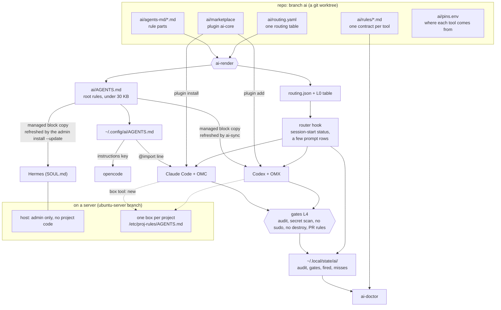

# dotfiles, branch `ai`

One AI setup for every machine. Agents, tools, rules, hooks and gates. Audited, always the newest stable release, with proof that each tool fires.

- Branch `ai` holds only the AI layer. The OS base (shell, git, packages, server hardening) lives in the other branches: `main` (macOS), `windows`, `ubuntu-server`.
- One source of rules. Every agent (Claude Code, Codex, Hermes, opencode) gets the same text.
- One set of tools. Each tool follows its newest stable release; every new version is audited before it is installed.
- One usage contract per tool. It says when to use it, when not, how we enforce it and how we prove it fired.
- Telemetry and the tools' own auto-update are off: updates come only from `install.sh`. Everything can be removed with one command.

## Start here: docs/GUIDE.md

The owner guide explains how the setup works inside (rules, router, gates, skills), how it builds, and what it reports.
It has full example sessions: adopt a messy repo, start an iOS and Android app, fix a bug, build V2, triage.
In any session, ask "which skill for X?" to get the global `skills-guide` skill.

Status (2026-11-17): one profile, `dev-mac`, on all 3 machines (an Apple silicon Mac, an old Intel Mac, a home server). Windows planned, not supported yet.

## Current state (2026-11-17)

- **Flow:** feature branch, the `ship` skill, then every PR goes through the owner (the agent merges only after the
  owner says merge). After a merge: `/improve-codebase-architecture` and `/retro`. The owner says release: the
  `release` skill. Details: `docs/GUIDE.md` section 15. Decisions: `docs/agents/notes.md`.
- **Enforcement round (2026-11-16 to 2026-11-17, PR #1):** the install was complete, but agents skipped most rules
  and skills (3 skill uses in 7 days). Text in AGENTS.md is advice. So the rules that matter now run as mechanisms
  at the moment of the action: gates (PreToolUse deny), stop rules (Stop hook block, once per session), a short
  skill card at session start, and a winner table for skills that overlap. `ai-eval` measures it. Section 3 of
  `docs/GUIDE.md` has the detail ("Enforcement: gates, stop rules, skill card, winner table").
- **Fix round (PR #2 to #4, `ai` at ddabcc1, 2026-11-17):** owner rule "Standing permission" (every agent runs every
  command the task needs until a gate, a denied call or an owner-only step; proof: `grep -c "^Standing permission"
  ~/.config/ai/AGENTS.md` prints 1). `ai-adopt` commits every file it writes (clean tree after one run) and keeps
  owner flags in the managed Makefile block. `ai-doctor` honours `~/.config/ai/rtk-hook` = `off`. Prompt rules
  ignore pasted output (code fences, lines that start with `⏺ ❯ > │`) and product names. The merge OK comes only
  from the owner's own typed lines. An `<agent-message>` hand-back counts as a notification. `tdd` is a stop rule:
  the skill card lists 4 must-use skills (writing-for-agents, diagnosing-bugs, ship, tdd). The five bugs are
  R-001 to R-005 in `docs/REGRESSIONS.md`. All three machines run ddabcc1, `ai-doctor` 0 fail. Rollout runbook:
  the `setup-rollout` skill.
- **Numbers:** router cases 449 before, 600 after; 14 test suites, 0 failed. Claude behaviour, hits in 3 runs,
  before to after: vague performance prompt 0/3 to 3/3, vague ship prompt 0/3 to 3/3, `ship` 1/3 to 3/3;
  4 should-not-fire cases 3/3 (no false fire); 20 of 21 cases at 3/3. The `tdd` case was 0/3: the `tdd` stop rule
  came after that run. Codex after-run: open (usage limit hit; ticket 12).
- **Gates (dev-mac):** secret-scan, pr-rules, merge-approval (no merge, no push to main without the owner's OK),
  no-verify (no skipped git hooks), writing-for-agents, ship, gh-write, winner-gate and the first broad search
  (graph-first). **Stop rules:** diagnosing-bugs and tdd. `audit-before-install`, `no-sudo`, `no-destroy` and the
  project `check-fast` stop hook are off on `dev-mac` (profile `server` only). Everything else is a nudge. Every
  deny path honours the owner escape hatch (`sudo ai-gate-skip`).
- **Per project (ai-adopt):** 13 Matt Pocock skills, ui-ux-pro-max, a pre-commit hook, `ai-docs-check` in
  `make check`, `## Project rules` (add or tighten, never loosen), CODING_STANDARDS.md for the reviewer.
- **One knowledge store:** the repo (Map, GLOSSARY.md, docs/). Claude auto memory is off.
- **Navigation:** graphify for wide questions, Serena for exact symbols, rg for text. The first broad search of a
  session is denied once with "run graphify query first". Serena tools are always loaded (`alwaysLoad`).
- **Run a session on the machine where the repo lives** (`ssh <machine>`, then `claude` in the repo). A session on
  another machine that works through ssh has no gates, no Serena and no project rules for that repo.
- **Adopted:** two real projects, one on the home server and one on the old Mac, through PRs. Other projects on the
  main Mac: the owner picks them.
- **Open (ticket 12):** Codex after-run, the evolution test (ticket 11), trim of the post-compact context (about
  10.1k characters; the L0 table tail is cut at 9.5k there), final audit and rollout.

## History: where we stopped on 2026-11-13 (server work)

Read this first when you pick the work up again. Full history and design: `docs/AUDIT-BRIEF.md`.
Audit reports (local, not in git) live next to the checkouts in `ai-audit/`.

**Done and proven live on the server** (commit `2ab6f03` deployed from `/opt/ai-setup`):
- Claude Bash sandbox required (bubblewrap copy with its own AppArmor profile); credentials hidden,
  home read-only, network through the proxy. Unix sockets stay blocked.
- Planted project config cannot run (`strictPluginOnlyCustomization` hooks + mcp).
- Gates block in real sessions: live canary in `ai-doctor --live` (token commit, PR without blocks,
  unaudited install all denied). Gates see through `rtk`, `env`, wrappers; deny always wins.
- Box MCP tool (`box`) for Claude, Codex, Hermes: talks to the root `proj-agent` socket, no sudo.
- Serena and graphify on by default (tuned: no shell tool, no memories, 40k answer cap; graph
  refreshes itself after agent commits). One navigation order: AGENTS.md Map, graphify query,
  Serena symbols, narrow rg. `ai-adopt` writes the Map, Libraries, Serena index, graph and one
  managed `.gitignore` block.
- OMC off by default on servers (`ai-adopt --tools omc`); claude-seo, claude-blog, Playwright opt-in.
  GitHub MCP and Grounded Docs removed (agents use `gh`). opencode off on servers, herdr on.
- Always-on context measured at about 34k tokens per fresh Claude session (was 49k).
- docs/TOOLS.md sections 7 (every tool's default and configuration) and 8 (overlaps, one job each).

**Tier 1 project checks: DONE in code on branch `ai` (2026-11-14), not deployed.** Tier per repo (`try`, `mvp`,
`long`), `ai-check-detect` + `check-fast`/`check` targets, the `stop-check` Stop hook, `no-destroy` gate, PR tier
fields, Done/Lessons, regression ledger (`ai-ledger`), `ai-ratchet`, the `feature-grill` row (SPEC 25). Next: the
the crawler project pilot (`ai-adopt --tier long`), a real plugin install and a real Codex run of the Stop hook.

**Profiles: DONE in code (2026-11-14), not deployed.** `server` (today) and `dev-mac`
(both Macs and Ubuntu dev boxes: no scanner, no package audit, no audit gate, no opencode, no box, no last30days); `install.sh --profile NAME`,
saved in `~/.config/ai/profile`. skill-scanner is off in every profile since 2026-11-15 (owner): skills and plugins
install at the newest stable with no scan. The code stays: add `skill-scanner` to PROFILE_SCANNERS to turn it on. Details: docs/INSTALL.md (Profiles), docs/SECURITY.md, `ai/SPEC.md` section 27.

**Open, in order:**
1. **macOS installer: DONE and proven on an old Intel Mac (macOS 12).** `ai-doctor`: 59 pass, 1 warn
   (no `secrets.env`). Scanners install there through the source-build fallback and the legacy
   skill-scanner pin; RTK built patched (`cargo update`). Gates fail closed on an internal error.
   `ai-adopt` ran on the first project; its AGENTS.md now holds the project rules (CLAUDE.md is
   only `@AGENTS.md`, so Codex reads the same rules).
   **Server: deployed 2026-11-13** (`23b482c`): tests 219 cases + all suites green as the main user,
   `ai-doctor --live` 97 pass, 0 fail (sandboxed Bash, box tool, 3 live gate canaries). Left: an attack
   test of every gate by hand; oh-my-codex: the next install takes the newest stable (no cooldown since 2026-11-14).
   Fixed on the way: ai-sync dropped Codex env keys added after the trust block (aiconf toml-set);
   root-guard test failed for a user without sudo.
   2026-11-13: `ai-libs` keeps only imported packages when a full pip freeze has more than 40 pins;
   house rules gained 3 lines (no `.env` edits, no prod deploy without OK, a failing test is a blocker).
2. **Newest stable for every tool: DONE in code (owner decision 2026-11-14).** No exact pins and no
   cooldown: `ai/lib/resolve.py` finds the newest stable release of each tool from `ai/pins.env` (now a
   sources file), every `install.sh` run moves a tool when it differs, after `agent-audit`. RTK is built from
   source at the newest release tag (one path for every OS and arch), source audited first, tag and commit in
   the audit log. Section 7 says how to hold a tool back.
2b. **Owner decisions 2026-11-14 (M3 Mac): DONE in code, not yet installed on the Mac.** caveman and
   `byterover-mcp` removed from Claude and Codex (saved, uninstall restores them); claude-seo, claude-blog,
   ui-ux-pro-max and typesafe off at user scope (`ai-adopt --tools ui` for ui-ux-pro-max); one Serena (a
   user-scope copy is moved out); macOS rtk from the Homebrew formula with `brew upgrade rtk` (one rtk on PATH);
   OMX hooks on Homebrew's stable `opt/node` link; last30days on by default in Claude. The lists are in
   `ai/pins.env` (`AI_DROP_*`, `AI_OFF_CLAUDE_PLUGINS`). Next: dry run, then the real install on the M3.
3. **Claude live checks on the server** could not run today (the server's Claude account was out
   of quota): rerun `ai-doctor --live` as the main user and the end-to-end test (a small web page in
   a try box through the box tool, test, commit). Codex already passed context7 + box creation.
4. **A/B test of navigation cost** on one real repo: same 3 tasks with Serena + graphify on and with
   `no-serena` / `no-graph`. Keep the defaults only where they win.
5. Hermes: one end-to-end test from the phone before trusting it.
6. Later, in its own session (not part of this round): the owner's main Mac, the same way: dry run,
   install, `ai-adopt` per project.

How to continue on a server: `sudo /opt/ai-setup/install.sh --update --for-user <user>`.
On a Mac: `git -C ~/.dotfiles-ai pull` (ai-sync runs), or rerun `~/.dotfiles-ai/install.sh`.

## Contents

1. [How the whole thing fits together](#1-how-the-whole-thing-fits-together)
2. [Install](#2-install)
3. [How it works, in plain words (6 examples)](#3-how-it-works-in-plain-words)
4. [What runs where](#4-what-runs-where)
5. [Manual steps per machine](#5-manual-steps-per-machine)
6. [Verify](#6-verify) (includes the owner checklist)
7. [Update](#7-update)
8. [Remove or revert](#8-remove-or-revert)
9. [Where things live](#9-where-things-live)
10. [Troubleshooting](#10-troubleshooting)
11. [Read next](#11-read-next)

## 1. How the whole thing fits together



Read it from the top.

1. You edit the repo: rule parts, the routing table, tool contracts.
2. `ai-render` joins the parts and the L0 table into one root rules file. It also builds `routing.json` for the hooks.
3. Each agent receives that one file in the way it supports (see [docs/AGENTS-MD.md](docs/AGENTS-MD.md)).
4. The plugin `ai-core` gives Claude and Codex our hooks, skills and MCP server list.
5. The router hook adds a short status line and the skill card at session start, and a few cheap reminders. The gates block unsafe or skipped steps (the table below). Stop rules make the agent use a skill before it ends a turn. A separate Stop hook runs the project's `check-fast` before the agent says it is done (section 3, example E).
6. Every decision is logged. `ai-doctor` reads the logs and the contracts and tells you what is wrong. `ai-doctor --live` runs a canary `claude -p` session: a token commit, `gh pr create` without the PR blocks, an unaudited `uv add` and a force push to main (in a scratch repo with no remote) must each be denied (new DENY lines in `gates.log`).
7. On a server, project work happens inside a box, never on the host.

### Parts, in one table

| Part | What it is | Detail |
|---|---|---|
| Agents | Claude Code (main), Codex + OMX (main), Hermes. OMC: on on macOS, per project on servers (`ai-adopt --tools omc`). herdr: everywhere. opencode: macOS; on servers only with `AI_EXTRA_AGENTS=opencode`. omo: optional | [docs/TOOLS.md](docs/TOOLS.md) |
| Plugin `ai-core` | our skills, hooks and MCP list, one folder, installed by Claude and Codex | `ai/marketplace/plugins/ai-core/` |
| MCP servers | global: context7 (the one docs tool), box (project boxes on a server) and Serena (on by default in every project; a line `no-serena` in `.ai/enabled` opts out). Per project only: Playwright | [docs/TOOLS.md](docs/TOOLS.md) |
| Other tools | RTK (Claude: our wrapper hook `rtk-hook`; it does nothing in auto mode), Ponytail, i-have-adhd, five mattpocock skills, `gh`, graphify (CLI, on by default; `no-graph` opts out), last30days (Claude, on by default). Per project only: claude-seo, claude-blog, ui-ux-pro-max (`ai-adopt --tools seo,blog,ui`). Dropped and removed by install: caveman, `byterover-mcp` | [docs/TOOLS.md](docs/TOOLS.md) |
| Root rules | the one AGENTS.md all agents read | [docs/AGENTS-MD.md](docs/AGENTS-MD.md) |
| Usage contracts | `ai/rules/<tool>.md`, five sections each | [docs/EXTENDING.md](docs/EXTENDING.md) |
| Router + gates + stop rules | session-start status and skill card, a few prompt rows, gates, two skill stop rules, the winner table for overlapping skills | "Gates and stop rules" below; `docs/GUIDE.md` |
| Project checks (Tier 1) | per adopted repo: a tier (`try`, `mvp`, `long`) in `.ai/enabled`; `check-fast` / `check` targets (`ai-check-detect`); a Stop hook that runs `check-fast`; Done and Lessons in AGENTS.md; long tier: regression ledger (`docs/REGRESSIONS.md`, `ai-ledger`) and `ai-ratchet` | section 3, example E; `ai/rules/check-command.md` |
| Project knowledge | per repo, inside its AGENTS.md: a "## Map" (where things live, how to run and test, conventions) and a "## Libraries" table (version, context7 ID). Made by `ai-adopt`, kept fresh by `ai-libs --sync` and a post-commit note | section 3, example D |
| Evals | prompts that must and must not fire a tool (English, Romanian, Russian), run by `ai-eval` (fixture repos, install level, headless behaviour level) | `ai/evals/`, `ai/bin/ai-eval` |

### The routing layers

One table (`ai/routing.yaml`) feeds every layer, so they never disagree. Since v4 (owner decision 2026-11-12, after an audit) the table is small: passive context in AGENTS.md beats tool nudges, and the logs showed per-tool nudges ignored. What is left: the gates and stop rules, the session-start status and skill card, a post-commit freshness note, the em dash lint, the library-docs row (it fires only on a library named in the Libraries block, or before an edit of a dependency file), the "not enabled" suggestions and the opt-in catalog. Since 2026-11-16 the rules that matter most are enforced, not only said (see below).

| Layer | What | Catches |
|---|---|---|
| L0 | routing table inside the root rules | knowledge missing from context, all agents |
| L1 | status lines and the skill card at session start; the table and the card again after compaction or /clear | drift late in a session, skills the agent did not see |
| L2 | forced evaluation: the agent must answer YES or NO per matched tool ("none needed" is allowed) | paraphrases |
| L3 | regex fast path: file types, tool names, commands | exact cases |
| L4 | gates (PreToolUse deny) and stop rules (Stop block, once per session) | "skipped it and did it anyway", skills never used |
| L5 | subagents get the table at start | subagent misses |
| L6 | skill descriptions: triggers first, Romanian and Russian phrases | non-English prompts |
| L7 | evals, miss log, `ai-doctor` | silent regressions |

A miss (a rule fired and the matching tool was not used) is logged. It is never silent.

### Gates and stop rules

A gate blocks a step until its condition holds. A stop rule blocks the end of a turn until a skill ran.

| Gate | Blocks | Until |
|---|---|---|
| `audit-before-install` | installs: npm, pnpm, yarn, bun, pip, uv (`uv add`, `pip install`, `npm install`/`ci`, ...); curl piped to a shell. Asks the owner for one-off runners (`uvx`, `uv tool run`, `uv run --with`, `npx`, `npm exec`, `pnpm dlx`, `yarn dlx`, `bunx`, `pipx run`) unless the package has a PASS or (npx) is a local bin of the project, and for brew, cargo, go, gem, pipx | `agent-audit` logged a PASS for that package in the last 24 hours (`agent-audit npm left-pad@1.3.0` or the two-word form) |
| `secret-scan` | `git commit`, `git push` | the diff has no key, token, password or private key |
| `no-destroy` | `rm -r` of the home folder, `/`, the repo root, `.git`, data folders or paths outside the repo; force push or delete of `main`/`master`; `git reset --hard` on main with changes; `git clean -x` at the root; `compose down -v`, `docker volume prune`; per repo (`.ai/destructive.txt`): SQL `DROP`/`TRUNCATE` on a protected database and extra command prefixes | never: the owner runs it. Rebuildable folders (`node_modules`, `.venv`, `dist`, `build` ...) and text that only names a command pass |
| `pr-rules` | `gh pr create`, `gh pr edit`; `--fill` and `--web` | the body has a Mermaid block, the author-sessions block and the fields of the `pr` skill template (`Evidence`, `Door:`, `Blast Radius:`) plus `Docs:`, `Changed guards:` and `Ledger: R-NNN` on fix PRs, no placeholder text, and a fix PR has a test file in its diff. Over 400 changed lines: a warning |
| `merge-approval` | `gh pr merge`, `git push` to `main` or `master` | the owner's latest message says merge or approve |
| `no-verify` | `git commit` or `git push` with `--no-verify` (or `commit -n`) | never: fix what the git hook reports |
| `writing-for-agents` | Edit, Write, MultiEdit, `apply_patch` or a shell write (`>`, `>>`, `tee`, `sed -i`, `cp`, `mv`) of `AGENTS.md`, `CLAUDE.md`, `CLAUDE.local.md` or a `SKILL.md` | the session has a proof of the `writing-for-agents` skill (a Skill call, a typed `/name` or a read of its SKILL.md). Not seen: `python -c`, `perl -i`, a script file |
| `ship` | `gh pr ready` | the `ship` skill ran in this session |
| `gh-write` | every `gh` write except the PR commands (issue create or comment, repo edit, release, label, `gh api` with a write method or fields, unknown subcommands) | the owner says yes (Codex: denied with a message). `gh` reads pass. `gh pr create`, `edit`, `ready`, `merge` keep their own gates |
| `winner-gate` | a Skill call of a skill that loses in the `winners` table of `ai/routing.yaml` (for example `oh-my-claudecode:tdd`, `:plan`, `:execute`, `:research`, `:review`, `:pr`, `:wiki`, `:release`) | never: the deny names the winner. A typed `/name` never reaches the Skill tool, so the owner's choice always runs. `autopilot`, `ralph`, `team` and `ultragoal` unlock the losers for the rest of the session. Codex: a shell read of a losing skill file is denied the same way |
| graph-first (rule `nav-first`) | the first broad search of a session (`rg`, `grep -r`, `find -name`, the Grep tool) in a repo with a graph | one deny with "run graphify query first"; the next search passes. A session that already used graphify or a Serena tool passes |
| `no-sudo` | `sudo`, `su`, `doas`, `pkexec`, `sudoedit`, `run0` at a command position (also inside `bash -c`, behind `env`, `nice`, `timeout`) | never: the agent gives the owner the exact command. This includes `sudo proj-agent`. Box work: the box tool (MCP server `box`: list, new, exec, logs, status, restart, ports, url, snapshot, doctor, help); outside a sandbox also plain `proj-agent <subcommand>`; never sudo (`proj-agent` is the root-owned `/usr/local/sbin/proj-agent`) |

On profile `dev-mac` the rows `audit-before-install`, `no-sudo` and `no-destroy` are not rendered, and the `stop-check` hook is off (profile `server` only).

Stop rules (strength `stop`): the prompt arms the rule, and the next Stop is blocked once per session when the skill was not used.

| Stop rule | Armed by | Until |
|---|---|---|
| `diagnosing-bugs` | a bug or performance prompt (slow, performance, broken, debug, crash, regression; Romanian and Russian forms) | the `diagnosing-bugs` skill ran |
| `tdd` | a tests-first prompt (tests first, tdd, red-green; Romanian and Russian forms) | Matt's `tdd` skill ran (the OMC `tdd` is no proof) |
| `stop-check` (separate hook) | files changed in the session | the project `check-fast` is green |

A vendor copy (`oh-my-claudecode:x`, `oh-my-codex:x`) is never a proof for `x`. Each block is a row in `misses.jsonl`; `ai-doctor` shows them over 30 days.

Gates catch honest mistakes. They are not a sandbox against a hostile agent: the OS sandbox and the box are (see [docs/SECURITY.md](docs/SECURITY.md)). Escape hatch, owner only: `sudo ai-gate-skip <gate> <minutes max 60> <why>` (root-owned `/usr/local/sbin/ai-gate-skip` on Linux installs). The gate name is the rule id, or `winner-gate`, or `nav-first`. It writes the root-owned `/etc/ai/gate-skip`; the gate lets the step through until it expires, and each pass is logged to `~/.local/state/ai/gates.log`. `AI_GATE_SKIP=...` inside a command does nothing any more (an agent could type it). Details and known limits: `ai/marketplace/plugins/ai-core/hooks/README.md`.

## 2. Install

Needs: git, sudo (Ubuntu), and a base setup (`~/.dotfiles`). `install.sh` installs the rest. It is safe to run twice: the second run changes nothing.

### Ubuntu server

On a server, an admin user runs the install for the main user. The main user has no general sudo.

1. Set up the base first. Follow the README of the `ubuntu-server` branch. It ends with an "AI setup" section that repeats these steps.
2. As the main user, add the AI worktree. It must be a separate folder. Checking out `ai` inside `~/.dotfiles` would break the links of the base branch.
```
git -C ~/.dotfiles fetch origin ai
git -C ~/.dotfiles worktree add ~/.dotfiles-ai ai
```
3. As the ADMIN user, from a root-owned clone in `/opt/ai-setup` (owner decision: root never runs code from the agent's home). `--update` fetches and fast-forwards that clone (it refuses a dirty clone or rewritten history), then runs the updated script. Dry run first, read the output:
```
sudo git clone --branch ai https://github.com/<owner>/.dotfiles.git /opt/ai-setup   # once
sudo /opt/ai-setup/install.sh --update --for-user <user> --dry-run                   # read it
sudo /opt/ai-setup/install.sh --update --for-user <user>                             # install, and every update
```
4. `install.sh` and `uninstall.sh` refuse to run as root from a folder not owned by root or the admin, and print these commands. The main user's `~/.dotfiles-ai` stays a work tree for editing only.
5. As the main user: copy `secrets.env.example` to `~/.config/ai/secrets.env`, set mode 600, fill the keys you need.
6. Do the manual steps in section 5.
7. Check: `ai-doctor`.

`install.sh` asks "Is this a new Ubuntu server that needs the base server setup first?" The default is No. Answer Yes only on a fresh server: it prints the `ubuntu-server` instructions and stops.

Options: `--update`, `--for-user <user>`, `--dry-run`, `--agents claude,codex,hermes`, `--skip-packages`, `--yes`. Env `AI_EXTRA_AGENTS=opencode` adds opencode on a server (off by default there). Run `install.sh --help` for the final list. More in [docs/INSTALL.md](docs/INSTALL.md).

### macOS (later)

Out of scope until the server test and the owner review are done. Then (one user, no sudo, the work tree is the install source):
```
git -C ~/.dotfiles worktree add ~/.dotfiles-ai ai
~/.dotfiles-ai/install.sh --dry-run
```
Rules for every machine: the install only changes agent configuration. It never touches your projects, databases or services. On macOS it never writes managed settings (an employer may manage them). RTK is on by default; the exact switch for one machine is still being finalized, see `install.sh --help`. With the Homebrew formula `rtk` installed, the Mac keeps that copy and moves it with `brew upgrade rtk` (no Rust needed).

### Windows

Planned, not supported yet.

## 3. How it works, in plain words

Six real cases. Each shows which layer does what.

### Example A: "Make me a Telegram bot"

You type this in Claude Code on the server.

1. **The prompt arrives.** The tie-break table says: for a new app, the grilling skill beats OMC deep-interview. The router adds a short forced-evaluation text (L2): answer YES or NO for grilling, or say none needed.
2. **Questions first.** The agent asks one round of questions: who uses the bot, must it run 24/7, what data must stay. You answer. (`/grill-me` is the typed form; the agent cannot fire it.)
3. **Project setup.** The agent proposes `ai-start` for the new repo: AGENTS.md with a Map and a Libraries section, opt-in tools only if needed.
4. **Box rules apply (server).** The hosting rules (imported into the root rules) say: never create a project on the host. The agent picks a tier (a bot that must stay up is `mvp`) and calls the box tool `new` (`mcp__plugin_ai-box_box__new`, name and tier; the server runs the root-owned `/usr/local/sbin/proj-agent`, the one root-level action agents may ask for). It makes an isolated box.
5. **Inside the box.** Code goes to `/srv/app`, secrets to `/srv/app/.env`. The box has its own copy of the rules at `/etc/proj-rules/AGENTS.md`.
6. **Library docs.** The agent adds the Telegram library. The root rules say: docs before code. It asks context7 (`resolve-library-id` once, then `query-docs`). It does not answer API details from memory. Before the commit it runs `ai-libs --sync`, so the Libraries section of AGENTS.md holds the ID and the next session skips the lookup step.
7. **The install gate.** `pip install` or `npm install` of the library is blocked until `agent-audit` passed (see example B).
8. **Output.** Ponytail keeps the diff small. i-have-adhd keeps the reply short. RTK shortens the command output the agent reads.
9. **The proof.** `~/.local/state/ai/fired.jsonl` shows the skills that ran; `gates.log` shows every block.
10. **The end.** The agent says: box name, tier, how to see logs, how to restart. It never prints the bot token. It tells you where to put it.

### Example B: the agent runs `npm install left-pad`

1. The agent calls the Bash tool with `npm install left-pad`.
2. Before the command runs, the `audit-before-install` gate reads it. A small shell parser splits the command into parts, so quoted text and commit messages never trigger it.
3. It looks in `~/.local/state/ai/audit.log` for a PASS for `left-pad` in the last 24 hours. There is none.
4. The command does not run. The agent sees:
```
Blocked: no agent-audit PASS in the last 24 h for npm left-pad. Run: agent-audit npm left-pad
```
5. The agent runs `agent-audit npm left-pad`. It checks the package with guarddog and osv-scanner. If nothing is found it writes `PASS` to `audit.log`. If something is found it writes `FAIL`, and the agent must stop and show you the findings.
6. After a PASS, the agent installs again. Better: it pins the version, `npm install left-pad@1.3.0`. Unpinned `npx ...@latest` and `curl ... | sh` are always blocked, with no way through except the audit and a download you can check.
7. For brew, cargo, go, gem and pipx the gate asks you: `agent-audit` cannot scan those yet.
8. The block is logged to `gates.log`.

### Example C: a commit with a secret

1. The agent runs `git commit -m "add bot"`. The staged diff has a line `TELEGRAM_TOKEN = "123456:ABC..."`.
2. The `secret-scan` gate reads the staged diff (and, when the command is `git add ... && git commit` or `commit -a`, the unstaged and new files too). It runs its own patterns and `gitleaks` when installed.
3. It finds an assigned secret. The commit does not run. The agent sees:
```
Secret scan found: assigned-secret. Remove it from the ... before you commit or push.
```
4. The agent moves the token into `.env` (gitignored) or `~/.config/ai/secrets.env`, unstages the file, and commits again.
5. `git push` is scanned the same way: commits not yet on any remote (the last 300).
6. If the scan takes too long, it denies. It never passes unscanned.
7. One allowlisted value exists: the free context7 key, by owner decision. Nothing else.

### Example D: a new session in an adopted repo

The repo was set up once with `ai-adopt`. Its AGENTS.md has two managed sections near the top:

```
<!-- AI:map START (ai-adopt; edit freely inside, keep it under 60 lines) -->
## Map
- What: price-bot (Python).
- Entry points: `bot` -> `app.main:run`; `Dockerfile`.
- Where things live: `src/` (42 code files), `tests/` (18 code files).
- Run: `uv sync`. Test: `uv run pytest`.
- Conventions:
  - New HTTP calls go through src/app/http.py (one client, retries there).
<!-- AI:map END -->
<!-- AI:libraries START lock: uv.lock sha256:3f9a1c2e4b5d -->
## Libraries
| lib | version | context7 | note |
| httpx | 0.28.1 | /encode/httpx/0.28.1 | |
<!-- AI:libraries END -->
```

You open a new Claude or Codex session and type: "add retries to the price fetcher".

1. **Session start.** The agent already has the repo AGENTS.md in context (no tool call). The router adds one status line, for example: "Read the Map and Libraries sections of this repo's AGENTS.md first, then search narrowly. Map: present. Libraries: match uv.lock."
2. **Locate.** The Map says HTTP calls go through `src/app/http.py`. The agent runs one narrow search (`rg -n "def fetch_price" src/`) and reads only the located lines. No folder scan.
3. **Library docs.** The Libraries row gives `/encode/httpx/0.28.1`. The agent calls context7 `query-docs` with that ID: no `resolve-library-id`, no web search.
4. **Edit, test.** The Map names the test command.
5. **Commit.** Row `knowledge-check` reads the commit. No module was added or moved and no lockfile changed, so it says nothing. Had the agent added `src/app/retry.py`, it would say "Update the Map section in AGENTS.md."

What it costs: the two sections are about 1,000 to 2,000 tokens, loaded every session with the rest of AGENTS.md. One narrow search plus a few located lines is about 1,000; one docs call about 2,000. The same task from zero (list folders, grep, read 5 to 10 files, resolve the library) is often 25,000 tokens or more, in every session. ACCEPTANCE T1 measures the always-on budget with `/context`.

Serena and graphify are on in every project (owner decision 2026-11-12 evening), so between steps 2 and 3 the agent can also run `graphify query` for structure and Serena `find_symbol` for the exact definition. A project opts out with `no-serena` / `no-graph` in `.ai/enabled`.

### Example E: a bug fix in a long-tier project

The repo was adopted with `ai-adopt --tier long`. It has `tier: long` in `.ai/enabled`, a Makefile block with `check-fast` (lint + unit, measured 14 s) and `check` (everything, plus `ai-ledger --check` and `ai-ratchet`), a Done block in AGENTS.md, `docs/REGRESSIONS.md` with a row `R-012 | ... | area: src/billing/ | ... | test: tests/regressions/test_r012_refund_once.py | reopened: 0`, and `.ai/ratchet.json`.

You type: "refunds are paid twice when the bank times out, fix it".

1. **Edit.** Before the first Edit in `src/billing/`, the router adds one line: "Regression area src/billing/ has R-012: keep them green, run tests/regressions/test_r012_refund_once.py". Once per area per session.
2. **Stop.** The agent says it is done. The Stop hook sees that files changed since the session start and runs `make check-fast`. A test fails: the stop is blocked with the last 40 lines, and the agent continues; its next stop checks the fix. The same failing files are blocked at most twice (4 times per chain); then the owner gets a note.
3. **No cheating.** The agent deletes the failing test instead. `check-fast` is green, but `ai-ratchet` sees "tests 412 -> 411" and the stop is blocked again. A check that ran 0 tests also fails.
4. **No damage.** `git reset --hard` on main with changes, `rm -rf data/` or `docker compose down -v` are blocked by `no-destroy`.
5. **Ledger.** The fix adds `R-013` with a test that failed before the fix. `ai-ledger --check` (in `make check`) checks the test exists and carries the id, no row was removed, `reopened` only went up.
6. **PR.** `gh pr create --title "fix(billing): one refund per timeout"` needs `Evidence` (command and output), `Door:`, `Blast Radius:`, `Docs:`, `Changed guards:`, `Ledger: R-013`, and a test file in the diff. `TODO` in a field counts as missing.

 With oh-my-claudecode in a persistent mode (ralph, autopilot), OMC owns the stop; the check runs at the first stop after the mode ends, and OMC never blocks a continuation stop, so no stop gets a block from both (checked with the real OMC 5.1.0 hook). A chain of continuation stops gets at most 4 blocks from the check.

### Example F: a new feature (the feature flow)

The repo is adopted with tier `mvp`. `.ai/enabled` has `skills: grill-with-docs, domain-modeling, to-spec, to-tickets, tdd`, so `ai-adopt` linked those mattpocock skills (and their callees) into `.claude/skills/` and `.agents/skills/`. The repo has a verification skill `.agents/skills/verify-shop/` (made once with `/create-verification-skill`, committed) with a feature map, and the session status says "Verify skill: verify-shop (6 features)."

You type: "implement a discount code option at checkout".

1. **Questions first.** The `feature-grill` row adds: grill-with-docs first. The agent asks one round of questions (who may use a code, can codes stack, what the receipt shows), then writes the answers to `GLOSSARY.md` and, for a hard-to-reverse choice, `docs/adr/`.
2. **Spec and tickets** (the feature touches 3+ files). `to-spec` writes `docs/specs/discount-codes.md`; `to-tickets` writes `docs/tickets/discount-codes/01-...md`, one vertical slice each, with acceptance criteria and the verify-shop feature (`checkout`) the slice must pass. No GitHub issue is made without you.
3. **Per slice, the Done order.** After the first code edit the router says once: check-fast, then verify-shop on the changed feature, then e2e. The agent runs `make check-fast` (the Stop hook would run it anyway); then `verify-shop`: launch, doctor, drive every entry point `features/checkout.md` lists (button, keyboard, CLI), screenshots and the order row in the database as evidence, cleanup keeps the evidence; only then a Playwright e2e test with a screenshot comparison for the proven journey.
4. **PR.** `Evidence` names the check output, `artifacts/checkout/discount.png` and `tests/e2e/test_discount.py`. Without the verify run and the test path the pr-rules gate blocks a PR that changes app code.
5. **Upkeep.** After 25 code commits (or 30 days with code commits) since the feature map changed, the status says "stale: run /maintain-verification-skill". It drives every feature again and ships one PR of map fixes.

Tier `try` skips the skills (plain grilling) and the verify step is optional.

## 4. What runs where

| Thing | Server host | Project box | macOS (later) |
|---|---|---|---|
| Root rules (`AGENTS.md`) | yes, per user | yes, `/etc/proj-rules/AGENTS.md` | yes |
| Plugin `ai-core` (router, gates) | yes | follows the agent: where an agent runs with the plugin, the hooks run | yes |
| Claude Code, Codex + OMX | yes, admin work only | yes, project work | yes |
| OMC | per project (`ai-adopt --tools omc`) | per project | yes, everywhere |
| Hermes | yes, as its own user `hermes` | no | not part of the plan |
| opencode | only with `AI_EXTRA_AGENTS=opencode` | no | yes |
| herdr | yes | no | yes |
| RTK, `gh` | yes | yes | yes |
| Serena, graphify | yes, on in every project unless opted out | yes | yes |
| context7 | yes | yes | yes |
| Playwright MCP | no | per project only | per project only |
| Project code and project services | never | always | on your own disk |

The rule for servers: agents on the host do server admin only, with you watching. Project work happens in the box. See `docs/AGENTS-hosting.md` on the `ubuntu-server` branch.

## 5. Manual steps per machine

The installer cannot do these. It prints them at the end.

- Log in to each agent: Claude Code, Codex (`codex login --device-auth`), Hermes provider keys.
- Codex on macOS: open `/hooks` once and trust the plugin hooks. Linux admin installs run Ponytail and i-have-adhd from `/etc/codex/hooks.json` (their plugin copies are off), so no trust step there.
- Claude: run `/seo setup` once, then `/seo doctor`.
- Fill `~/.config/ai/secrets.env` (mode 600). Names only are in `secrets.env.example`.
- Serena: `serena download-ls-dependencies <language>` for the languages you use.
- Ask the owner before anything a contract marks "owner decides".

## 6. Verify

### What is available here: `ai-info`

Run `ai-info` on any machine with this setup (every user, Hermes too) to see what it offers: installed agents and versions, Claude plugins on or off (for you and in the current folder), skills, MCP servers, the gates and how the owner opens one (`sudo ai-gate-skip`), the opt-in tools with the exact `ai-adopt --tools <id>` command, and, inside a repo, its state (Map, Libraries, enabled tools). It is local and fast: no network, no secrets, names and versions only. `ai-info --short` prints about 8 lines; on a server, `server-info` (ubuntu-server branch) shows them at login. Agents are told to run it when unsure which tools exist.

Install, update or adopt as an agent: the `setup-rollout` skill (`ai/skills/setup-rollout/SKILL.md`). The setup source is branch `ai`.

### Checks

```
ai-doctor
```
It checks: plugin list and validation, MCP servers connected, each tool against its newest stable release ("update available" lines), telemetry and update switches, root file size, every enabled tool has a contract, copied rule blocks equal the source (`ai-sync --check`), evals, the miss log, stale Serena entries. Inside an adopted repo (cwd or `--project PATH`) also: the Map section present and at most 60 lines, the Libraries section against the lockfiles (`ai-libs --check`), a secret scan of both sections, and only where turned on: the Serena entry and graph freshness. A fast check runs at the end of `install.sh`: `ai-doctor --quick`.

Spot checks:
- A new Claude session says "ADHD MODE ACTIVE (always-on)".
- `claude mcp list` shows context7, box and serena connected (Playwright only inside projects that turned it on).
- `rtk gain --history` grows after you run `git status` in a session.
- The full acceptance run for a server: [docs/ACCEPTANCE.md](docs/ACCEPTANCE.md).

### Owner checklist (after the enforcement round)

Run these on each machine.
1. `git -C ~/.dotfiles-ai log --oneline -1` shows the installed `ai` commit. `~/.dotfiles-ai/ai/bin/ai-doctor --quick | tail -1` ends with 0 fail.
2. `grep -E "^\| (tdd|ship|writing-for-agents|diagnosing-bugs|gh-write) " ~/.config/ai/AGENTS.md` shows 5 rows.
3. `cat ~/.claude/CLAUDE.md` is the short form. `grep -o rtk-hook ~/.claude/settings.json` finds the wrapper. The ai-serena plugin `.mcp.json` has `alwaysLoad`.
4. In an adopted repo: `make check-fast` is green, and `grep -c '^no-stop-check' .ai/enabled` is 0.
5. In a fresh session:
   - The skill card shows at the start.
   - "write this down in AGENTS.md" loads `writing-for-agents` first.
   - "investigate why X is slow" uses `diagnosing-bugs`.
   - "write tests first" uses `tdd` (`oh-my-claudecode:tdd` is denied).
   - "ship it" runs `ship` before `gh pr ready`.
   - "create a GitHub issue" asks first.

To see that a tool really fires, read the logs in `~/.local/state/ai/` ([docs/CONTEXT.md](docs/CONTEXT.md)).

## 7. Update

Tools update on every `install.sh` run (owner decision 2026-11-14). No tool updates itself.

1. What moves: every tool of the setup (Codex, OMC, OMX, opencode, herdr, Serena, graphify, context7, RTK, the
   audit scanners, the plugin sources and the Claude and Codex plugins made from them) goes to its newest
   stable release when the installed one differs. Stable = not a pre-release, not a draft, not yanked. There is
   no waiting period. This is the same on macOS and on servers.
2. Each new version is audited first (`agent-audit`). A new version with findings is NOT installed: the old one
   stays and the run prints a warning. `ai/audit-accepted.txt` lines are per exact version (git sources: per
   full commit, never a tag), so the owner reviews the findings and adds a line for the new version before it goes in.
   - Audited: the npm packages (Codex, OMC npm route, OMX, opencode, context7, Playwright MCP), the PyPI packages
     (Serena, graphify, guarddog, skill-scanner) and the git sources (Ponytail, i-have-adhd, claude-seo,
     claude-blog, last30days, mattpocock skills, the OMC plugin, the RTK source). On macOS with the Homebrew
     formula `rtk`, the release tag is audited and then `brew upgrade rtk` runs (no source build). For npm, guarddog checks the package
     itself, not its dependencies.
   - NOT audited: the herdr and osv-scanner release binaries (checked only against the sha256 their project
     publishes; SLSA provenance or a GitHub attestation is checked only when `slsa-verifier` or a logged-in `gh`
     is on the machine). Each change prints `WARN unaudited binary update: <tool> <old> -> <new>`. Also not
     audited: the very first guarddog on a machine (bootstrap, with a warning) and Claude Code itself.
3. Offline, or a registry error: the installed version stays and the run says so. The install does not fail.
4. Server: as admin, `sudo /opt/ai-setup/install.sh --update --for-user <user>`. It fast-forwards the root-owned clone, moves every tool to its newest stable release and refreshes everything else, including the Hermes copies and the `/etc` rules, which only this admin command can refresh. Run it on a schedule you choose: nothing updates between runs.
5. macOS: `~/.dotfiles-ai/install.sh`. A `git -C ~/.dotfiles-ai pull` alone runs `ai-sync` (rules and your own files), not the tool updates.
6. On a server, `ai-sync` from a user's `~/.dotfiles-ai` refreshes only that user's own files.
7. See what changed: `~/.local/state/ai/resolved.json` (per tool: source, newest seen, installed, times; on a server the system tools are in `/var/lib/ai/resolved.json`) and the `install` lines in `~/.local/state/ai/audit.log`. `ai-doctor` prints `update available: <tool> <installed> -> <newest>`.
8. Hold a tool back: add `<TOOL>_HOLD=<version>` to `ai/pins.env` (for example `CODEX_HOLD=0.167.0`, or a tag or commit for a git source). The next run installs exactly that version and leaves it there. Remove the line to follow the newest stable again. See [docs/EXTENDING.md](docs/EXTENDING.md), "Updates and holding a tool back".
9. Run `ai-doctor`.

## 8. Remove or revert

You can always go back. There are three levels. Pick the smallest that does the job. On a server the admin runs them from the root-owned clone: `sudo /opt/ai-setup/uninstall.sh --for-user <user>` (add `--dry-run` first). On macOS: `~/.dotfiles-ai/uninstall.sh`. The table uses the macOS form.

| Level | Command | What it removes |
|---|---|---|
| 1. Undo the install | `~/.dotfiles-ai/uninstall.sh` | only what the install added, and it restores what the install replaced |
| 2. Undo and wipe config **(coming)** | `~/.dotfiles-ai/uninstall.sh --purge-config` | level 1, plus the whole config and state folders of the agents |
| 3. Remove everything **(coming)** | `~/.dotfiles-ai/uninstall.sh --purge-all` | level 2, plus the agents and tools the installer added |

**Level 1 (exists today).** `uninstall.sh` reads the records the install wrote: `~/.local/state/ai/managed-keys.json` (your files, plugins, MCP registrations, links), `/var/lib/ai/managed-keys.json` (system files, services, firewall rules on Ubuntu) and the same file for the Hermes user. It undoes each record. A managed block is removed and the text around it stays. A key that you changed after the install is left alone and reported. Run it with `--dry-run` first. It keeps on purpose: `~/.config/ai/secrets.env`, your logins, `~/.serena`, plugin data folders, and the backups in `~/.local/state/ai/backup`.

**Level 2 (coming).** For when you want a clean slate. Before it deletes anything it makes a backup tarball of the folders. Then it asks you to type `purge`. Any other answer cancels.

**Level 3 (coming).** Also removes the agents and tools the installer put there (Claude Code, Codex, OMC, OMX, opencode, herdr, Serena, graphify, RTK and so on), after the same backup and the same typed confirmation.

What no level touches: your projects, project boxes, databases, and the server base (the `ubuntu-server` setup). To also drop the worktree after level 1: `git -C ~/.dotfiles worktree remove ~/.dotfiles-ai`.

Per-tool cleanup details are in the "Setup checklist" of each `ai/rules/<tool>.md`.

## 9. Where things live

| Path | What |
|---|---|
| `~/.dotfiles` | OS base branch |
| `~/.dotfiles-ai` | this branch (git worktree) |
| `~/.dotfiles-ai/ai/` | the AI layer: `routing.yaml`, `agents-md/`, `rules/`, `adapters/`, `lib/`, `bin/`, `marketplace/`, `skills/`, `evals/`, `pins.env`, `TOOLBOX.md`, `SPEC.md` |
| `ai/AGENTS.md` | the rendered root rules (built on each machine by `ai-render`, not committed) |
| `ai/build/` | generated, not committed: `routing.json`, `L0.md` |
| `~/.config/ai/AGENTS.md` | root rules as the agents read them |
| `~/.config/ai/TOOLBOX.md` | ready tools that are not installed by default |
| `~/.config/ai/secrets.env` | your keys, mode 600, never committed |
| `~/.local/state/ai/` | `audit.log`, `gates.log`, `misses.jsonl`, `fired.jsonl`, `docs-ids.jsonl`, `nudges.json`, `router-errors.log`, `managed-keys.json` |
| `<project>/AGENTS.md` | project knowledge, committed: the managed Map and Libraries sections. `graphify-out/` is generated and gitignored |
| `<project>/.gitignore` | `ai-adopt` keeps one managed block (`# >>> AI tools` ... `# <<< AI tools`) on every run: `.omc/*`, `.codex/`, `.claude/*`, `.serena/*`, `graphify-out/`, `.ai/*`, with the shared files let through: `.claude/settings.json`, `.serena/project.yml`, `.ai/enabled`, `.omc/skills/`. After `ai-adopt` the only new files are `AGENTS.md`, `CLAUDE.md`, `.gitignore`, `.claude/settings.json`, `.ai/enabled`, `.serena/project.yml` |
| `~/.local/bin/` | links to every command in `ai/bin/` |
| `~/.claude/CLAUDE.md`, `~/.codex/AGENTS.md`, Hermes `SOUL.md` | each has one managed block `AI:core` that carries or points to the root rules |

Commands in `ai/bin/`: `ai-info`, `ai-doctor`, `ai-render`, `ai-sync`, `agent-audit`, `ai-start`, `ai-adopt`, `ai-libs`, `claude-notify`, `pr-resume`.

## 10. Troubleshooting

| Symptom | Check |
|---|---|
| A tool never fires | `~/.local/state/ai/misses.jsonl`. Then the contract `ai/rules/<tool>.md`. Then its eval. |
| A command is blocked | Read the gate message. Run `agent-audit`, remove the secret, add the PR blocks. Only the owner can open a gate: `sudo ai-gate-skip <gate> <minutes> <why>`. |
| Rules look old after a pull | Run `ai-sync`. Then `ai-sync --check`. |
| A skill has no description in the list | The skill list is over budget. Check `skillListingBudgetFraction`, run `/skill-doctor`. The L0 table still routes. |
| MCP server not connected | `claude mcp list`, `codex mcp list`. Check `~/.config/ai/secrets.env` and the contract setup checklist. |
| Root file too big | `ai-doctor` fails above 30 KB. Shorten the parts in `ai/agents-md/`. Long text belongs in `ai/rules/`. |
| Codex hooks do not run | macOS: open `/hooks` and trust them; a change to a hook script needs new trust. Linux admin install: check `/etc/codex/hooks.json`. |
| A vendor tool wrote its own block | Our install skips it and reports. Never edit inside vendor markers. |
| `rtk gain` fails | A wrong `rtk` package is installed. See `ai/rules/rtk.md`. |
| Router error | `~/.local/state/ai/router-errors.log`. A router error never blocks a session (it fails open, except a gate decision already made). |
| Agent scans whole folders in an adopted repo | Does AGENTS.md have the Map section (`ai-adopt`)? Does the session start line appear? Is the Map still true (`ai-adopt --refresh-map`)? |
| Session start says "Libraries stale" | `ai-libs --sync`, commit AGENTS.md. Offline, it keeps the old rows and says so. |

## 11. Read next

- [docs/TOOLS.md](docs/TOOLS.md): every tool, why we chose it, how it works here, how tools overlap and interact.
- [docs/AGENTS-MD.md](docs/AGENTS-MD.md): what a standardized AGENTS.md means and how to change a rule.
- [docs/INSTALL.md](docs/INSTALL.md): every install step and option.
- [docs/CONTEXT.md](docs/CONTEXT.md): lists of rules, hooks, routing, logs.
- [docs/EXTENDING.md](docs/EXTENDING.md): add a skill, MCP server, plugin, rule. Hold a tool back. Retire a tool.
- [docs/SECURITY.md](docs/SECURITY.md): the security model: boxes, the agent sandbox, no sudo, no planted config, gates.
- [docs/ACCEPTANCE.md](docs/ACCEPTANCE.md): tests to run after an install on a server.
- `ai/SPEC.md`: the design. `ai/SPEC-LOG.md`: why.
