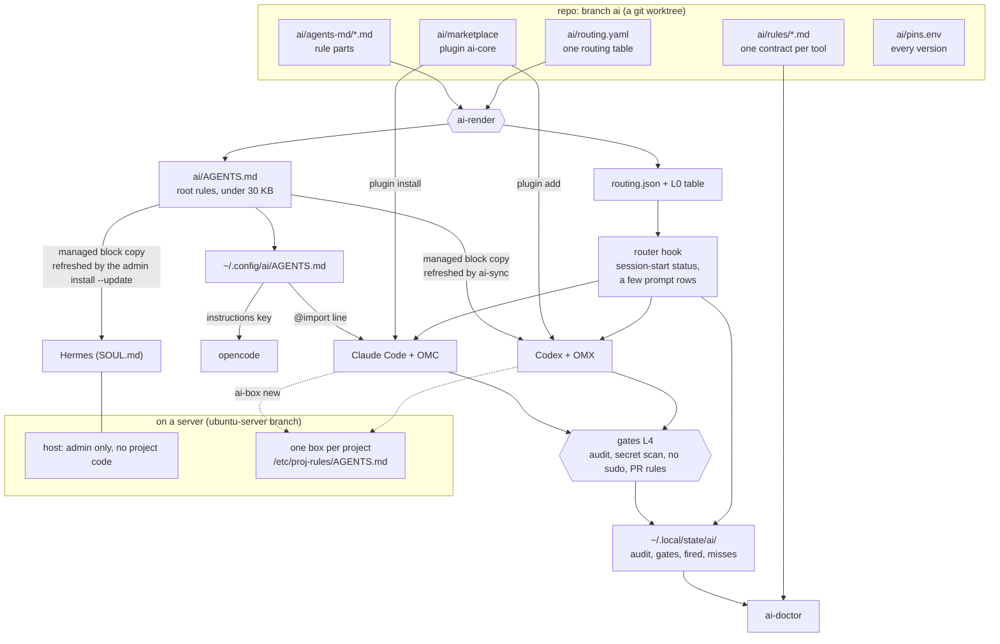

# dotfiles, branch `ai`

One AI setup for every machine. Agents, tools, rules, hooks and gates. Pinned, audited, with proof that each tool fires.

- Branch `ai` holds only the AI layer. The OS base (shell, git, packages, server hardening) lives in the other branches: `main` (macOS), `windows`, `ubuntu-server`.
- One source of rules. Every agent (Claude Code, Codex, Hermes, opencode) gets the same text.
- One set of tools. Each tool was audited and is pinned to the audited version.
- One usage contract per tool. It says when to use it, when not, how we enforce it and how we prove it fired.
- Telemetry and auto-update are off. Everything can be removed with one command.

Status: server first. macOS later. Windows planned, not supported yet. Items marked **coming** are designed but not in the code yet.

## Contents

1. [How the whole thing fits together](#1-how-the-whole-thing-fits-together)
2. [Install](#2-install)
3. [How it works, in plain words (4 examples)](#3-how-it-works-in-plain-words)
4. [What runs where](#4-what-runs-where)
5. [Manual steps per machine](#5-manual-steps-per-machine)
6. [Verify](#6-verify)
7. [Update](#7-update)
8. [Remove or revert](#8-remove-or-revert)
9. [Where things live](#9-where-things-live)
10. [Troubleshooting](#10-troubleshooting)
11. [Read next](#11-read-next)

## 1. How the whole thing fits together



Read it from the top.

1. You edit the repo: rule parts, the routing table, tool contracts.
2. `ai-render` joins the parts and the L0 table into one root rules file. It also builds `routing.json` for the hooks.
3. Each agent receives that one file in the way it supports (see [docs/AGENTS-MD.md](docs/AGENTS-MD.md)).
4. The plugin `ai-core` gives Claude and Codex our hooks, skills and MCP server list.
5. The router hook adds a short status line at session start and a few cheap reminders. The gates block four unsafe steps.
6. Every decision is logged. `ai-doctor` reads the logs and the contracts and tells you what is wrong.
7. On a server, project work happens inside a box, never on the host.

### Parts, in one table

| Part | What it is | Detail |
|---|---|---|
| Agents | Claude Code + OMC (main), Codex + OMX (main), Hermes, opencode, herdr, omo (optional) | [docs/TOOLS.md](docs/TOOLS.md) |
| Plugin `ai-core` | our skills, hooks and MCP list, one folder, installed by Claude and Codex | `ai/marketplace/plugins/ai-core/` |
| MCP servers | context7 (global, the one docs tool). Per project only: Serena, Playwright | [docs/TOOLS.md](docs/TOOLS.md) |
| Other tools | RTK, Ponytail, i-have-adhd, pinned mattpocock skills, `gh`. Per project only: graphify, claude-seo, claude-blog (`ai-adopt --tools graph,seo,blog`) | [docs/TOOLS.md](docs/TOOLS.md) |
| Root rules | the one AGENTS.md all agents read | [docs/AGENTS-MD.md](docs/AGENTS-MD.md) |
| Usage contracts | `ai/rules/<tool>.md`, five sections each | [docs/EXTENDING.md](docs/EXTENDING.md) |
| Router + gates | session-start status, a few prompt rows, four gates | section 3 below |
| Project knowledge | per repo, inside its AGENTS.md: a "## Map" (where things live, how to run and test, conventions) and a "## Libraries" table (version, context7 ID). Made by `ai-adopt`, kept fresh by `ai-libs --sync` and a post-commit note | section 3, example D |
| Evals | prompts that must and must not fire a tool (English, Romanian, Russian) | `ai/evals/` |

### The routing layers

One table (`ai/routing.yaml`) feeds every layer, so they never disagree. Since v4 (owner decision 2026-11-12, after an audit) the table is small: passive context in AGENTS.md beats tool nudges, and the logs showed per-tool nudges ignored. What is left: the four gates, the session-start status, a post-commit freshness note, the em dash lint, the library-docs row, the "not enabled" suggestions and the opt-in catalog.

| Layer | What | Catches |
|---|---|---|
| L0 | routing table inside the root rules | knowledge missing from context, all agents |
| L1 | status lines at session start; the table again after compaction or /clear | drift late in a session |
| L2 | forced evaluation: the agent must answer YES or NO per matched tool ("none needed" is allowed) | paraphrases |
| L3 | regex fast path: file types, tool names, commands | exact cases |
| L4 | gates for rules with no exception | "skipped it and did it anyway" |
| L5 | subagents get the table at start | subagent misses |
| L6 | skill descriptions: triggers first, Romanian and Russian phrases | non-English prompts |
| L7 | evals, miss log, `ai-doctor` | silent regressions |

A miss (a rule fired and the matching tool was not used) is logged. It is never silent.

### The four gates

A gate blocks a step until its condition holds.

| Gate | Blocks | Until |
|---|---|---|
| `audit-before-install` | npm, pnpm, yarn, bun, pip, uv, npx `@latest`, curl piped to a shell. Asks the owner for brew, cargo, go, gem, pipx | `agent-audit` logged a PASS for that package in the last 24 hours |
| `secret-scan` | `git commit`, `git push` | the diff has no key, token, password or private key |
| `pr-rules` | `gh pr create`, `gh pr edit` | the body has a Mermaid block and the author-sessions block |
| `no-sudo` | `sudo`, `su`, `doas`, `pkexec`, `sudoedit`, `run0` at a command position (also inside `bash -c`, behind `env`, `nice`, `timeout`) | never: the agent gives the owner the exact command. On a server agents run box commands as `ai-box <subcommand>` (a root-owned wrapper for `sudo -n proj-agent`; Claude's sandbox cannot run a command that starts with sudo). The router rewrites a plain `sudo proj-agent <sub>` from Claude to `ai-box <sub>` |

Gates catch honest mistakes. They are not a sandbox against a hostile agent: the OS sandbox and the box are (see [docs/SECURITY.md](docs/SECURITY.md)). Escape hatch, owner only: `sudo ai-gate-skip <gate> <minutes max 60> <why>` (root-owned `/usr/local/sbin/ai-gate-skip` on Linux installs). It writes the root-owned `/etc/ai/gate-skip`; the gate lets the step through until it expires, and each pass is logged to `~/.local/state/ai/gates.log`. `AI_GATE_SKIP=...` inside a command does nothing any more (an agent could type it). Details and known limits: `ai/marketplace/plugins/ai-core/hooks/README.md`.

## 2. Install

Needs: git, sudo (Ubuntu), and a base setup (`~/.dotfiles`). `install.sh` installs the rest. It is safe to run twice: the second run changes nothing.

### Ubuntu server

On a server, an admin user runs the install for the main user. The main user has no general sudo.

1. Set up the base first. Follow the README of the `ubuntu-server` branch. It ends with an "AI setup" section that repeats these steps.
2. As the main user, add the AI worktree. It must be a separate folder. Checking out `ai` inside `~/.dotfiles` would break the links of the base branch.
```
git -C ~/.dotfiles fetch origin ai
git -C ~/.dotfiles worktree add ~/.dotfiles-ai ai
```
3. As the ADMIN user, from a root-owned clone in `/opt/ai-setup` (owner decision: root never runs code from the agent's home). `--update` fetches and fast-forwards that clone (it refuses a dirty clone or rewritten history), then runs the updated script. Dry run first, read the output:
```
sudo git clone --branch ai https://github.com/btc-fan/.dotfiles.git /opt/ai-setup   # once
sudo /opt/ai-setup/install.sh --update --for-user <user> --dry-run                   # read it
sudo /opt/ai-setup/install.sh --update --for-user <user>                             # install, and every update
```
4. `install.sh` and `uninstall.sh` refuse to run as root from a folder not owned by root or the admin, and print these commands. The main user's `~/.dotfiles-ai` stays a work tree for editing only.
5. As the main user: copy `secrets.env.example` to `~/.config/ai/secrets.env`, set mode 600, fill the keys you need.
6. Do the manual steps in section 5.
7. Check: `ai-doctor`.

`install.sh` asks "Is this a new Ubuntu server that needs the base server setup first?" The default is No. Answer Yes only on a fresh server: it prints the `ubuntu-server` instructions and stops.

Options: `--update`, `--for-user <user>`, `--dry-run`, `--agents claude,codex,hermes,opencode,herdr`, `--skip-packages`, `--yes`. Run `install.sh --help` for the final list. More in [docs/INSTALL.md](docs/INSTALL.md).

### macOS (later)

Out of scope until the server test and the owner review are done. Then (one user, no sudo, the work tree is the install source):
```
git -C ~/.dotfiles worktree add ~/.dotfiles-ai ai
~/.dotfiles-ai/install.sh --dry-run
```
Rules for every machine: the install only changes agent configuration. It never touches your projects, databases or services. On macOS it never writes managed settings (an employer may manage them). RTK is on by default; the exact switch for one machine is still being finalized, see `install.sh --help`.

### Windows

Planned, not supported yet.

## 3. How it works, in plain words

Four real cases. Each shows which layer does what.

### Example A: "Make me a Telegram bot"

You type this in Claude Code on the server.

1. **The prompt arrives.** The tie-break table says: for a new app, the grilling skill beats OMC deep-interview. The router adds a short forced-evaluation text (L2): answer YES or NO for grilling, or say none needed.
2. **Questions first.** The agent asks one round of questions: who uses the bot, must it run 24/7, what data must stay. You answer. (`/grill-me` is the typed form; the agent cannot fire it.)
3. **Project setup.** The agent proposes `ai-start` for the new repo: AGENTS.md with a Map and a Libraries section, opt-in tools only if needed.
4. **Box rules apply (server).** The hosting rules (imported into the root rules) say: never create a project on the host. The agent picks a tier (a bot that must stay up is `mvp`) and runs `ai-box new <name> --tier mvp` (the root-owned wrapper for `sudo -n proj-agent`, the one root-level action agents may take). It makes an isolated box.
5. **Inside the box.** Code goes to `/srv/app`, secrets to `/srv/app/.env`. The box has its own copy of the rules at `/etc/proj-rules/AGENTS.md`.
6. **Library docs.** The agent adds the Telegram library. The root rules say: docs before code. It asks context7 (`resolve-library-id` once, then `query-docs`). It does not answer API details from memory. Before the commit it runs `ai-libs --sync`, so the Libraries section of AGENTS.md holds the ID and the next session skips the lookup step.
7. **The install gate.** `pip install` or `npm install` of the library is blocked until `agent-audit` passed (see example B).
8. **Output.** Ponytail keeps the diff small. i-have-adhd keeps the reply short. RTK shortens the command output the agent reads.
9. **The proof.** `~/.local/state/ai/fired.jsonl` shows the skills that ran; `gates.log` shows every block.
10. **The end.** The agent says: box name, tier, how to see logs, how to restart. It never prints the bot token. It tells you where to put it.

### Example B: the agent runs `npm install left-pad`

1. The agent calls the Bash tool with `npm install left-pad`.
2. Before the command runs, the `audit-before-install` gate reads it. A small shell parser splits the command into parts, so quoted text and commit messages never trigger it.
3. It looks in `~/.local/state/ai/audit.log` for a PASS for `left-pad` in the last 24 hours. There is none.
4. The command does not run. The agent sees:
```
Blocked: no agent-audit PASS in the last 24 h for npm left-pad. Run: agent-audit npm left-pad
```
5. The agent runs `agent-audit npm left-pad`. It checks the package with guarddog and osv-scanner. If nothing is found it writes `PASS` to `audit.log`. If something is found it writes `FAIL`, and the agent must stop and show you the findings.
6. After a PASS, the agent installs again. Better: it pins the version, `npm install left-pad@1.3.0`. Unpinned `npx ...@latest` and `curl ... | sh` are always blocked, with no way through except the audit and a download you can check.
7. For brew, cargo, go, gem and pipx the gate asks you: `agent-audit` cannot scan those yet.
8. The block is logged to `gates.log`.

### Example C: a commit with a secret

1. The agent runs `git commit -m "add bot"`. The staged diff has a line `TELEGRAM_TOKEN = "123456:ABC..."`.
2. The `secret-scan` gate reads the staged diff (and, when the command is `git add ... && git commit` or `commit -a`, the unstaged and new files too). It runs its own patterns and `gitleaks` when installed.
3. It finds an assigned secret. The commit does not run. The agent sees:
```
Secret scan found: assigned-secret. Remove it from the ... before you commit or push.
```
4. The agent moves the token into `.env` (gitignored) or `~/.config/ai/secrets.env`, unstages the file, and commits again.
5. `git push` is scanned the same way: commits not yet on any remote (the last 300).
6. If the scan takes too long, it denies. It never passes unscanned.
7. One allowlisted value exists: the free context7 key, by owner decision. Nothing else.

### Example D: a new session in an adopted repo

The repo was set up once with `ai-adopt`. Its AGENTS.md has two managed sections near the top:

```
<!-- AI:map START (ai-adopt; edit freely inside, keep it under 60 lines) -->
## Map
- What: price-bot (Python).
- Entry points: `bot` -> `app.main:run`; `Dockerfile`.
- Where things live: `src/` (42 code files), `tests/` (18 code files).
- Run: `uv sync`. Test: `uv run pytest`.
- Conventions:
  - New HTTP calls go through src/app/http.py (one client, retries there).
<!-- AI:map END -->
<!-- AI:libraries START lock: uv.lock sha256:3f9a1c2e4b5d -->
## Libraries
| lib | version | context7 | note |
| httpx | 0.28.1 | /encode/httpx/0.28.1 | |
<!-- AI:libraries END -->
```

You open a new Claude or Codex session and type: "add retries to the price fetcher".

1. **Session start.** The agent already has the repo AGENTS.md in context (no tool call). The router adds one status line, for example: "Read the Map and Libraries sections of this repo's AGENTS.md first, then search narrowly. Map: present. Libraries: match uv.lock."
2. **Locate.** The Map says HTTP calls go through `src/app/http.py`. The agent runs one narrow search (`rg -n "def fetch_price" src/`) and reads only the located lines. No folder scan.
3. **Library docs.** The Libraries row gives `/encode/httpx/0.28.1`. The agent calls context7 `query-docs` with that ID: no `resolve-library-id`, no web search.
4. **Edit, test.** The Map names the test command.
5. **Commit.** Row `knowledge-check` reads the commit. No module was added or moved and no lockfile changed, so it says nothing. Had the agent added `src/app/retry.py`, it would say "Update the Map section in AGENTS.md."

What it costs: the two sections are about 1,000 to 2,000 tokens, loaded every session with the rest of AGENTS.md. One narrow search plus a few located lines is about 1,000; one docs call about 2,000. The same task from zero (list folders, grep, read 5 to 10 files, resolve the library) is often 25,000 tokens or more, in every session. ACCEPTANCE T1 measures the always-on budget with `/context`.

Big repos can add Serena or graphify for that project only (`ai-adopt --tools serena,graph`).

## 4. What runs where

| Thing | Server host | Project box | macOS (later) |
|---|---|---|---|
| Root rules (`AGENTS.md`) | yes, per user | yes, `/etc/proj-rules/AGENTS.md` | yes |
| Plugin `ai-core` (router, gates) | yes | follows the agent: where an agent runs with the plugin, the hooks run | yes |
| Claude Code + OMC, Codex + OMX | yes, admin work only | yes, project work | yes |
| Hermes | yes, as its own user `hermes` | no | not part of the plan |
| opencode | yes | yes | yes |
| herdr | yes | no | yes |
| RTK, `gh` | yes | yes | yes |
| Serena, graphify | installed; on per project only | per project only | per project only |
| context7 | yes | yes | yes |
| Playwright MCP | no | per project only | per project only |
| Project code and project services | never | always | on your own disk |

The rule for servers: agents on the host do server admin only, with you watching. Project work happens in the box. See `docs/AGENTS-hosting.md` on the `ubuntu-server` branch.

## 5. Manual steps per machine

The installer cannot do these. It prints them at the end.

- Log in to each agent: Claude Code, Codex (`codex login --device-auth`), Hermes provider keys.
- Codex on macOS: open `/hooks` once and trust the plugin hooks. Linux admin installs run Ponytail and i-have-adhd from `/etc/codex/hooks.json` (their plugin copies are off), so no trust step there.
- Claude: run `/seo setup` once, then `/seo doctor`.
- Fill `~/.config/ai/secrets.env` (mode 600). Names only are in `secrets.env.example`.
- Serena (only if a project turns it on): `serena download-ls-dependencies <language>` for the languages you use.
- Ask the owner before anything a contract marks "owner decides".

## 6. Verify

### What is available here: `ai-info`

Run `ai-info` on any machine with this setup (every user, Hermes too) to see what it offers: installed agents and versions, Claude plugins on or off (for you and in the current folder), skills, MCP servers, the gates and how the owner opens one (`sudo ai-gate-skip`), the opt-in tools with the exact `ai-adopt --tools <id>` command, and, inside a repo, its state (Map, Libraries, enabled tools). It is local and fast: no network, no secrets, names and versions only. `ai-info --short` prints about 8 lines; on a server, `server-info` (ubuntu-server branch) shows them at login. Agents are told to run it when unsure which tools exist.

### Checks

```
ai-doctor
```
It checks: plugin list and validation, MCP servers connected, pinned versions, telemetry and update switches, root file size, every enabled tool has a contract, copied rule blocks equal the source (`ai-sync --check`), evals, the miss log, stale Serena entries. Inside an adopted repo (cwd or `--project PATH`) also: the Map section present and at most 60 lines, the Libraries section against the lockfiles (`ai-libs --check`), a secret scan of both sections, and only where turned on: the Serena entry and graph freshness. A fast check runs at the end of `install.sh`: `ai-doctor --quick`.

Spot checks:
- A new Claude session says "ADHD MODE ACTIVE (always-on)".
- `claude mcp list` shows context7 connected (Serena and Playwright only inside projects that turned them on).
- `rtk gain --history` grows after you run `git status` in a session.
- The full acceptance run for a server: [docs/ACCEPTANCE.md](docs/ACCEPTANCE.md).

To see that a tool really fires, read the logs in `~/.local/state/ai/` ([docs/CONTEXT.md](docs/CONTEXT.md)).

## 7. Update

Updates are never automatic.

1. Server: as admin, `sudo /opt/ai-setup/install.sh --update --for-user <user>`. It fast-forwards the root-owned clone and refreshes everything, including the Hermes copies and the `/etc` rules, which only this admin command can refresh.
2. macOS: `git -C ~/.dotfiles-ai pull`. A git hook runs `ai-sync`, which re-renders the rules and refreshes your own files (Claude, Codex, opencode). If a pin or an adapter changed, run `~/.dotfiles-ai/install.sh`.
3. On a server, `ai-sync` from a user's `~/.dotfiles-ai` refreshes only that user's own files.
4. A new tool version needs a new audit and a new pin. See [docs/EXTENDING.md](docs/EXTENDING.md), "Bump a pin".
5. Run `ai-doctor`.

## 8. Remove or revert

You can always go back. There are three levels. Pick the smallest that does the job. On a server the admin runs them from the root-owned clone: `sudo /opt/ai-setup/uninstall.sh --for-user <user>` (add `--dry-run` first). On macOS: `~/.dotfiles-ai/uninstall.sh`. The table uses the macOS form.

| Level | Command | What it removes |
|---|---|---|
| 1. Undo the install | `~/.dotfiles-ai/uninstall.sh` | only what the install added, and it restores what the install replaced |
| 2. Undo and wipe config **(coming)** | `~/.dotfiles-ai/uninstall.sh --purge-config` | level 1, plus the whole config and state folders of the agents |
| 3. Remove everything **(coming)** | `~/.dotfiles-ai/uninstall.sh --purge-all` | level 2, plus the agents and tools the installer added |

**Level 1 (exists today).** `uninstall.sh` reads the records the install wrote: `~/.local/state/ai/managed-keys.json` (your files, plugins, MCP registrations, links), `/var/lib/ai/managed-keys.json` (system files, services, firewall rules on Ubuntu) and the same file for the Hermes user. It undoes each record. A managed block is removed and the text around it stays. A key that you changed after the install is left alone and reported. Run it with `--dry-run` first. It keeps on purpose: `~/.config/ai/secrets.env`, your logins, `~/.serena`, plugin data folders, and the backups in `~/.local/state/ai/backup`.

**Level 2 (coming).** For when you want a clean slate. Before it deletes anything it makes a backup tarball of the folders. Then it asks you to type `purge`. Any other answer cancels.

**Level 3 (coming).** Also removes the agents and tools the installer put there (Claude Code, Codex, OMC, OMX, opencode, herdr, Serena, graphify, RTK and so on), after the same backup and the same typed confirmation.

What no level touches: your projects, project boxes, databases, and the server base (the `ubuntu-server` setup). To also drop the worktree after level 1: `git -C ~/.dotfiles worktree remove ~/.dotfiles-ai`.

Per-tool cleanup details are in the "Setup checklist" of each `ai/rules/<tool>.md`.

## 9. Where things live

| Path | What |
|---|---|
| `~/.dotfiles` | OS base branch |
| `~/.dotfiles-ai` | this branch (git worktree) |
| `~/.dotfiles-ai/ai/` | the AI layer: `routing.yaml`, `agents-md/`, `rules/`, `adapters/`, `lib/`, `bin/`, `marketplace/`, `skills/`, `evals/`, `pins.env`, `TOOLBOX.md`, `SPEC.md` |
| `ai/AGENTS.md` | the rendered root rules (built on each machine by `ai-render`, not committed) |
| `ai/build/` | generated, not committed: `routing.json`, `L0.md` |
| `~/.config/ai/AGENTS.md` | root rules as the agents read them |
| `~/.config/ai/TOOLBOX.md` | ready tools that are not installed by default |
| `~/.config/ai/secrets.env` | your keys, mode 600, never committed |
| `~/.local/state/ai/` | `audit.log`, `gates.log`, `misses.jsonl`, `fired.jsonl`, `docs-ids.jsonl`, `nudges.json`, `router-errors.log`, `managed-keys.json` |
| `<project>/AGENTS.md` | project knowledge, committed: the managed Map and Libraries sections. `graphify-out/` (opt-in) is generated and gitignored |
| `~/.local/bin/` | links to every command in `ai/bin/` |
| `~/.claude/CLAUDE.md`, `~/.codex/AGENTS.md`, Hermes `SOUL.md` | each has one managed block `AI:core` that carries or points to the root rules |

Commands in `ai/bin/`: `ai-info`, `ai-doctor`, `ai-render`, `ai-sync`, `agent-audit`, `ai-start`, `ai-adopt`, `ai-libs`, `claude-notify`, `pr-resume`.

## 10. Troubleshooting

| Symptom | Check |
|---|---|
| A tool never fires | `~/.local/state/ai/misses.jsonl`. Then the contract `ai/rules/<tool>.md`. Then its eval. |
| A command is blocked | Read the gate message. Run `agent-audit`, remove the secret, add the PR blocks. Only the owner can open a gate: `sudo ai-gate-skip <gate> <minutes> <why>`. |
| Rules look old after a pull | Run `ai-sync`. Then `ai-sync --check`. |
| A skill has no description in the list | The skill list is over budget. Check `skillListingBudgetFraction`, run `/skill-doctor`. The L0 table still routes. |
| MCP server not connected | `claude mcp list`, `codex mcp list`. Check `~/.config/ai/secrets.env` and the contract setup checklist. |
| Root file too big | `ai-doctor` fails above 30 KB. Shorten the parts in `ai/agents-md/`. Long text belongs in `ai/rules/`. |
| Codex hooks do not run | macOS: open `/hooks` and trust them; a change to a hook script needs new trust. Linux admin install: check `/etc/codex/hooks.json`. |
| A vendor tool wrote its own block | Our install skips it and reports. Never edit inside vendor markers. |
| `rtk gain` fails | A wrong `rtk` package is installed. See `ai/rules/rtk.md`. |
| Router error | `~/.local/state/ai/router-errors.log`. A router error never blocks a session (it fails open, except a gate decision already made). |
| Agent scans whole folders in an adopted repo | Does AGENTS.md have the Map section (`ai-adopt`)? Does the session start line appear? Is the Map still true (`ai-adopt --refresh-map`)? |
| Session start says "Libraries stale" | `ai-libs --sync`, commit AGENTS.md. Offline, it keeps the old rows and says so. |

## 11. Read next

- [docs/TOOLS.md](docs/TOOLS.md): every tool, why we chose it, how it works here, how tools overlap and interact.
- [docs/AGENTS-MD.md](docs/AGENTS-MD.md): what a standardized AGENTS.md means and how to change a rule.
- [docs/INSTALL.md](docs/INSTALL.md): every install step and option.
- [docs/CONTEXT.md](docs/CONTEXT.md): lists of rules, hooks, routing, logs.
- [docs/EXTENDING.md](docs/EXTENDING.md): add a skill, MCP server, plugin, rule. Bump a pin. Retire a tool.
- [docs/SECURITY.md](docs/SECURITY.md): the security model: boxes, the agent sandbox, no sudo, no planted config, gates.
- [docs/ACCEPTANCE.md](docs/ACCEPTANCE.md): tests to run after an install on a server.
- `ai/SPEC.md`: the design. `ai/SPEC-LOG.md`: why.
