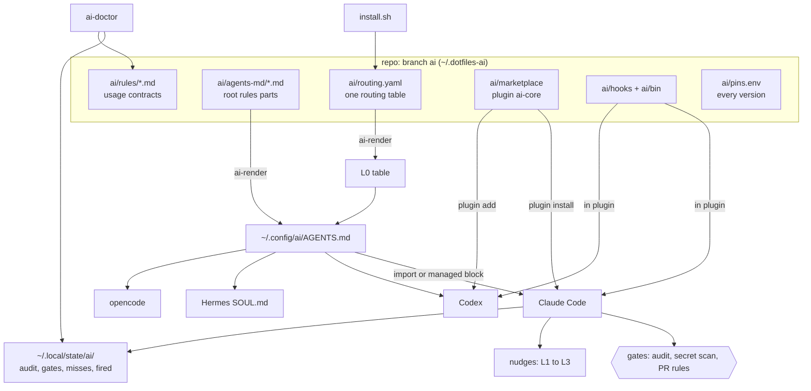

# dotfiles, branch `ai`

One AI setup for every machine. Agents, tools, rules, hooks and gates. Pinned, audited, with proof that each tool fires.

Branch `ai` holds only the AI layer. The OS base (shell, git, packages) lives in the other branches: `main` (macOS), `windows`, `ubuntu-server`.
Status: server first. macOS later. Windows planned, not supported yet.

## 1. What it is

- One set of rules for every agent (Claude Code, Codex, Hermes, opencode). One root file: `~/.config/ai/AGENTS.md`.
- One set of tools (MCP servers, plugins, skills). Each tool is audited and pinned to the audited version.
- One usage contract per tool: `ai/rules/<tool>.md`. It says when to use the tool, when not, how use is enforced, how we prove it fired, and how to set it up.
- Hooks that remind the agent and gates that block unsafe steps.
- Telemetry and auto-update are off in every tool. Updates happen only after a new audit.
- The repo is public. No secrets, no host names, no personal data. One exception: a free context7 API key (owner decision).

## 2. How it works



Read it from the top. You edit the repo. `install.sh` renders the routing table and the root rules, then registers the plugin with each agent. Agents read the rules. Hooks inside the plugin remind and block. Everything they do is logged. `ai-doctor` reads the logs and the contracts and tells you what is wrong.

### Parts

- **Agents.** Claude Code with oh-my-claudecode (main). Codex with oh-my-codex (main). Hermes (chat gateway, runs as its own user). opencode (always installed, second front-end). herdr (runs agents in panes). Gemini and Kimi CLI: later. omo: optional, only when asked. Details: `ai/rules/omc.md`, `omx.md`, `hermes.md`, `opencode.md`, `herdr.md`, `omo.md`.
- **Plugin `ai-core`.** One plugin in `ai/marketplace/plugins/ai-core/`. It holds our skills, our hooks and the MCP server list. Claude and Codex both install it from the same folder (a local marketplace named `ai`). The agents write only their own registration. Our install code never owns a whole config file.
- **MCP servers.** Serena (code reading and editing), context7 and Grounded Docs (library docs), GitHub (full access). Playwright is per project only. Plugin tools are named `mcp__plugin_ai-core_<server>__<tool>`.
- **Other tools.** graphify (code map), RTK (short command output), Ponytail (small diffs), i-have-adhd (reply shape), claude-seo and claude-blog (SEO and blog skills), pinned copies of five mattpocock skills.
- **Root rules.** `ai/agents-md/*.md` are joined in order, plus the L0 table, into one file. Part 00 is the owner text, copied byte for byte. The file stays under 30 KB.
- **Usage contracts.** One file per tool in `ai/rules/`. Sections: Vendor rules, When and when not, Enforcement, Proof, Setup checklist. The installer implements every setup item. `ai-doctor` fails when an enabled tool has no contract.
- **Evals.** `ai/evals/`. Prompts that should fire a tool and prompts that must not. Written in English, Romanian and Russian.

### Routing layers

Agents do not always remember to use the right tool. We add seven layers. One table, `ai/routing.yaml`, feeds all of them, so they never disagree.

| Layer | What | Catches |
|---|---|---|
| L0 | routing table inside the root rules | knowledge missing from context (all agents) |
| L1 | SessionStart inject, again after compaction | drift late in a session |
| L2 | forced-evaluation hook: the agent answers YES or NO per matched tool, "none needed" is allowed | paraphrases |
| L3 | regex fast path (file types, tool names, commands) | exact cases |
| L4 | gates for rules with no exception: audit before install, secret scan, PR rules | "skipped it and did it anyway" |
| L5 | subagents get the table through SubagentStart | subagent misses |
| L6 | skill descriptions with triggers first, Romanian and Russian phrases | non-English prompts |
| L7 | evals, miss log, `ai-doctor` | silent regressions |

Expected misses: about 0% on keyword prompts, 10 to 25% on hard prompts, more for non-English prompts, subagents and Hermes. Misses are logged, never silent.

### Gates

A gate blocks a step until its condition holds.
- `audit-before-install`: blocks npm, pip, uv, npx and curl-to-shell without a PASS from `agent-audit` in the last 24 hours. It asks for brew, cargo, go, gem, pipx.
- `secret-scan`: blocks `git commit` and `git push` when the staged diff has a key, token or password.
- `pr-rules`: blocks `gh pr create` and `gh pr edit` without a Mermaid block and the author-sessions block.

Escape hatch: `AI_GATE_SKIP=<rule-id>` with a reason. It is logged to `~/.local/state/ai/gates.log`.

## 3. Install

Needs: git, sudo (Ubuntu). `install.sh` installs the rest.

### Ubuntu server

1. Set up the base first. Follow the README of the `ubuntu-server` branch. It ends with an "AI setup" section that repeats the next steps.
2. Add the AI worktree. It must be a separate folder. Checking out `ai` inside `~/.dotfiles` would break the links of the base branch.
```
git -C ~/.dotfiles fetch origin ai
git -C ~/.dotfiles worktree add ~/.dotfiles-ai ai
```
3. Dry run. Read the output.
```
~/.dotfiles-ai/install.sh --dry-run
```
4. Install.
```
~/.dotfiles-ai/install.sh
```
5. Copy `secrets.env.example` to `~/.config/ai/secrets.env`, set mode 600, fill the keys you need.
6. Do the manual steps in section 4.
7. Check.
```
ai-doctor
```

`install.sh` asks "Is this a new Ubuntu server that needs the base server setup?" The default is No. Answer Yes only on a fresh server: it prints the `ubuntu-server` instructions and stops.

Options: `--dry-run`, `--agents claude,codex,hermes,opencode,herdr`, `--skip-packages`, `--rtk-hook`, `--yes`. More in `docs/INSTALL.md`.

### macOS

Later. The Macs are out of scope until the server test and the owner review are done. When enabled:
```
git -C ~/.dotfiles worktree add ~/.dotfiles-ai ai
~/.dotfiles-ai/install.sh --dry-run
```
Rules for macOS: install never writes macOS managed settings. The RTK hook is not turned on without `--rtk-hook` and the owner's OK. Never touch the 999 project, its Postgres or its `com.md999.*` launchd jobs.

### Windows

Planned, not supported yet.

## 4. Manual steps per machine

The installer cannot do these. It prints them at the end.
- Log in to each agent: Claude Code, Codex (device code), Hermes provider keys.
- Codex: open `/hooks` once and trust the plugin hooks (Ponytail, ai-core).
- Claude: run `/seo setup` once, then `/seo doctor`.
- Fill `~/.config/ai/secrets.env` (mode 600). Names only are in `secrets.env.example`.
- Serena: `serena download-ls-dependencies <language>` for the languages you use.
- Ask the owner before anything that is marked in a contract as "owner decides".

## 5. Verify

```
ai-doctor
```
`ai-doctor` checks: plugin list and validation, MCP servers connected, pinned versions, telemetry and update switches, root file under 30 KB, every enabled tool has a contract, evals, the miss log, stale Serena entries. A fast check runs at the end of `install.sh`: `ai-doctor --quick`.

To see that a tool really fires, look at the logs in `~/.local/state/ai/`. See `docs/CONTEXT.md`.

## 6. Update

Updates are never automatic.
1. Pull: `git -C ~/.dotfiles-ai pull`.
2. A new tool version needs a new audit and a new pin. See `docs/EXTENDING.md`, "Bump a pin".
3. Run `~/.dotfiles-ai/install.sh` again. It is safe to run twice: the second run changes nothing.
4. Run `ai-doctor`.

## 7. Remove

```
~/.dotfiles-ai/uninstall.sh
```
It removes only what the install added. It reads `~/.local/state/ai/managed-keys.json`. It does not remove your own settings, other plugins or the agents. Then you can delete the worktree: `git -C ~/.dotfiles worktree remove ~/.dotfiles-ai`.

## 8. Where things live

| Path | What |
|---|---|
| `~/.dotfiles` | OS base branch |
| `~/.dotfiles-ai` | this branch (git worktree) |
| `~/.dotfiles-ai/ai/` | the AI layer: `routing.yaml`, `agents-md/`, `rules/`, `hooks/`, `bin/`, `marketplace/`, `skills/`, `evals/`, `TOOLBOX.md`, `SPEC.md` |
| `~/.dotfiles-ai/ai/build/` | generated, not committed: `routing.json`, `L0.md`, the rendered root file |
| `~/.config/ai/AGENTS.md` | root rules, imported by each agent |
| `~/.config/ai/TOOLBOX.md` | ready tools that are not installed by default |
| `~/.config/ai/secrets.env` | your keys, mode 600, never committed |
| `~/.local/state/ai/` | `audit.log`, `gates.log`, `misses.jsonl`, `fired.jsonl`, `nudges.json`, `managed-keys.json` |
| `~/.local/bin/` | links to every command in `ai/bin/` |
| `~/.claude/CLAUDE.md`, `~/.codex/AGENTS.md`, Hermes `SOUL.md` | each has one managed block that points to the root rules |

Commands (in `ai/bin/`): `ai-doctor`, `ai-render`, `agent-audit`, `ai-start`, `ai-adopt`, `claude-notify`, `pr-resume`.

## 9. Troubleshooting

| Symptom | Check |
|---|---|
| A tool never fires | `~/.local/state/ai/misses.jsonl`. Then the contract: `ai/rules/<tool>.md`. Then the eval for the tool. |
| A command is blocked | Read the gate message. Fix the cause: run `agent-audit`, remove the secret, add the PR blocks. Escape hatch only when the owner says so: `AI_GATE_SKIP=<rule-id>`. |
| The skill has no description in the list | The skill list is over budget. Check `skillListingBudgetFraction` and run `/skill-doctor`. The L0 table still routes. |
| MCP server not connected | `claude mcp list`, `codex mcp list`. Check `~/.config/ai/secrets.env` and the contract setup checklist. |
| Root file too big | `ai-doctor` fails above 30 KB. Shorten the parts in `ai/agents-md/`. Long text belongs in `ai/rules/`. |
| Codex hooks do not run | Open `/hooks` and trust them. |
| A vendor tool wrote its own block | Our install skips it and reports. Never edit inside the vendor markers. |
| `rtk gain` fails | A wrong `rtk` package is installed. See `ai/rules/rtk.md`. |
| Rust coreutils quirks on Ubuntu 26.04 | Avoid `chown -h` and `stat -c` in scripts. |

## 10. More

- `docs/INSTALL.md`: every install step, per OS.
- `docs/CONTEXT.md`: lists of rules, agents, MCP servers, plugins, skills, hooks, routing and toolbox.
- `docs/EXTENDING.md`: add a skill, MCP server, plugin, routing rule or toolbox entry. Bump a pin. Retire a tool.
- `ai/SPEC.md`: the design. `ai/SPEC-LOG.md`: why.
