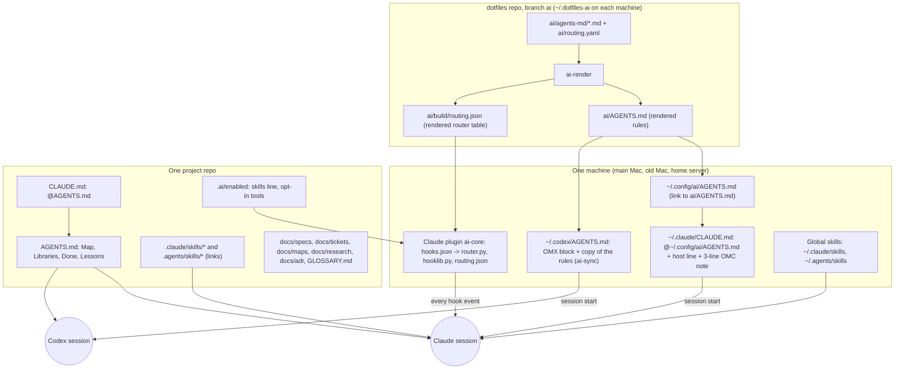
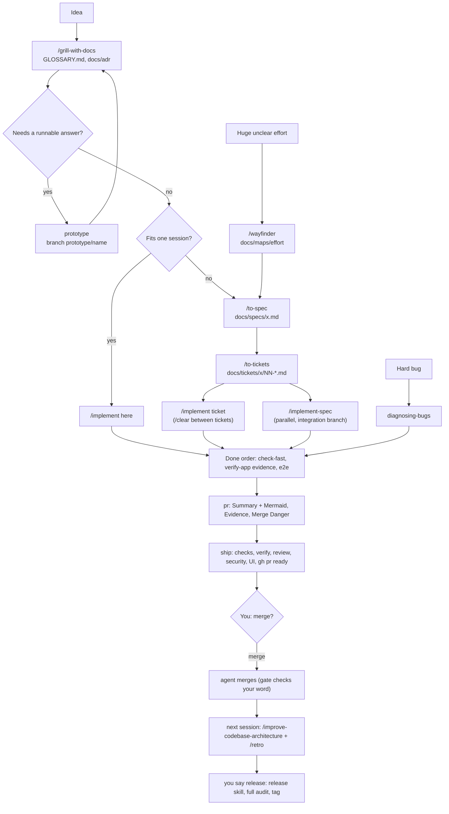
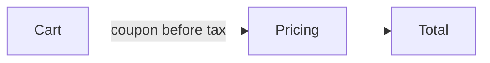
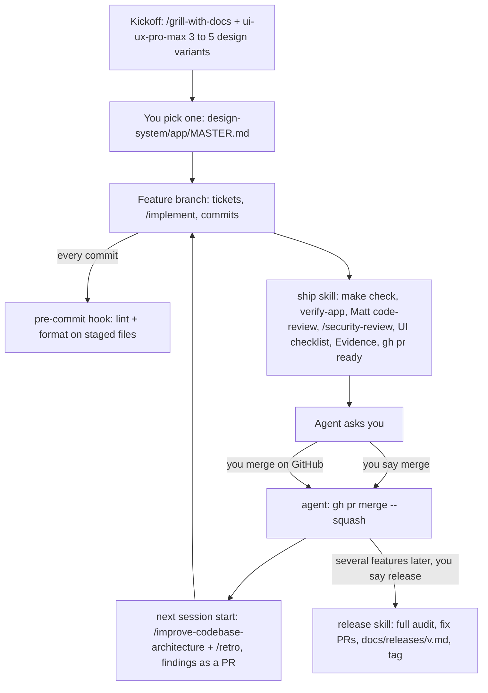

# The AI setup: owner guide

Status: 2026-11-17. Branch `ai`. Profile `dev-mac` on all 3 machines (the main Mac, an old Intel Mac, a home server).

Read this guide from the top once. After that, use the table of contents and the cheat sheet (section 12).

Rules for this document:
- Every command and every output block below is real output from the main Mac, unless the block says "example" or
  "not verified".
- Secrets are replaced with `<REDACTED>`.
- The agent can answer questions about skills for you: ask "which skill for X?" in any session. That starts the
  global `skills-guide` skill (`ai/skills/skills-guide/SKILL.md`).

## Contents

1. [The idea in one page](#1-the-idea-in-one-page)
2. [The layers: what loads, from where, and why](#2-the-layers-what-loads-from-where-and-why)
3. [Inside the router: hooks, nudges, gates](#3-inside-the-router-hooks-nudges-gates)
   - [3.5 Enforcement: gates, stop rules, skill card, winner table](#35-enforcement-gates-stop-rules-skill-card-winner-table)
   - [3.6 Testing the setup with ai-eval](#36-testing-the-setup-with-ai-eval)
4. [Skills: how they load, where they live, which are on](#4-skills-how-they-load-where-they-live-which-are-on)
5. [Project knowledge: where it lives](#5-project-knowledge-where-it-lives)
6. [How the setup builds: install.sh, ai-sync, ai-doctor, ai-info](#6-how-the-setup-builds-installsh-ai-sync-ai-doctor-ai-info)
7. [What the setup reports, with real output](#7-what-the-setup-reports-with-real-output)
8. [ai-start and ai-adopt: the project layer, file by file](#8-ai-start-and-ai-adopt-the-project-layer-file-by-file)
9. [The flows: idea to ship, phase boundaries](#9-the-flows-idea-to-ship-phase-boundaries)
10. [Scenarios with full example sessions](#10-scenarios-with-full-example-sessions)
   - [10.G New feature in a crawler project, prompt to draft PR](#10g-simulation-a-new-feature-in-a-crawler-project-from-prompt-to-draft-pr)
11. [Pull requests: the template, the gate, the git workflow](#11-pull-requests-the-template-and-the-gate)
12. [Cheat sheet](#12-cheat-sheet)
13. [Troubleshooting](#13-troubleshooting)
14. [What is not verified](#14-what-is-not-verified)
15. [Ship, merge, release: the long-term flow](#15-ship-merge-release-the-long-term-flow)
16. [Tests, scenarios and how the setup behaves (real output)](#16-tests-scenarios-and-how-the-setup-behaves-real-output)

---

## 1. The idea in one page

The setup has one job: every agent (Claude Code, Codex) on every machine starts with the same rules, the same
tools and the same project knowledge. You do not repeat yourself. The agent does not guess.

Five ideas carry the whole design:

1. **One source of rules.** You edit `ai/agents-md/*.md` and `ai/routing.yaml` in this repo. `ai-render` builds
   one file, `ai/AGENTS.md`. Every agent reads that file. Claude reads it through an `@` import. Codex gets a
   copy.
2. **Knowledge lives in the repo, next to the code.** Each project has an `AGENTS.md` with a Map, a Libraries
   table, a Done list and Lessons. Specs, tickets, decisions and research notes are Markdown files in the repo.
   No hidden memory store.
3. **A deterministic router, not an LLM, decides when to remind the agent.** One Python script (`router.py`)
   runs on every hook event. It uses regex and project state. It is fast (50 ms measured) and it cannot
   hallucinate.
4. **Few hard stops, and mechanisms for the rest.** On `dev-mac` the agent is autonomous except for the gates:
   `secret-scan` (no key, token or password in a commit or push), `pr-rules` (a PR body must have the agreed
   parts), `merge-approval` (no merge and no push to main without your OK), `no-verify` (no skipped git hooks),
   and since 2026-11-16 the skill gates, `gh-write`, the winner gate and the graph-first deny. No stop rule
   blocks the end of a turn: `diagnosing-bugs` and `tdd` are hints since 2026-11-18 (ticket 14). Section 3.5
   lists them all.
5. **Skills do the method.** Matt Pocock's skills give the engineering flow (grill, spec, tickets, tdd,
   review, PR, retro). Our own skills add verification (`verify-<app>`), prompting other agents and the
   `skills-guide`.

What changed in the enforcement round (2026-11-16 to 2026-11-17, details in section 3.5):
- Text in `AGENTS.md` is advice. The logs showed 3 skill uses in 7 days. So the rules that matter now run at the
  moment of the action: gates, stop rules, a skill card at session start and a winner table for overlapping
  skills. `ai-eval` measures it (section 3.6).
- A harness notification (a task result that arrives as a prompt) fires no rule and never sets or clears the
  merge-approval OK.
- The global `~/.claude/CLAUDE.md` is short. The RTK hook on Claude is our wrapper and does nothing in auto mode.
  Serena tools are always loaded. herdr is on every machine.

What changed before (owner decisions, 2026-11-16, details in section 15):
- Every PR goes through you. The agent merges only after you say "merge" (or "approve"). The `merge-approval`
  gate blocks `gh pr merge` and a push to main or master without that.
- Feature done: the `ship` skill. After a merge: `/improve-codebase-architecture` and `/retro`. You say release:
  the `release` skill. A good approach in one repo: `promote-skill`. Tools upgraded: `upgrade-review`.
  Install, update or adopt on a machine or in a folder: `setup-rollout` (setup source: branch `ai`).
- ui-ux-pro-max is on in every project; kickoff makes 3 to 5 design variants and you pick one.
- Markdown only in its places (`ai-docs-check` in `make check`); a pre-commit hook checks staged files.
- One knowledge store: the repo. Claude auto memory is off; old memory moves into the repo once per project.
- Navigation: graphify for wide questions, Serena for exact symbols, rg only for text.

Owner decisions, 2026-11-15:
- `skill-scanner` is off on every machine. Installs are not blocked by scanner rejects.
- Every tool installs at its newest stable release.
- Full autonomy on `dev-mac`: `no-sudo`, `no-destroy`, the Stop check and the Claude ask/deny permission rules
  are off. Only `secret-scan` and `pr-rules` gate (2026-11-16: plus `merge-approval` and `no-verify`, and the
  enforcement round of section 3.5).
- Project tiers are removed. Every project gets the full set: Done list, regression ledger
  (`docs/REGRESSIONS.md`), ratchet (`.ai/ratchet.json`), PR extras (Docs, Changed guards, Ledger on fix PRs).
- All 27 skills of Matt Pocock's official plugin are available. 6 are global. 13 (since 2026-11-16) are linked in every project by
  default. 7 are opt-in per project. Details in section 4.
- The PR body follows Matt's `pr` template, plus a required Mermaid diagram.

---

## 2. The layers: what loads, from where, and why

### 2.1 The picture



### 2.2 Layer by layer

| Layer | File | Who writes it | Who reads it | When |
|---|---|---|---|---|
| Rule sources | `ai/agents-md/00-owner.md` ... `90-toolbox-and-vendor-rules.md`, `ai/routing.yaml` | You (or an agent) in this repo | `ai-render` | When you change a rule |
| Rendered rules | `ai/AGENTS.md` | `ai-render` | Everything below | Built, committed |
| Global rules for Claude | `~/.claude/CLAUDE.md` | install.sh (managed blocks `AI:core`, `AI:host`, and a 3-line OMC note). `ai-doctor` reports the long OMC block if an OMC update writes it back | Claude Code | Every Claude session start |
| The rules file Claude imports | `~/.config/ai/AGENTS.md` | install.sh (a link into `~/.dotfiles-ai/ai/AGENTS.md`) | Claude, through `@~/.config/ai/AGENTS.md` | Every Claude session start |
| Global rules for Codex | `~/.codex/AGENTS.md` | install.sh and `ai-sync` (block `AI:core`, a copy), OMX (its own blocks) | Codex | Every Codex session start |
| Host line | `AI:host` block in the two files above | install.sh | Both agents | "This machine: projects live in ~/work ..." |
| Router | Claude plugin `ai-core`: `hooks/hooks.json`, `router.py`, `hooklib.py`, `routing.json` | install.sh (from `ai/marketplace/plugins/ai-core`) | Claude Code hooks; Codex hooks (`codex-hooks.json`) | Every hook event |
| Project rules | `<repo>/AGENTS.md` | `ai-adopt` (managed blocks), agents and you (everything else) | Claude (through `<repo>/CLAUDE.md` = `@AGENTS.md`), Codex (reads `AGENTS.md` natively) | Every session in that repo |
| Project switches | `<repo>/.ai/enabled` | `ai-adopt` | Router, ai-adopt | Every hook event in that repo |

Why a project still has `CLAUDE.md` with `@AGENTS.md`: Claude Code 2.1.277 and later reads `AGENTS.md` by itself,
but only when the repo has no `CLAUDE.md`. Our `CLAUDE.md` holds one line, `@AGENTS.md`, so Claude always gets the
same file Codex reads, also in sessions that cannot read `AGENTS.md` directly. The Claude docs say this import never
loads the file twice. One file, two agents.

Codex reads `~/.codex/AGENTS.override.md` (else `~/.codex/AGENTS.md`), then one file per folder from the repo
root down (`AGENTS.override.md`, else `AGENTS.md`), up to `project_doc_max_bytes` (we set 65536; the default is
32 KiB). A file closer to your folder comes later and wins. `ai-doctor` fails when `~/.codex/AGENTS.override.md`
exists, because it would replace our rules. `~/.codex/rules/*.rules` are command permissions (allow, prompt,
forbidden), not instructions.

Why the global rules are a link for Claude but a copy for Codex: Claude can import a file (`@path`). Codex
cannot. So `ai-sync` copies the text into the `AI:core` block of `~/.codex/AGENTS.md`. Run `ai-sync` after a
`git pull` of the dotfiles (or install its git hook: `ai-sync --install-hook`).

### 2.3 What loads into a session, and what it costs

Measured on the main Mac (2026-11-15):

| Item | Size | Loads |
|---|---|---|
| `~/.config/ai/AGENTS.md` (our global rules) | 2,032 words, about 2.7k tokens | Claude and Codex, every session |
| OMC note in `~/.claude/CLAUDE.md` | 3 lines (it was a block of 679 words before 2026-11-16) | Claude only |
| `~/.codex/AGENTS.md` total | 5,455 words, about 7k tokens (OMX about 3,400 words + our copy) | Codex only |
| i-have-adhd ruleset | about 1,200 words | Claude, injected at session start |
| Project `AGENTS.md` | 500 to 1,500 words (a web app: 518, a crawler: 1,305) | Every session in the repo |
| Each skill | name + description only, about 50 tokens | Every session; the body loads only when the skill runs |
| A typed-only skill (`disable-model-invocation: true`) | 0 tokens | Only when you type `/name` |
| Session start status lines (router) | about 150 words | Every session start |

Total fixed cost: about 6k tokens for Claude. That is about 3 percent of a 200k context window. The largest
single item is OMC (its block plus 35 skill and 19 agent descriptions).

---

## 3. Inside the router: hooks, nudges, gates

### 3.1 One script for every event

`ai/marketplace/plugins/ai-core/hooks/hooks.json` connects every Claude hook event to one command:

```
/usr/bin/python3 "${CLAUDE_PLUGIN_ROOT}/hooks/router.py" --agent claude <EventName>
```

The router reads only `routing.json` (rendered from `ai/routing.yaml`). It uses the Python standard library
only, so it starts fast. It never breaks a session: an internal error goes to `router-errors.log` and the hook
exits 0. A deny decided before the error still counts.

| Event | Matcher | What the router does |
|---|---|---|
| `SessionStart` | startup, resume, clear, compact | Status line for this repo (Map, Libraries, Serena, Graph, Verify skill), the session-start rules, the skill card and the author-sessions line (`main: <session id> dir: <cwd>`). After `compact` or `clear` it sends the routing table and the card again. |
| `UserPromptSubmit` | every prompt | Regex on your prompt. When a rule matches, it adds an "L2" checklist: the agent must answer YES or NO per tool before it acts. |
| `UserPromptExpansion` | typed `/skill` | Logs that a typed skill fired (proof). |
| `PreToolUse` | Bash, Read, Edit, Write, MultiEdit, Grep, Glob, Skill, Agent, Task | The gates (section 3.5) and some nudges (ledger areas). Claude Bash also runs the `rtk-hook` wrapper. |
| `PostToolUse` | Bash, Edit, Write, Skill, context7 tools | Nudges after the fact: after `git commit` (update the Map), after a write with an em dash, after a docs lookup. |
| `Stop` | every stop | The stop rules (none since 2026-11-18: `diagnosing-bugs` and `tdd` are hints). The verify walls `verify-tool-exists` and `verify-tool-used` (section 3.5). The miss log: a rule fired but the agent never called the tool it named. Then `claude-notify`. The `stop-check` (runs check-fast before "done") is off on `dev-mac`. |
| `SubagentStop` | every subagent stop | The verify hooks, for each subagent in its own checkout. |
| `SessionEnd` | every end | Drops the session state file, cleans Serena. |
| `Notification` | permission or idle prompt | `claude-notify` (a desktop or phone note). |

Codex has the same router through `codex-hooks.json`. Codex has no "ask", so an ask becomes a deny there.

### 3.2 The layers L0 to L7

The design names each kind of help with a layer number. You see these names in the agent's context:

| Layer | Name | What it is | Example you will see |
|---|---|---|---|
| L0 | Routing table | The table at the end of the global rules. Always in context. | "pr-rules (gate) - before gh pr create or edit - PR body: ..." |
| L1 | Session start | Rules with `when: session_start`, plus the status line. | `[ai router: project-knowledge] Read the Map and Libraries ...` |
| L2 | Forced evaluation | After a prompt rule matched: answer YES or NO per tool, then use every YES tool first. | `[ai router L2] Before you act, answer YES or NO ...` |
| L3 | Regex nudge | A rule whose trigger matched (a prompt word, a command, a file). | `[ai router: no-em-dash] Remove the em dash ...` |
| L4 | Gate | The tool call is denied. | `[ai gate secret-scan] Secret scan found ...` |
| L7 | Miss log | `~/.local/state/ai/misses.jsonl`: a rule fired, the agent did not follow it. | Read it to find rules that do not work. |

Why a gate and not a nudge: a nudge is a reminder. The agent can ignore it. A gate cannot be ignored. The gates
block what must never happen (leaked secrets, a merge without your OK, skipped git hooks) and the steps where a
skipped skill costs most (agent docs, `gh pr ready`). Section 3.5 has the full list.

### 3.3 The rules (routing.yaml v4)

Global rules (every repo):

| Rule | Kind | Fires when | Says |
|---|---|---|---|
| project-knowledge | nudge | session start in a code repo | Read the Map and Libraries of AGENTS.md first, then search narrowly. Plus the status line. |
| no-ai-base | nudge | session start, repo without `.ai/base-version` | Suggest `ai-adopt`. |
| knowledge-check | nudge | after `git commit` | Update the Map, run `ai-libs --sync`, as the commit needs. |
| secret-scan | **gate** | before `git commit` or `git push` | Remove the secret first. |
| pr-rules | **gate** | before `gh pr create` or `gh pr edit` with a body | The PR body template (section 11). |
| ledger-nudge | nudge | before an edit in a file that `docs/REGRESSIONS.md` covers | Keep its R-IDs green, run their tests. |
| no-em-dash | nudge | after a write that contains U+2014 | Use "-", ":" or a new sentence. |
| docs-lookup | nudge | a prompt about a library, SDK or API | context7 with the Libraries ID first. |
| feature-grill | nudge | a feature request prompt (EN, RO, RU) | Grill first, then to-spec and to-tickets for 3+ files. |
| verify-before-done | nudge | after a code edit, project with a `verify-<app>` skill | check-fast, then verify-<app> evidence, then e2e. |
| seo-, blog-, browser-not-enabled | nudge | SEO, blog or browser prompt in a project without that tool | Suggest `ai-adopt --tools <id>`. Do not install it. |
| merge-approval, no-verify | **gate** | `gh pr merge` or a push to main; `--no-verify` | Wait for your "merge"; fix what the git hook reports. |
| writing-for-agents | **gate** | before an edit or shell write of AGENTS.md, CLAUDE.md, CLAUDE.local.md, a SKILL.md | Load the `writing-for-agents` skill first. |
| ship | **gate** | before `gh pr ready` | Run the `ship` skill first. |
| gh-write | **gate** | a `gh` write other than the PR commands | Ask the owner. |
| diagnosing-bugs | nudge | a bug or performance prompt | Use the `diagnosing-bugs` skill. A hint: the turn end is not blocked. |
| tdd | nudge | a tests-first prompt | Use Matt's `tdd` skill. A hint: the turn end is not blocked. |

Opt-in rows (only where the project turned the tool on): serena, graph (both on by default), omc, seo, blog,
browser, ui, tracker-flow, domain-docs, knowledge-wiki.

Rows that exist but are off on `dev-mac` (server profile only): `no-sudo`, `no-destroy`, `audit-before-install`.

The `docs-lookup` row fires only when the prompt names a library of the repo's Libraries block, or before an edit
of a dependency file (`package.json`, `pyproject.toml`, `requirements*.txt`, `go.mod`, `Cargo.toml`, `Gemfile`,
`composer.json`). A prompt that only says "docs" stays quiet: it was missed 72 of 88 times before.

### 3.4 Fixed stale text (2026-11-15)

- The `knowledge-check` row now says "Update the Map section of AGENTS.md" (it said "Update mem:core").
- The `knowledge-wiki` row is removed. `llm-wiki-compiler` is not installed; the audit rejected it for code repos.

### 3.5 Enforcement: gates, stop rules, skill card, winner table

Why: the install was complete (`ai-doctor` 0 fail), but agents skipped most rules and skills. Text in
`AGENTS.md` is advice: when two texts conflict, the model picks one. Only hooks and gates were followed. So a rule
that matters is a mechanism that runs at the moment of the action, for Claude Code and Codex together.

| Mechanism | Event | What it does |
|---|---|---|
| Gate | PreToolUse | Denies the tool call with the reason and the next step |
| Stop rule | Stop | A prompt arms it. The next Stop gets `{"decision": "block"}` once per session when the skill was not used. No rule uses it since 2026-11-18 |
| Skill card | SessionStart | A short text (under 1500 characters) with the must-use skills, the hint skills and the typed-only skills |
| Winner table | PreToolUse on the Skill tool | Denies a skill that loses in an overlap, and names the winner |
| Verify walls | Stop, SubagentStop | `verify-tool-exists` and `verify-tool-used`: block the end of a turn that changed app code without a proven `verify-<app>` or a fresh valid run (below) |
| Verify commit gate | git pre-commit (`ai-precommit`) | Refuses a commit that adds a test without a valid verify run newer than HEAD |
| Measurement | `ai-doctor`, `ai-eval` | Skill use over 30 days, misses of the skill rules, hit rate per case |

**Proof of a skill.** A skill counts as used when the session has one of these: a Skill tool call, a typed `/name`,
or a read of that skill's `SKILL.md` from a skill install folder (`.claude/skills`, `.agents/skills`, a plugin
cache, the machine copy). The proof lives in the session state, not in the shared log. A vendor copy such as
`oh-my-claudecode:tdd` is never a proof for `tdd`. A `SKILL.md` in the repo's own `ai/skills/` is no proof.

**Gates and stop rules** (a rule with `require_skill: <name>` in `ai/routing.yaml`):

| Rule | Strength | Needs | Note |
|---|---|---|---|
| `writing-for-agents` | gate | the skill before an Edit, Write, MultiEdit or `apply_patch` of AGENTS.md, CLAUDE.md, CLAUDE.local.md or a SKILL.md, and before a shell write (`>`, `>>`, `tee`, `sed -i`, `cp`, `mv`) onto them | Not seen: `python -c`, `perl -i`, a script file |
| `ship` | gate | the skill before `gh pr ready` | `gh pr ready --undo` passes |
| `gh-write` | gate | the owner says yes (Codex: denied with a message) | `gh` reads pass. `pr create`, `edit`, `ready`, `merge` keep their own gates |
| graph-first (`nav-first`) | gate, once | `graphify query` before the first broad search (`rg`, `grep -r`, `find -name`, the Grep tool) in a repo with a graph | The next search passes. A stale graph: "graphify update, then query". A session that used graphify or a Serena tool passes. Serena symbol tools are the right answer for "where is X used" |

Each block is a row in `~/.local/state/ai/misses.jsonl`. `ai-doctor` shows the misses and the use of each skill over
30 days.

**Hints, not stops (2026-11-18, ticket 14).** `diagnosing-bugs` (a bug or performance prompt: slow, performance,
broken, debug, crash, regression; Romanian and Russian forms) and `tdd` (a tests-first, tdd or red-green prompt) were
stop rules. As stops they blocked 7 of 7 turns falsely: research and setup prompts that only mention debug, broken
or crash. Now they are nudges. The prompt still shows the hint. The end of the turn is never blocked.

**OMC walls (2026-11-18, ticket 15).** OMC's magic keywords are off: install.sh puts `OMC_SKIP_HOOKS=keyword-detector`
(OMC's own switch) into the Claude settings env on every machine. The word "autopilot" in a normal prompt starts
nothing. A typed `/oh-my-claudecode:autopilot` still runs the skill. `ai-doctor` checks the switch. The OMC
context-guard Stop hook (it blocks the turn end above 75 percent context) stays on: OMC 5.8.5 has no switch for it.

**The skill card.** At every SessionStart (startup, resume, clear, compact) the agent gets one card. It names the
2 must-use skills that a gate checks (`writing-for-agents`, `ship`) and 2 hint skills (`diagnosing-bugs`, `tdd`), with
one trigger line each. It also lists
the 8 typed-only skills (`grill-with-docs`, `to-spec`, `to-tickets`, `implement`, `handoff`, `wayfinder`,
`improve-codebase-architecture`, `retro`). The model cannot call a typed-only skill (`disable-model-invocation`). So the card says: read the `SKILL.md`, follow it, and
tell the owner the typed form. The data is the `skills:` block of `ai/routing.yaml`. `ai-render` fails when the
worst case is over 1500 characters.

**The winner table.** OMC and OMX add about 85 and 24 skills, and many do the same job as ours. `skillOverrides`
cannot hide plugin skills. So the `winners:` block of `ai/routing.yaml` holds the overlap table of the skills guide
(section 5 of `ai/skills/skills-guide/SKILL.md`) as data. A Skill call of a losing skill is denied with the
winner's name. When the winner is typed-only, the text says "read `<SKILL.md path>` and follow it". Example: a call
of `oh-my-claudecode:tdd` is denied, and the agent uses Matt's `tdd`.
- Orchestration skills (`autopilot`, `ralph`, `team`, `ultragoal`) pass. They call other skills inside. After one of
  them ran, the losers pass for the rest of the session.
- `ask`, `babysit`, `fix-ci` and `cancel` are no losers: they pass, and unlock nothing.
- A typed `/name` never reaches the Skill tool, so your own choice always runs.
- Codex has no Skill tool. There, a shell read of a losing skill file is denied the same way.
- A test keeps the skills guide table and the data in step.

**Verify walls (2026-11-18, verify-enforcement 02 to 04).** They read `.verify/evidence/<run>/run.log` of the
agent's own checkout (a linked worktree is its own checkout). A run counts when its log has all 4 lines, `doctor:
PASS` and `db_writes: no` (contract: `ai/rules/verification-skill.md`).
- `verify-tool-exists` (Stop, SubagentStop, adopted repos): app code changed in the turn, and the project has no
  `verify-<app>` skill, or one without a valid run. The message says: build it with `create-verification-skill`,
  prove it with one real run.
- `verify-tool-used` (Stop, SubagentStop, adopted repos): app code changed in the turn, and no valid run finished
  after the first change. The message names the skill and its launch, doctor, drive and cleanup commands.
- The change comes from git (the code files that differ from the turn start, tests too), so a shell write and a
  commit count. Loop limits: 2 blocks per app-code state, 4 per chain of stops.
- Commit gate (`ai-precommit`, every writer: Claude, Codex, subagents, the shell, you): in a project with a verify
  skill, a staged `def test_...(` (Python) or `test(` / `it(` in a JS or TS spec file needs a valid run that finished
  after HEAD's commit time. Edits and deletions of tests pass. Each refusal is a `verify-commit` line in the wall log.

**The escape hatch.** Every deny path honours it: `sudo ai-gate-skip <gate> <minutes max 60> <why>`. The gate name is
the rule id, `winner-gate`, `nav-first`, `verify-tool-exists` or `verify-tool-used`. The agent has no sudo, so it cannot skip a gate itself.

**Known limits.**
- The winner gate on the Skill tool is Claude only. Codex gets the file-read form.
- The `writing-for-agents` gate cannot see `python -c`, `perl -i` or a script file.
- After `/compact` or `/clear` the SessionStart text is about 10.1k characters. The L0 table tail is cut at 9.5k
  there. It stays complete in the root rules.
- Codex must trust the changed `router.py`, `hooklib.py` and `stop-check.py` again after an install (`ai-sync`
  writes the trust hashes).
- A git hook in the dotfiles checkout (post-merge, post-rewrite) runs `ai-sync` and so puts the checkout live in
  `~/.codex`. While a feature branch of this repo is merged in a dev checkout, merge with
  `git -c core.hooksPath=/dev/null merge ...`, so unreviewed code does not go live.

### 3.6 Testing the setup with ai-eval

`ai/bin/ai-eval` tests the setup in three levels. Reports go outside the repo.

| Level | Command | What it does |
|---|---|---|
| Fixtures | `ai-eval fixtures DIR` | Makes the fixture repos in DIR: `empty-git`, `docs-only`, `no-git`, `app` (a Python package with a test, a Makefile with `check` and a `verify-app` skill) and `project-copy` (a clone of the repo in `$AI_EVAL_PROJECT`, without its remotes) |
| Install | `ai-eval install [--keep] [--out DIR]` | Runs `ai-adopt` twice on each fixture in a throwaway HOME, then `ai-doctor --project-only` and the uninstall. A pass: both runs exit 0, the second run changes no tracked file, doctor and uninstall exit 0. `no-git` must be refused first, then pass with `--init` |
| Behaviour | `ai-eval behaviour [--agent claude\|codex\|both] [--runs N] [--dry] [--out DIR]` | Starts a fresh headless `claude -p` or `codex exec` per case and run, on a fresh copy of the adopted fixture. `--dry` only lists the runs |

How a behaviour run is made safe and scored:
- `AI_STATE_DIR` points to a folder of the run, so your own stats stay clean. The herdr variables are unset.
- Claude gets at most 15 turns, so a Stop rule can fire.
- A run that fails before any tool call (for example a usage limit) is an error, not a miss.
- A run is a hit when every expected item is seen and no `not_*` item is seen. Seen items: Skill tool calls, a read of a
  `SKILL.md`, tool calls, and the rules and skills in the run's `fired.jsonl`.

The cases are the files `ai/evals/cases/*.json` (21 today): plain, Romanian, Russian, should-not-fire and vague
("hard") prompts. The case format and the run steps are in `ai/evals/HOWTO.md`. How to add a case: `docs/EXTENDING.md`,
section 6.

Result on 2026-11-16 (Claude, hits in 3 runs, before to after):

| Case | Before | After |
|---|---|---|
| `hard-perf` ("investigate how it performs") | 0/3 | 3/3 |
| `hard-ship` ("wrap it up for review") | 0/3 | 3/3 |
| `ship` | 1/3 | 3/3 |
| `diagnosing-bugs`, `writing-for-agents` (English, Romanian, Russian) | 3/3 | 3/3 |
| 4 should-not-fire cases | 3/3 | 3/3 (no false fire) |
| `winner-tdd` | 0/3 | the `tdd` stop rule came after this run |

20 of 21 cases reach 3/3. `graphify-first` is answered with the Serena symbol tools (the navigation rule). Codex: the
first baseline was 18 of 18 on plain prompts; the hard-case run hit the usage limit (24 of 27 runs were errors). The
Codex after-run is open. The report is `docs/reports/ai-eval-baseline-2026-11-16.md`.

---

## 4. Skills: how they load, where they live, which are on

### 4.1 How a skill loads

A skill is a folder with a `SKILL.md` file. The file starts with frontmatter:

```yaml
---
name: implement
description: "Implement a piece of work based on a spec or set of tickets."
disable-model-invocation: true
---
```

1. At session start, Claude reads only `name` and `description` of every skill it can see. About 50 tokens each.
2. When your request matches a description, the model calls the Skill tool. Only then the full `SKILL.md` body
   loads. This is an **auto** skill (the model can start it).
3. With `disable-model-invocation: true`, the skill is **typed**: it is not in the model's list at all. It costs
   0 tokens. Only you can start it, by typing `/<name>`. Codex uses `policy.allow_implicit_invocation: false`
   in `agents/openai.yaml` for the same effect.
4. A skill can call another skill with the Skill tool (for example `implement` calls `tdd` and `code-review`).
   That callee must be visible in the same project. That is why `ai-adopt` links callees too.

Where Claude looks: `~/.claude/skills/` (global), `<repo>/.claude/skills/` (project), and plugin skills.
Where Codex looks: `~/.agents/skills/` (global) and `<repo>/.agents/skills/` (project).

### 4.2 Where the files are on disk

| What | Path | Note |
|---|---|---|
| Matt Pocock originals (audited copy) | `~/.local/share/ai/plugins/mattpocock-skills/<name>/` | Unchanged copies of upstream (0 lines differ, checked 2026-11-15). install.sh refreshes them at the newest stable tag. |
| Global links (Claude) | `~/.claude/skills/<name>` -> the copy above | 6 Matt skills |
| Global copies (Codex) | `~/.agents/skills/<name>` | Same 6, plus our own |
| Our own skills | `~/.dotfiles-ai/ai/skills/<name>/` | skills-guide, prompting-claude-and-codex, create- and maintain-verification-skill |
| Project links | `<repo>/.claude/skills/<name>`, `<repo>/.agents/skills/<name>` | Made by `ai-adopt` from the `skills:` line. Gitignored. Made again on each machine. |
| Project verify skill | `<repo>/.agents/skills/verify-<app>/` and a committed link `.claude/skills/verify-<app>` | Made by `/create-verification-skill` |

### 4.3 Which skills are on

| Scope | Skills | Change it with |
|---|---|---|
| Global, every repo | Matt: grilling, grill-me, wait-what, writing-for-agents, retro, ask-matt. Ours: skills-guide, prompting-claude-and-codex, create-verification-skill, maintain-verification-skill | install.sh |
| Plugins, global | ai-core (router, context7 MCP, prompting-claude-and-codex), ai-serena (Serena MCP), ponytail (6 skills), i-have-adhd, oh-my-claudecode (35 skills, 19 agents) | install.sh |
| Global flow skills (ours) | ship, release, promote-skill, upgrade-review, setup-rollout (section 15) | install.sh; a new one: `git pull` (ai-sync links it) |
| Project default (every project) | grill-with-docs, domain-modeling, to-spec, to-tickets, tdd, pr, diagnosing-bugs, improve-codebase-architecture, implement, research, handoff, wayfinder, prototype. Callees linked with them: codebase-design, code-review | `skills:` line in `.ai/enabled` |
| Project opt-in | implement-spec, triage, wizard, to-questionnaire, teach, setup-matt-pocock-skills | `ai-adopt --skills <full list>` |
| Plugin, on in every project | ui-ux-pro-max (`no-ui` in `.ai/enabled` turns it off) | `ai-adopt` |
| Plugins, opt-in per project | claude-seo, claude-blog, ai-playwright | `ai-adopt --tools <id>` (seo, blog, browser) |
| Not installed | Matt's in-progress (chief-of-staff, claude-handoff, loop-me, software-factory, writing-*) and misc (git-guardrails, shoehorn, scaffold-exercises, setup-pre-commit, setup-ts-deep-modules) | Matt's own plugin leaves them out too |

A rerun of `ai-adopt` adds new defaults and keeps the extra opt-ins already on the `skills:` line.

Do not run `/setup-matt-pocock-skills` in a repo that `ai-adopt` set up. `ai-adopt` already wrote
`docs/agents/issue-tracker.md` and `docs/agents/domain.md` in the format the skills read. The upstream setup
also tries to write into `CLAUDE.md` and may create GitHub labels.

### 4.4 Every Matt skill in one table

Typed = you type `/<name>`. Auto = the model starts it when the task fits (you can also type it).

| Skill | Start | What it does | Writes |
|---|---|---|---|
| grilling | auto | Interview in rounds. A recommended answer per question. Facts are the agent's job, decisions are yours. | nothing |
| grill-me | typed | grilling with no repo (a plan, a text, a life decision) | nothing |
| grill-with-docs | typed | grilling plus domain-modeling, in a repo | `GLOSSARY.md`, `docs/adr/NNNN-*.md` |
| domain-modeling | auto | Sharpens terms, splits overloaded words, records ADRs | `GLOSSARY.md`, `docs/adr/` |
| codebase-design | auto | Deep-module words: module, interface, depth, seam, adapter | nothing |
| wayfinder | typed | Map of decision tickets for a huge, unclear effort. One ticket per session. Decisions, not code. | `docs/maps/<effort>/map.md`, `issues/NN-*.md` |
| prototype | auto | Throwaway code for one design question (logic: one HTML file; UI: variants on one route) | branch `prototype/<name>` |
| research | auto | Background agent reads primary sources, writes a cited note | `docs/research/<topic>.md` |
| to-spec | typed | The current conversation becomes a spec. No new interview. | `docs/specs/<feature>.md` |
| to-tickets | typed | Spec becomes tracer-bullet tickets with "Blocked by" edges | `docs/tickets/<feature>/NN-*.md` |
| implement | typed | One ticket: tdd at agreed seams, tests, code-review, commit | code, tests, a commit |
| implement-spec | typed | Whole spec: one subagent per ready ticket, own worktrees, one integration branch | a branch, commits |
| tdd | auto | Red, green, refactor. One vertical slice at a time. | tests, code |
| code-review | auto | Two parallel reviews of a diff: Standards and Spec | a report |
| pr | auto | The PR body template | the PR body |
| diagnosing-bugs | auto | Fast red command first, then shrink, rank guesses, probe, regression test, fix, clean up | a test, a fix |
| triage | typed | Moves raw incoming issues through triage states, writes agent-ready briefs | tracker files |
| improve-codebase-architecture | typed | Survey for "deepening" chances, HTML report, then grill one. Runs after each merge to main (project default). | a report in `$TMPDIR` |
| wizard | auto | A bash script that walks a human through manual steps (keys, dashboards) | a script you run |
| handoff | typed | Session summary for another agent, machine or person | a file in `$TMPDIR` |
| retro | typed | After a session: fixes for the environment, not the code | suggestions |
| wait-what | typed | "That did not land": the agent explains again in plain words | nothing |
| to-questionnaire | typed | A questionnaire for the person who has the missing answer | a Markdown file |
| teach | typed | Teaches a concept over several sessions | learning record files |
| writing-for-agents | auto | Rules for skills, AGENTS.md, CLAUDE.md | nothing |
| ask-matt | typed | Router: "which flow fits?" | nothing |
| setup-matt-pocock-skills | typed | Upstream repo setup (do not use in adopted repos) | `docs/agents/*` |

### 4.5 Overlaps: which one wins

| Need | Use | Not |
|---|---|---|
| Kickoff or feature interview | grill-with-docs | OMC deep-interview (only when you want an "ambiguity score") |
| Plan a well-scoped feature | to-spec, to-tickets | OMC plan, ralplan |
| Plan a huge unclear effort | wayfinder | OMC ultragoal |
| Build tickets | implement, implement-spec | OMC execute, team (use those for ad-hoc parallel work) |
| Research a library | research (context7 first) | OMC research, web search |
| Review a diff | Matt code-review (say "Matt code-review skill") | built-in `/code-review`, OMC review |
| Prove a feature works | verify-<app> | "tests pass" alone |
| Store knowledge | AGENTS.md, GLOSSARY.md, docs/* | Serena memories, OMC wiki, Claude auto memory (off) |
| Before the merge | ship (ours) | OMC verify alone |
| Cut a version | release (ours) | OMC release |
| Build test-first | tdd (Matt) | OMC tdd |
| Write a PR body | pr (Matt) | OMC pr |

The winner gate enforces this table: when an agent calls a losing OMC skill, the call is denied and the
message names the winner. The exact list is in the skills guide, section 5. Your own typed /name always runs,
and OMC orchestration (autopilot, ralph, team, ultragoal, ask, babysit, fix-ci, cancel) always runs.

---

## 5. Project knowledge: where it lives

| Knowledge | Place | Who updates it | Read when |
|---|---|---|---|
| How the repo is built, where things live | `AGENTS.md` Map (max 60 lines, between `<!-- AI:map START/END -->`) | `ai-adopt` first; agents after commits; `ai-adopt --refresh-map` | Every session start |
| Libraries, versions, docs IDs | `AGENTS.md` Libraries (between `<!-- AI:libraries START/END -->`) | `ai-libs --sync` | Before library code |
| What "done" means | `AGENTS.md` Done (6 lines, managed) | `ai-adopt` | Before "done" |
| Mistakes that no check catches yet | `AGENTS.md` Lessons (max 15 lines) | Agents | Every session |
| Words of the domain | `GLOSSARY.md` | grill-with-docs, domain-modeling | During grilling, PR text, wait-what |
| Hard-to-reverse decisions | `docs/adr/NNNN-<title>.md` | grill-with-docs, domain-modeling | Before a change in that area |
| What to build | `docs/specs/<feature>.md` | to-spec | implement, code-review (Spec axis) |
| Progress | `docs/tickets/<feature>/NN-*.md`, closed in `done/` | to-tickets, implement, you | Next session |
| Big unclear efforts | `docs/maps/<effort>/map.md` | wayfinder | Each wayfinder session |
| Facts from outside | `docs/research/<topic>.md` | research | grill-with-docs |
| Bugs that came back | `docs/REGRESSIONS.md` (R-NNN rows) | you, agents (`ai-ledger`) | Before an edit in that area (ledger-nudge) |
| Test, skip, lint counts | `.ai/ratchet.json` | `ai-ratchet` | `make check` |
| Code structure | graphify graph (`graphify-out/`, gitignored) | rebuilds after commit, checkout, merge | Wide questions: `graphify query "<question>" --budget 1500`, impact: `graphify affected "<path>::<symbol>"` |
| Symbols | Serena (live, from the code) | nobody (always current) | Exact symbol, callers, edits: find_symbol, find_referencing_symbols, replace_symbol_body |
| Visual direction | `design-system/<app>/MASTER.md` + `pages/<page>.md` | ui-ux-pro-max at kickoff (`--persist`) | Before UI work; code-review checks it |
| Project-only rules | `AGENTS.md` `## Project rules` | you, agents | Every session (add or tighten, never loosen the global rules) |
| Release reports | `docs/releases/<version>.md` | release skill | Next release |

What is **not** knowledge storage:
- Serena memories: off on purpose. The Map is the one place. Serena is for its code tools (exact symbols, callers,
  safe edits), not for notes.
- Claude auto memory: off since 2026-11-16 (`autoMemoryEnabled: false`). A repo that still has old memory files
  gets one session-start note (rule `legacy-memory`): move the durable facts into the repo through a PR.
- Navigation order in a big repo: the Map, then graphify (where, how, impact), then Serena (exact), then a narrow
  `rg` for text only. A once-per-session reminder (rule `nav-first`) fires on the first broad search.
- `/handoff` files: they go to `$TMPDIR`. They carry work to another place. They are not kept.
- OMC `.omc/` state: local, gitignored, except `.omc/skills/`.

Why this design: a second copy of knowledge (a wiki, a memory store) goes stale. The Map is in the repo, small,
read every session, and the router asks for an update after each commit. The graph rebuilds itself.

---

## 6. How the setup builds: install.sh, ai-sync, ai-doctor, ai-info

### 6.1 install.sh

Run it from the install copy on each machine:

```bash
cd ~/.dotfiles-ai && git pull && ./install.sh
```

What it does, in order (simplified):
1. Reads the profile: `--profile NAME`, else `~/.config/ai/profile`, else the default. All 3 machines use
   `dev-mac` (saved in `~/.config/ai/profile`).
2. Resolves the newest stable version of each tool (npm, PyPI, GitHub releases or tags) and records it.
3. Installs or upgrades each tool: Claude Code, Codex, RTK, graphify, Serena, context7 MCP, OMC, OMX, the Claude
   plugins (ai-core, ai-serena, ponytail, i-have-adhd, OMC), Matt Pocock skills, pstack verification skills.
4. Writes the global rules (`~/.claude/CLAUDE.md` blocks, `~/.config/ai/AGENTS.md` link, `~/.codex/AGENTS.md`
   copy), Claude settings (env switches, allow rules), Codex config, hook trust.
5. Links the global skills.

Profile `dev-mac` switches (file `ai/profiles/dev-mac.env`):

| Switch | Value | Effect |
|---|---|---|
| PROFILE_SCANNERS | empty | No skill-scanner, guarddog, osv-scanner |
| PROFILE_PACKAGE_AUDIT | 0 | No package audit before an install |
| PROFILE_AUDIT_GATE | 0 | No audit-before-install gate |
| PROFILE_ROOT_LAYER | 0 | Linux: everything in the home folder, no sudo, no /etc files |
| PROFILE_GUARDS | 0 | No ask/deny permission rules, no Stop check, no-sudo and no-destroy rows off |
| PROFILE_OPENCODE, PROFILE_BOX, PROFILE_LAST30DAYS | 0 | Those tools are not installed |
| PROFILE_GITLEAKS | 1 | gitleaks is installed at the pinned version (`GITLEAKS_HOLD` in `ai/pins.env`) for the secret-scan gate |

Useful flags:
- `--skip-scan <tool,...|all>`: skip the scanner for these tools (only matters on a profile with scanners).
- `--dry-run`: print the plan, change nothing.
- A rerun is an upgrade. It moves each tool to the newest stable release. It does not reinstall what is current.

### 6.2 ai-sync

```
ai-sync                       ai-render, then refresh the copies below
ai-sync --check               exit 1 when a copy differs from the current ai/AGENTS.md (ai-doctor)
ai-sync --install-hook [dir]  git post-merge + post-rewrite hooks, so `git -C ~/.dotfiles-ai pull` runs ai-sync
ai-sync --dry-run             print what would change
```

Use it after you edit a rule, or after a `git pull` when you do not want a full install.

It also links each skill in `ai/skills` into `~/.claude/skills` and `~/.agents/skills` (only folders that
install.sh made; a real folder that is not ours stays). So a new skill arrives with `git pull`: no install.sh run.
It prints only the links that changed. A link that fails gives a warning; the rules refresh goes on (R-007).

### 6.3 ai-info: what is on this machine

Real output on the main Mac (from inside `~/work/<project>`, a repo that is not adopted):

```
AI setup on this machine (ai-info). Names and versions only.

Profile: dev-mac (~/.config/ai/profile) (ai/profiles; install.sh --profile NAME changes it)

Agents:
  claude    2.1.325
  codex     0.165.0
  opencode  not installed
  hermes    not installed
  herdr     not installed

Claude plugins (on for you / on in this folder):
  ai-core       on                     global
  OMC           on                     global (macOS); servers: per project, ai-adopt --tools omc
  Ponytail      on                     global
  i-have-adhd   on                     global
  claude-seo    off                    per project: ai-adopt --tools seo
  claude-blog   off                    per project: ai-adopt --tools blog
  ai-serena     on                     global (every project; off here: no-serena in .ai/enabled)
  ai-playwright off                    per project: ai-adopt --tools browser

Skills (10): 999-ads, create-verification-skill, grill-me, grilling, maintain-verification-skill, omc-reference,
prompting-claude-and-codex, retro, wait-what, writing-for-agents
  mattpocock: grilling, grill-me, wait-what, retro, writing-for-agents

MCP servers: context7 (global, library docs; IDs in the Libraries section of a repo AGENTS.md),
  serena (global, symbols: context claude-code / codex / ide, --project-from-cwd, no memories).
  Per project only: playwright (ai-adopt --tools browser).
  graphify: CLI, on in every project (graphify query; ai-adopt builds the graph and its git hooks).

Gates: secret-scan, pr-rules
  No gate skip on this profile: the owner runs a blocked command himself
  Agents never use sudo; a blocked gate or a sandbox error is final for them.

This project (mail-domain): Map missing (ai-adopt), Libraries not needed (no dependencies), enabled: none
  Not adopted yet: ai-adopt writes the Map and Libraries sections.
```

Note: this output is from before the rollout of ask-matt and skills-guide. After the next `install.sh` the
skill list also shows `ask-matt` and `skills-guide` (not verified at the time of writing).

### 6.4 ai-doctor: is everything healthy

`ai-doctor` prints one PASS, WARN or FAIL line per check. Real output on the main Mac (trimmed):

```
PASS profile dev-mac (/Users/<you>/.config/ai/profile)
PASS dev-mac: no guarddog from this setup
PASS dev-mac: no osv-scanner from this setup
PASS dev-mac: no audit-before-install gate row in the rendered routing
PASS routing.json, L0.md, AGENTS.md rendered and current
PASS AGENTS.md size 12238 of 30720 bytes
PASS AGENTS.md has no em dash
PASS router answers a prompt in 50 ms (limit 1000)
PASS Claude: plugin ai-core installed
PASS Codex: plugin ai-core installed
WARN update available: codex 0.165.0 -> 0.169.0
     re-run install.sh (it moves the tool after agent-audit)
PASS graphify 0.9.110 is the newest stable
PASS mattpocock-skills d1478fcb140d is the newest stable
WARN update available: omc-plugin 5.8.5 -> 5.8.6
PASS rtk 1.2.0 is the newest stable
PASS serena 2.1.0 is the newest stable
PASS contract pr-rules complete
...
PASS Codex ~/.codex/AGENTS.md: AI:core block is current
WARN ~/.config/ai/secrets.env present
PASS Codex: 15 of 15 of our hooks trusted (ai-core, rtk, graphify)
FAIL Claude permissions.deny protects rule and config files
     missing: Edit(~/.claude/settings.json), Edit(//etc/claude-code/**), Edit(~/.codex/config.toml), ...
FAIL Claude allow list has write or push rules
     Bash(rtk find *) without the deny Bash(rtk find *-exec*), ...
PASS Codex MCP: serena (on by default, context codex)
PASS dropped Claude plugins gone (caveman@caveman mattpocock-skills@claude-plugins-official)
```

How to read it:
- `WARN update available`: run `install.sh` again.
- `WARN omc-plugin 5.8.5 -> 5.8.6`: expected. OMC is held at 5.8.5 on purpose: 5.8.6 is missing
  `bridge/mcp-server.cjs`, so its MCP server does not start.
- `WARN secrets.env present`: expected. The context7 key lives there.
- The two `FAIL` lines about deny rules are expected on `dev-mac` after the full-autonomy decision (no deny
  rules). The doctor check was not changed for that profile yet. It is a known false alarm, not a broken setup.

`ai-doctor --project` (inside a repo) adds project checks: Map, Libraries, verify skill, Lessons length.

### 6.5 Other commands

| Command | Use |
|---|---|
| `ai-libs`, `ai-libs --sync`, `ai-libs --check` | The Libraries table: versions from lockfiles, context7 IDs |
| `ai-check-detect` | Prints the stack and the `check-fast` / `check` commands it would write |
| `ai-ledger [--check|--hits FILE]` | The regression ledger `docs/REGRESSIONS.md` and its honesty checks |
| `ai-ratchet [--init|--show]` | Test, skip and lint counts that may only get better |
| `pr-resume [<pr>]` | Resume the agent sessions that wrote a PR (from its author-sessions block) |
| `ai-render` | Build `ai/AGENTS.md` and `routing.json` from the sources |

---

## 7. What the setup reports, with real output

### 7.1 Session start: the status line

When you start Claude in a repo, the router sends this (real, demo repo before `ai-adopt`):

```
[ai router: project-knowledge] Read the Map and Libraries sections of this repo's AGENTS.md first, then search
narrowly. tier: none (not adopted; ai-adopt sets it). Map: missing (ai-adopt writes it). Libraries: no lockfile.
Serena on. Graph: missing, run GRAPHIFY_BACKEND=none graphify extract . --code-only. Verify skill: missing. Agent
task: build verify-<app> with create-verification-skill at the first feature task, and prove it with one real run.

[ai router: no-ai-base] No AI base or Map here. Suggest the owner runs ai-adopt.

[ai router: serena] Serena is on here (no memories, the Map is the knowledge place): get_symbols_overview /
find_symbol for definitions, find_referencing_symbols for users, replace_symbol_body for edits.

[ai router: graph] graphify is on here: graphify query for structure before rg; the graph refreshes itself after
commits, merges and checkouts.
```

Read each field:

| Field | Meaning | Your action |
|---|---|---|
| Map | present (N lines), missing, or stale | missing: `ai-adopt`. stale: `ai-adopt --refresh-map` or ask the agent to update it |
| Libraries | current, stale, no lockfile | stale: `ai-libs --sync` |
| Serena | on or off (`no-serena`) | nothing |
| Graph | present or missing | missing: the command it prints |
| Verify skill | `verify-<app> (N features)`, stale, missing | missing: nothing. The agent builds it with `create-verification-skill` at the first feature task |

Note: the word "tier" in the status line is from the version installed today. Tiers are removed in the next
rollout (every project is the full set). Not verified at the time of writing.

### 7.2 A prompt nudge (L2)

You type "add a refunds endpoint to the cart feature". The router adds (real):

```
[ai router L2] Before you act, answer YES or NO for each item in one short line, then use every YES tool first.
If nothing fits, answer "none needed".
- feature-grill: Feature work: before any code, run the grilling skill (one round of questions first), unless
  the change is trivial (typo, rename, one-line fix, a config value).
```

So the agent answers "feature-grill: YES" and starts grilling you before it writes code.

### 7.3 An after-the-fact nudge (L3)

The agent writes a file with an em dash. The router adds (real):

```
[ai router: no-em-dash] Remove the em dash (U+2014). Use '-', ':' or a new sentence. (.../README.md, 1 line(s))
```

### 7.4 Gate: secret-scan (L4)

The agent stages `app/settings.py` with a GitHub token in it and runs `git commit -m wip`. The router denies
(real):

```
[ai gate secret-scan] Secret scan found: assigned-secret, github-token. Remove it from the files to commit before
you commit or push.
Only the owner can let it through, by running the command himself. Do not try to get around the gate.
```

The agent must stop and tell you. If the hit is a false alarm, you run the commit yourself.

Since ticket 11 (2026-11-18) fewer false alarms reach you. In a test fixture path (`tests/`, `fixtures/`,
`conftest.py`, `.env.example`) only a real key shape blocks, for example a `ghp_` token with real length and
entropy. A fake test password such as `adminpass123` passes there. A merge commit does not scan content
that is already on the default branch again. The same key shapes in app code still block. Profile dev-mac
installs gitleaks (pinned version), and the gate runs it next to its own patterns.

### 7.5 Gate: pr-rules (L4)

The agent runs `gh pr create --title x --body 'just a summary'`. Today's installed router answers (real):

```
[ai gate pr-rules] PR not ready, missing: a ```mermaid diagram; the <!-- author-sessions block; Verify: (the
check command and the tail of its output); Risk: (one line: what can break). ...
```

After the rollout the gate checks the new template (section 11). It blocks without: Summary with Mermaid,
Evidence, Door, Blast Radius, author-sessions block. Docs, Changed guards and Ledger (fix PRs) only give a
warning (ticket 13, 2026-11-18). The exact new message is not verified at the time of writing.

### 7.6 ai-adopt plan and diff

See section 8.3 for a full real run.

---

## 8. ai-start and ai-adopt: the project layer, file by file

### 8.1 Two names, one script

- `ai-start`: a new project. It writes the layer and commits.
- `ai-adopt`: an existing repo. It shows the diff, asks one y/N, commits, and pushes (owner repos only).
- A rerun of either one is an upgrade. Managed blocks are replaced by their markers. Your text outside the
  blocks is never touched.

Flags:

| Flag | Effect |
|---|---|
| `--dir PATH` | Work on another folder |
| `--tools id,id` | Opt-in tools: omc, seo, blog, browser, ui, ... |
| `--skills a,b` or `none` | The project skill list (replaces the `skills:` line; defaults are added on rerun) |
| `--yes` | No question: commit (and push in `ai-adopt`). Never use it in a repo you do not want pushed. |
| `--dry-run` | Print the plan only |
| `--no-onboard` | Skip the headless Claude pass that proposes Map conventions |
| `--refresh-map` | Write the Map again |
| `--no-measure` | Do not run check-fast once to time it |
| `--no-knowledge` | Skip Map and Libraries |

### 8.2 Every file it writes

| File | Content | Committed |
|---|---|---|
| `.ai/base-version` | The routing.yaml version | no (gitignored) |
| `.ai/enabled` | The `skills:` line, opt-in tool ids, opt-outs (`no-serena`, `no-graph`) | yes |
| `Makefile` (or justfile) | A managed block with `check-fast` (lint + unit, under 60 s) and `check` (everything, plus `ai-ledger --check` and `ai-ratchet`) | yes |
| `AGENTS.md` | Map, Done, Lessons, Libraries | yes |
| `CLAUDE.md` | `@AGENTS.md` | yes |
| `.claude/settings.json` | Plugin opt-ins, skill overrides (for example `oh-my-claudecode:tdd: off`, so Matt's tdd wins) | yes |
| `.gitignore` | One managed block: `.omc/*`, `.claude/*`, `.serena/*`, `graphify-out/`, `.ai/*`, the skill link names | yes |
| `docs/agents/issue-tracker.md` | Where specs, tickets, research and wayfinder maps live | yes |
| `docs/agents/domain.md` | GLOSSARY.md and docs/adr layout | yes |
| `docs/REGRESSIONS.md` | The regression ledger (format inside) | yes |
| `.ai/ratchet.json` | Baseline counts | yes |
| `.serena/project.yml` | Serena language config | yes |
| `graphify-out/` | The code graph and its git hooks | no |
| `.claude/skills/*`, `.agents/skills/*` | Links to the Matt copies | no (made on each machine) |

### 8.3 A real run on a small demo repo

Demo repo: `shop-api` (FastAPI in `pyproject.toml`, `app/cart.py`, `tests/test_cart.py`).

Plan first (real, `ai-start --no-onboard --no-measure --dry-run`, from the working tree of this branch):

```
check targets: python: no ruff config, so no lint command
would write .ai/base-version
would write .ai/enabled
would write Makefile
would write AGENTS.md
would write docs/REGRESSIONS.md
would write CLAUDE.md
would write .claude/settings.json
would write .gitignore
would write docs/agents/issue-tracker.md
would write docs/agents/domain.md
would run serena project create --index
would run GRAPHIFY_BACKEND=none graphify extract . --code-only
would run graphify hook install (graph rebuilds after commit, checkout, merge, rebase)
would run ai-libs --sync
would run ai-ratchet --init (test, skip and lint counts that may only improve)
would run link project skills for Claude (.claude/skills) and Codex (.agents/skills): code-review,
  codebase-design, diagnosing-bugs, domain-modeling, grill-with-docs, pr, tdd, to-spec, to-tickets
Makefile would get:
# >>> ai checks (ai-adopt; edit freely inside, a rerun replaces this block) >>>
.PHONY: check-fast check
# check-fast: lint + unit tests, no network, target under 60 s (the agent Stop hook runs it)
check-fast:
	python3 -m pytest -x -q
# check: everything; run it before a PR and in CI
check:
	python3 -m pytest -q
	@if command -v ai-ledger >/dev/null 2>&1; then ai-ledger --check; else echo "ai-ledger not on PATH: ledger check skipped"; fi
	@if command -v ai-ratchet >/dev/null 2>&1; then ai-ratchet; else echo "ai-ratchet not on PATH: ratchet skipped"; fi
# <<< ai checks <<<
```

That run also printed: `skip skill links implement, research, handoff, wayfinder, prototype: not installed on
this machine`. The new default skills are linked only after `install.sh` copies them to the machine. So: run
`install.sh` first, then `ai-adopt`.

Real files after a full run (installed version, answer N, so nothing committed). `AGENTS.md`:

```markdown
# shop-api

<!-- AI:map START (ai-adopt; edit freely inside, keep it under 60 lines) -->
## Map
- What: shop-api (Python).
- Where things live: `app/` (1 code files), `tests/` (1 code files).
- Test: `pytest`.
- Library versions and docs IDs: the Libraries section below.
<!-- AI:map END -->

<!-- AI:done START (ai-adopt; 6 lines, a rerun replaces it) -->
## Done
1. In this order: check-fast green; then verify-<app> on the changed feature (launch, doctor, drive every entry
   point its feature file lists, evidence kept); only then add e2e tests for the proven journey; The project check
   (the Map says which) passes. The PR Verify field cites the output, the evidence path and the e2e test.
2. New behaviour has a test; a bug fix has a test that failed before the fix.
3. No test is deleted, skipped or weakened unless the owner said so in this session.
4. Docs touched by the change are updated (Map, README), or the PR says "Docs: none, because ...".
5. Only what was asked; a refactor goes in its own commit or PR.
6. A PR stays under about 400 changed lines (generated files excluded), else split it or say why.
<!-- AI:done END -->

## Lessons
<!-- One line per repeated mistake that no check catches yet; ... At most 15 lines ... -->

<!-- AI:libraries START lock: none -->
## Libraries
Docs: context7 query-docs with the ID below; skip resolve-library-id. ...

| lib | version | context7 | note |
|---|---|---|---|
| fastapi | ? | /websites/fastapi_tiangolo |  |
<!-- AI:libraries END -->
```

Notes on this output:
- The Map is thin because `--no-onboard` skipped the Claude pass. Without that flag, a headless `claude -p` with
  read-only tools adds convention lines (naming, layering, test layout).
- Version `?` means there is no lockfile. Add `uv.lock` (run `uv lock`) and run `ai-libs --sync`.
- Done item 1 still names the "PR Verify field". After the PR template change it means the Evidence section.

`CLAUDE.md`:

```
@AGENTS.md
```

`.claude/skills/` (links, real):

```
code-review -> ~/.local/share/ai/plugins/mattpocock-skills/code-review
codebase-design -> ~/.local/share/ai/plugins/mattpocock-skills/codebase-design
domain-modeling -> ~/.local/share/ai/plugins/mattpocock-skills/domain-modeling
grill-with-docs -> ~/.local/share/ai/plugins/mattpocock-skills/grill-with-docs
tdd -> ~/.local/share/ai/plugins/mattpocock-skills/tdd
to-spec -> ~/.local/share/ai/plugins/mattpocock-skills/to-spec
to-tickets -> ~/.local/share/ai/plugins/mattpocock-skills/to-tickets
```

Important finding on the main Mac: the global git ignore file `~/.config/git/ignore` ignores `AGENTS.md`,
`**/CLAUDE.md`, `.claude/` and `.serena/`. In the demo repo `git status` did not list `AGENTS.md` or
`CLAUDE.md`. In a new repo on the main Mac, add them with `git add -f AGENTS.md CLAUDE.md .claude/settings.json
.serena/project.yml`, or remove those lines from the global ignore file. Repos that already track these files
are not affected (git ignores the ignore file for tracked files).

### 8.4 docs/agents/issue-tracker.md (what the skills read)

```markdown
# Issue tracker

Local, in this repo. No GitHub issues, labels or remote calls without the owner's OK in this session.

- Specs (to-spec): `docs/specs/<feature-slug>.md`.
- Tickets (to-tickets): `docs/tickets/<feature-slug>/NN-<slice>.md`, one file per vertical slice: title,
  acceptance criteria, blocked by, and the verify-<app> feature the slice must pass. A ticket is done when
  check-fast is green, the verify run left evidence, and an e2e test encodes the proven journey.
- Close a ticket by moving its file to `docs/tickets/<feature-slug>/done/` in the PR that finishes it.
- Research notes (research): `docs/research/<topic>.md`, each claim with its source.

## Wayfinding operations
- Map: `docs/maps/<effort>/map.md`.
- Child ticket: `docs/maps/<effort>/issues/NN-<slug>.md`, with `Type:` and `Status:` lines.
- Blocking: a `Blocked by: NN, NN` line. Frontier: open, unblocked, unclaimed; first by number wins.
- Claim: `Status: claimed`. Resolve: `## Answer`, `Status: resolved`, a pointer in Decisions-so-far.
```

A repo adopted before this change keeps its old file (ai-adopt writes it only when it is missing). Add the
"Research notes" line and the "Wayfinding operations" section by hand, or delete the file and run `ai-adopt`.

---

## 9. The flows: idea to ship, phase boundaries

### 9.1 The main flow



What `/implement` does inside (from its SKILL.md): it reads the ticket and says its title, calls `tdd` at the
agreed seams, runs typecheck and single test files often, runs the full suite once at the end, calls
`code-review`, then commits to the current branch. Our Done order adds verify-<app> evidence and e2e after that.

Context hygiene (Matt's rule): keep grill-with-docs, to-spec and to-tickets in one unbroken session. Do not
compact before to-tickets: the spec needs the grilling verbatim. Each `/implement` then starts fresh from its
ticket file.

### 9.2 Phase boundaries: continue, clear, handoff, subagent, compact

A phase is one chunk of work (the grilling, one ticket, the QA). Decide only between phases. Ask in this order;
the first yes wins:

1. **Continue?** Yes when the next phase needs this one as a primary source (grill -> to-spec), or when there is
   room left (about 150k tokens of sharp reasoning).
2. **Context not relevant any more?** `/clear`. Cheapest. The old session can still be resumed.
3. **Must the work travel?** To Codex, to another machine, another repo, a colleague, or a side task you found in
   the middle: `/handoff`. The file goes to `$TMPDIR`.
4. **Can it run alone?** A review, a research question: a subagent.
5. **Otherwise:** `/compact <what the next phase needs>`.

Why `/compact` is last: every move except Continue turns a primary source into a summary. A summary can drop the
"why" behind a decision. Then the next session is confidently wrong.

---

## 10. Scenarios with full example sessions

The sessions below are examples. The owner prompts are what you type. The agent actions are what the setup
makes the agent do. File names and commands are real conventions of this setup. Skill behaviour is from the
skill files; the exact agent wording is an example.

### 10.A Adopt an existing mess

Starting point: `~/work/legacy-shop`. A Python and JavaScript repo. No tests for most code. No README. `ruff`
reports 400 findings. Old commits may contain a key.

#### Step A1: check secrets in the history first

Why first: `ai-adopt` commits and may push. A leaked key in old history is already public on the remote, but you
must know before you add more work on top.

```bash
cd ~/work/legacy-shop
git log --all -p | rg -n "ghp_|sk-[A-Za-z0-9]{20}|AKIA[0-9A-Z]{16}|-----BEGIN .*PRIVATE KEY" | head
```

If you find one: rotate the key at the provider today. History rewriting is a separate decision (it is a
one-way door for everyone who cloned the repo).

The secret-scan gate protects only new commits and pushes.

#### Step A2: run ai-adopt

```bash
cd ~/work/legacy-shop
ai-adopt --dry-run          # read the plan
ai-adopt                    # writes the layer, shows the diff, asks y/N
```

What you see (shape of a real run):

```
check targets: python: ruff found, 412 findings: check-fast would be red
write .ai/base-version
write .ai/enabled
write Makefile
write AGENTS.md
...
run link project skills for Claude (.claude/skills) and Codex (.agents/skills): code-review, codebase-design,
  diagnosing-bugs, domain-modeling, grill-with-docs, handoff, implement, pr, prototype, research, tdd, to-spec,
  to-tickets, wayfinder
Commit this? [y/N]
```

The first line is an example; the real text depends on what `ai-check-detect` finds.

Answer `y`. It commits only its own files (`git commit -- <paths>`). Your uncommitted work stays as it was.

What to check after:
- `cat AGENTS.md`: the Map must name the real entry points. If it is thin, run `ai-adopt --refresh-map`
  (without `--no-onboard`).
- `make check-fast`: it will probably be red. That is step A3.
- `ai-libs`: the Libraries table must list your direct dependencies.

#### Step A3: make check-fast green first

Why: every later step uses check-fast as its proof. A red baseline means no proof.

Example session:

```
You:    check-fast is red with 412 ruff findings. Make it green without changing behaviour.
        Plan first, then do it in small commits.
Agent:  [L2: feature-grill: NO (no new feature)]
        Plan:
        1. ruff --fix for the safe rules only (imports, unused vars): about 300 findings.
        2. Add per-file ignores for the 3 generated folders.
        3. Fix the remaining 60 by hand, one commit per rule.
        No test exists for most code, so I will not touch logic.
You:    go
Agent:  [runs uv run rtk ruff check --fix --select I,F401,F841]
        [commit 1 of 4] ... [check-fast green]
        [router after git commit: knowledge-check: update the Map if modules changed]
```

Rule from the global rules: a failing test is a blocker, never "pre-existing". The agent fixes the code; it
changes a test only when it is sure the test is wrong, and says why.

#### Step A4: lock current behaviour with characterization tests

Why: you cannot refactor a mess without a safety net. tdd is red-green, but here the code already exists, so the
first tests describe what the code does today.

```
You:    Write characterization tests for app/pricing.py through its public functions. Use the tdd skill.
        Do not change pricing.py.
Agent:  [Skill: tdd]
        Seams: calculate_total(cart), apply_coupon(cart, code). I test through these two only.
        [writes tests/test_pricing_characterization.py, 14 cases from real fixtures]
        [runs: uv run rtk pytest tests/test_pricing_characterization.py: 14 passed]
        [ai-ratchet: tests 3 -> 17, baseline tightened]
```

#### Step A5: survey the architecture

Add the opt-in skill first:

```bash
ai-adopt --skills grill-with-docs,domain-modeling,to-spec,to-tickets,tdd,pr,diagnosing-bugs,implement,research,handoff,wayfinder,prototype,improve-codebase-architecture
```

Then:

```
You:    /improve-codebase-architecture
Agent:  [reads GLOSSARY.md, ADRs, the Map]
        [writes an HTML report: 5 deepening candidates]
        1. Pricing logic is spread over 4 modules (shallow modules, no seam).
        2. The payment adapter is called directly from views (no adapter seam).
        ...
        Which one do we grill through?
You:    1
Agent:  [Skill: grilling + codebase-design]
        Q1: Should coupons be part of the pricing module or a separate module? Recommended: inside pricing,
            behind calculate_total, because ...
```

The result is an idea. It goes into the main flow at grill-with-docs, then to-spec.

#### Step A6: fix the first real bugs

See scenario 10.D. In a mess, the first bug usually has no seam for a regression test. diagnosing-bugs then says
so ("no correct seam exists, that itself is the finding"). That finding goes to the architecture survey.

#### Step A7: retro

```
You:    /retro
Agent:  Most severe first:
        1. The agent searched for the payment code 3 times: add "Payments: app/payments/adapter.py" to the Map.
        2. ruff was red for 2 years: check-fast now runs it; keep it.
        3. Two tests touch the network: mark them and move them out of check-fast.
```

Mechanical mistakes become checks. Judgement calls become coding standards or Lessons lines.

### 10.B Start a mobile project for iOS and Android

Stack choice: React Native with Expo is shown end to end. Kotlin Multiplatform (shared Kotlin, native UI) also
works with the same flow; only the build and verify commands change. The tool choices below (Expo, EAS, Maestro)
are suggestions. They are not tested with this setup yet.

#### Step B1: create the repo

```bash
mkdir -p ~/work/tripnotes && cd ~/work/tripnotes
git init
ai-start
```

Every project gets the full set: Done list, ledger, ratchet, 13 default skills (wayfinder and prototype
included). There is no tier question.

On the main Mac: `git add -f AGENTS.md CLAUDE.md .claude/settings.json` if the global ignore hides them (section 8.3).

#### Step B2: wayfinder for the foggy start

Why wayfinder and not grill-with-docs: a mobile app with offline sync, auth and store releases is too big and too
unclear for one session. grill-with-docs sharpens an idea you can hold in one session. wayfinder charts the
decisions first.

```
You:    /wayfinder A travel notes app for iOS and Android. Offline first, syncs when online, photo upload,
        push reminders, sign in with Apple and Google. Ship to both stores.
Agent:  [Skill: grilling + domain-modeling: name the destination]
        Q1: What is the destination of this map: a spec for v1, or a decision on the stack only?
            Recommended: a v1 spec, because the stack decision alone does not unblock building.
You:    v1 spec
Agent:  [breadth-first grilling: the whole space, not deep on one thread]
        [writes docs/maps/tripnotes-v1/map.md]
        [writes docs/maps/tripnotes-v1/issues/01-..md to 07-..md, then wires "Blocked by" in a second pass]
        [starts research subagents for the research tickets, in parallel]
        Charting is done. This session resolves nothing else.
```

The map file (example):

```markdown
## Destination
A buildable v1 spec for TripNotes (iOS + Android), ready for /to-spec.

## Notes
Domain: travel notes. Skills every session: grilling, domain-modeling. Stack leaning: React Native + Expo.

## Decisions so far

## Not yet specified
- Conflict rules when two devices edit the same note offline.
- Store listing content and screenshots.

## Out of scope
```

The tickets (example):

| File | Type | Question | Blocked by |
|---|---|---|---|
| `01-stack.md` | grilling | Expo managed workflow or bare React Native? | - |
| `02-auth-provider.md` | research | Which auth service supports Apple + Google sign-in with offline sessions? | - |
| `03-offline-store.md` | research | Which local store syncs best (SQLite + own sync, WatermelonDB, a hosted sync service)? | - |
| `04-sync-model.md` | grilling | Last-write-wins or per-field merge? | 03 |
| `05-push.md` | research | Expo push vs native APNs/FCM: limits, cost | 01 |
| `06-ui-shape.md` | prototype | Note list and editor: which layout? | 01 |
| `07-build-pipeline.md` | task | Create Apple developer and Google Play accounts, app ids | - |

Research tickets run as background agents with the `research` skill. Each writes a cited note, for example
`docs/research/auth-provider.md`, on a throwaway `research/<name>` branch that is pushed but never merged.

#### Step B3: work the map, one ticket per session

```
You:    /wayfinder docs/maps/tripnotes-v1/map.md
Agent:  [loads the map, not every ticket]
        Frontier: 01-stack (unblocked, unclaimed). Claiming it: Status: claimed.
        [grilling]
        Q1: Do you need a native module that Expo does not support (for example a custom camera filter)?
            Recommended: no, so Expo managed + EAS Build.
You:    no
Agent:  [writes "## Answer" in 01-stack.md, Status: resolved, adds a line to Decisions so far]
        [05-push.md and 06-ui-shape.md are unblocked now]
```

Next session: `/clear`, then `/wayfinder docs/maps/tripnotes-v1/map.md` again. One ticket per session (research
tickets are the exception).

Ticket 06 is a prototype ticket:

```
You:    /wayfinder docs/maps/tripnotes-v1/map.md 06
Agent:  [Skill: prototype, UI branch]
        Three very different layouts on one route, switched with ?variant=a|b|c and a bottom bar.
        Start: npx expo start, open the route, press w for the web preview or i for the iOS simulator.
        [commits to branch prototype/note-list-layouts]
You:    b, but with the search bar of a
Agent:  [records the verdict in 06-ui-shape.md, closes it; main keeps only the decision]
```

Ticket 07 is a task that only a human can do. The `wizard` skill is opt-in. Add it (`ai-adopt --skills <list>,wizard`):

```
You:    For 07, use the wizard skill.
Agent:  [Skill: wizard]
        [writes scripts/setup-stores.sh: opens the Apple developer page, asks for the team id, opens Google Play
         console, asks for the package name, runs `eas login` and `eas credentials`, saves values to the
         places you confirm]
        Run it yourself: bash scripts/setup-stores.sh
```

The agent does not edit `.env`. You run the script. New setting names go into `.env.example`.

#### Step B4: map clear, then to-spec and to-tickets

When "Not yet specified" is empty and no tickets are open:

```
You:    /to-spec from docs/maps/tripnotes-v1/map.md
Agent:  [reads the map and the linked decisions; no new interview]
        [writes docs/specs/tripnotes-v1.md: modules, data model, sync rules, screens, out of scope]
You:    /to-tickets docs/specs/tripnotes-v1.md
Agent:  [tracer-bullet slices, each end to end through UI, store and sync]
        docs/tickets/tripnotes-v1/01-create-note-offline.md
        docs/tickets/tripnotes-v1/02-sync-note-up.md        Blocked by: 01
        docs/tickets/tripnotes-v1/03-sign-in-apple.md
        ...
```

Keep this in one session (no compact between to-spec and to-tickets).

#### Step B5: the verify skill for a mobile app

The agent does this at the first feature task, once the app launches. It is the proof tool for every later ticket.

```
Agent:  [first feature task (step B6); status: "Verify skill: missing. Agent task: build verify-<app> ..."]
        [Skill: create-verification-skill]
        [writes .agents/skills/verify-tripnotes/SKILL.md: Launch, Doctor, Drive, Evidence, Cleanup, Helpers]
        Launch:   npx expo run:ios / npx expo run:android (simulator and emulator)
        Doctor:   xcrun simctl list devices booted; adb devices
        Drive:    Maestro flows per feature (features/create-note.md -> flows/create-note.yaml)
        Evidence: xcrun simctl io booted screenshot .verify/evidence/<run>/ios.png;
                  adb exec-out screencap -p > .verify/evidence/<run>/android.png; app logs; run.log
        [runs it once end to end; a skill that never ran is a draft; then the ticket starts]
```

Then rerun `ai-adopt` to add the committed link `.claude/skills/verify-tripnotes`.

Why not Playwright: Playwright drives web browsers. It cannot tap a native iOS or Android screen. It only helps
for the Expo web build (and the `browser` tool is opt-in: `ai-adopt --tools browser`). For native, use Maestro
or Detox (React Native) and the simulator or emulator screenshot commands. Not verified with this setup.

#### Step B6: implement ticket by ticket

```
You:    /implement docs/tickets/tripnotes-v1/01-create-note-offline.md
Agent:  Ticket: "Create a note offline".
        [Skill: tdd] seam: notesRepository.create(); first test: a note created offline is in the local store.
        RED: 1 failed. GREEN: 1 passed. ... 6 slices.
        [typecheck: npx tsc --noEmit] [single test files] [full suite once: npm test]
        [Skill: code-review]  Standards: 1 finding (naming). Spec: matches the ticket.
        [fixes the finding] [commit: feat(notes): create a note offline]
        [verify-before-done nudge] check-fast green; verify-tripnotes create-note: evidence in
        .verify/evidence/<run>/; then e2e: flows/create-note.yaml added.
        [moves the ticket to docs/tickets/tripnotes-v1/done/]
You:    /clear
You:    /implement docs/tickets/tripnotes-v1/02-sync-note-up.md
```

`/clear` between tickets: each ticket file is self-contained, so the old context is not needed.

#### Step B7: builds and store releases

- Builds: `eas build --platform all`. Submissions: `eas submit`. Store credentials are human steps (wizard,
  step B3).
- Never deploy to production or touch a production host without your explicit OK for that deploy (global rule).
  A store submission counts as a production deploy.

### 10.C Manage it day to day

#### Session start

1. `cd ~/work/<repo> && claude`.
2. Read the status line (section 7.1). Act on "missing" or "stale".
3. Say what you want. The router adds nudges (feature-grill, docs-lookup) when they fit.

#### Which agent, which machine

| Situation | Do |
|---|---|
| Continue a Claude session on the same machine | `claude --resume` |
| Move work from Claude to Codex | `/handoff continue in Codex: finish ticket 03`, then `codex` and paste the file path |
| Move from the main Mac to the home server | Commit and push the branch. `/handoff` with the next step. On the server: `ssh -o RemoteCommand=none <server>`, `cd ~/work/<repo> && git pull`, start the agent with the handoff file. `$TMPDIR` is per machine: copy the file (`scp`) or paste its text. |
| A side task found in the middle | `/handoff` it to a new session; continue the current phase |
| Resume the sessions that wrote a PR | `pr-resume <pr>` |

#### Parallel work

- `/implement-spec` (opt-in): one implementer subagent per ready ticket, each in its own git worktree, merged into
  one integration branch, one code-review at the end. Use it when the tickets have a clear "Blocked by" graph.
- OMC `/team`: ad-hoc parallel agents on a shared task list. Use it when there is no ticket graph.
- Your own worktrees: `git worktree add ../<repo>-<feature> -b <feature>`. Run `ai-adopt` once in the new
  worktree folder so the skill links exist there (links are gitignored).

#### Keep the knowledge fresh

- After a commit that adds, deletes or renames modules: the router asks the agent to update the Map.
- After a dependency change: `ai-libs --sync`.
- When a lesson repeats twice: add one line to Lessons (max 15). When a check covers it: delete the line.
- Every month in an active project: `/maintain-verification-skill` (the status line says when it is stale).

#### Upgrade a project after a setup change

```bash
cd ~/.dotfiles-ai && git pull && ./install.sh     # machine
cd ~/work/<repo> && ai-adopt                      # project: new defaults, new blocks, your text kept
```

### 10.D Fix a bug

Report: "The cart total is sometimes 1 cent off for orders with a coupon."

```
You:    Users report the cart total is sometimes 1 cent off with a coupon. Diagnose it.
Agent:  [Skill: diagnosing-bugs]
        Phase 1: a feedback loop first. No theory yet.
        [writes tests/regressions/test_r014_coupon_rounding.py with 1,000 random carts and coupons
         against a decimal reference]
        Command: uv run rtk pytest tests/regressions/test_r014_coupon_rounding.py -q
        Output:  1 failed: 37 of 1000 carts differ by 0.01 (example: 3 x 19.99, coupon 15%)
        Red-capable: yes. Deterministic: seeded. Fast: 0.8 s.

        Phase 2: minimised: 1 item, price 19.99, coupon 15%, quantity 3.

        Phase 3: ranked guesses (please re-rank if you know something):
        1. If float math is the cause, then computing in Decimal makes it pass.
        2. If rounding per line instead of per order is the cause, then rounding once at the end makes it pass.
        3. If the coupon is applied after tax, then moving it before tax changes the result.
You:    we changed tax code last week
Agent:  Re-ranked: 3 first.
        Phase 4: [DEBUG-a4f2] logs at the coupon and tax boundary. Coupon applied after tax: confirmed.
        Phase 5: the regression test is red. Fix: apply the coupon before tax. Test green. Original loop green.
        Phase 6: [DEBUG-a4f2] removed (rg finds 0). Commit message names the cause:
        "fix(pricing): apply coupon before tax (cause: tax refactor moved the coupon step)".
```

Then the ledger. Every project has `docs/REGRESSIONS.md`. Add a row:

```
R-014 | 2026-11-15 | app/pricing/** | tests/regressions/test_r014_coupon_rounding.py | reopened: 0
```

`ai-ledger --check` (part of `make check`) fails if the test file is missing or its name does not carry the id.
From now on, an edit in `app/pricing/**` gets the ledger-nudge: keep R-014 green.

The PR (section 11) for a fix: title `fix(pricing): ...`, a test file in the diff (the gate checks it), Evidence
with Before (the red run) and After (the green run), and `Ledger: R-014`.

### 10.E Enhance a feature or build V2

Goal: "Cart V2: saved carts across devices, shared carts."

1. Grill it:

   ```
   You:    /grill-with-docs Cart V2: saved carts across devices and shared carts.
   Agent:  [Skill: grilling + domain-modeling]
           Q1: "Shared cart": can two people edit at the same time, or does one own it? Recommended: one owner,
               others suggest items, because concurrent edits need a merge model.
           ...
           [GLOSSARY.md: + "Saved cart", + "Cart owner", + "Suggestion"]
           [docs/adr/0007-cart-ownership.md: one owner per cart (one-way door: the data model depends on it)]
   ```

   An ADR is for a hard-to-reverse decision. That is the same idea as "one-way door" in the PR.

2. Foggy? If the questions open more questions than they close (payments for shared carts, privacy, sync), stop
   and use `/wayfinder` instead (scenario 10.B).

3. Spec and tickets in the same session: `/to-spec`, then `/to-tickets`.

4. Build. For many tickets with a clear graph, use `/implement-spec` (add it with `ai-adopt --skills ...,implement-spec`):

   ```
   You:    /implement-spec docs/specs/cart-v2.md
   Agent:  Task graph: frontier = 01, 03, 05.
           [integration branch cart-v2]
           [3 implementer subagents in worktrees, each runs tdd, merges the integration tip before it reports]
           [merger subagent merges each finished ticket]
           [new frontier: 02, 04 ...]
           [all done: code-review on cart-v2, one fixer subagent for the findings]
           [worktrees cleaned up]
   ```

5. Verify every user-visible change (verify-<app>, evidence, e2e), then the PR.

6. `/retro` in the same session, before you clear.

### 10.F Triage, ask a colleague, learn something new

#### Triage incoming bug reports (opt-in skill `triage`)

Use it for reports you did not write (users, support, other teams). Not for tickets from to-tickets: those are
already agent-ready.

```
You:    /triage the 6 reports in docs/inbox/
Agent:  [moves each through triage states: needs-info, verified, ready-for-agent, wontfix]
        [grills you only where a decision is yours]
        [writes agent-ready briefs into docs/tickets/triage/NN-*.md]
```

Our tracker is local. No GitHub issues or labels without your OK. Not verified: how `triage` maps its states to
local files with our tracker doc.

#### Ask a colleague (opt-in skill `to-questionnaire`)

```
You:    /to-questionnaire I need the finance team to decide refund rules for shared carts.
Agent:  [asks about the send: who reads it, what you need back, by when]
        [writes docs/questionnaires/refund-rules.md: short questions aimed at the gap]
```

The answers go into grill-with-docs or to-spec.

#### Learn a new technology (opt-in skill `teach`)

```
You:    /teach me Kotlin Multiplatform, with this repo as the workspace.
Agent:  [writes a mission, a glossary, a learning record; one lesson per session]
```

### 10.G Simulation: a new feature in a crawler project, from prompt to draft PR

The crawler project lives on the old Mac in `~/work/<project>` (branch `master`). It was adopted before the 2026-11-15 changes, so step 0 upgrades it.

```
0. ssh <old-mac>  (tmux)       cd ~/work/<project> && ai-adopt
   ai-adopt: note: tier long (was mvp); write .ai/enabled, docs/REGRESSIONS.md, CODING_STANDARDS.md,
             docs/agents/issue-tracker.md (+ Wayfinding operations); link 12 skills; ai-ratchet --init
   Commit this and push? [y/N] y

1. claude
   [status] tier long · Map ok · Libraries 14 IDs · Serena on · Graph ok · Verify skill: missing
   You:   add CSV export of a transcript to the download menu
   [L2 nudge feature-grill] branch <feature-slug> first; grill-with-docs ...
   Agent: git switch -c csv-export                      <- the git workflow rule
          [Skill: grill-with-docs]
          Q1. One CSV row per segment or per sentence? Recommended: per segment (matches the segments table).
          Q2. Include start and end timestamps? Recommended: yes, as seconds.
          Q3. Free plan or paid only? Recommended: paid (GLOSSARY: "credits"); this is a one-way door for users.
   You:   1 yes, 2 yes, 3 paid
   Agent: GLOSSARY.md += "Export: a download of one transcript as CSV"
          docs/adr/0003-export-is-paid.md

2. /to-spec      -> docs/specs/csv-export.md
3. /to-tickets   -> docs/tickets/csv-export/01-export-endpoint.md
                    docs/tickets/csv-export/02-download-menu-item.md   Blocked by: 01
                    docs/tickets/csv-export/03-charge-credits.md      Blocked by: 01
   (steps 1 to 3 stay in one session: no /compact before to-tickets)

4. /clear
   /implement docs/tickets/csv-export/01-export-endpoint.md
   Agent: [tdd] tests/test_export.py::test_csv_has_one_row_per_segment  RED
          [code] app/export.py, app/routes/export.py                   GREEN
          [code-review] Standards (CODING_STANDARDS.md + smell list) | Spec (ticket 01): 1 finding fixed
          make check-fast: 41 passed
          git mv docs/tickets/csv-export/01-export-endpoint.md docs/tickets/csv-export/done/
          git commit -m "feat(export): CSV endpoint for one transcript"     [secret-scan gate: pass]
          git push -u origin csv-export
          gh pr create --draft --title "CSV export" --body-file /tmp/pr.md   [pr-rules gate: pass]
          -> Draft PR #57

5. /clear   /implement .../02-download-menu-item.md   -> commit, git push (PR #57 updates)
   /clear   /implement .../03-charge-credits.md       -> commit, git push

6. Agent: all 3 tickets in done/, make check green (ledger + ratchet included)
          gh pr edit 57 --body-file /tmp/pr.md   (Evidence: before 404, after 200 + test output)
          gh pr ready 57
   You:   review on GitHub, merge.

7. /retro
   Agent: 1. check-fast takes over 300 s: move the slow e2e tests out of check-fast (a Makefile change).
          2. The review missed a raw SQL string: add "no f-string SQL" as a ruff rule, not as a standard.
```

A bug in the same repo (for example "the CSV drops the last segment"): the agent creates `fix-csv-last-segment`,
`diagnosing-bugs` builds one failing command, writes `tests/regressions/test_r001_...py` first, fixes, adds the
`R-001` line to `docs/REGRESSIONS.md`, then the same draft PR flow. The PR needs `Ledger: R-001` and a test file.

---

## 11. Pull requests: the template and the gate

### 11.1 The template

The body follows Matt Pocock's `pr` skill, plus our required Mermaid diagram and our extras:

````markdown
## Summary



One or two lines: what changed and why.

## Evidence

- **Before:** `uv run pytest tests/regressions/test_r014_coupon_rounding.py`: 1 failed (37 of 1000 carts off by 0.01)
  **After:** same command: 1 passed. `make check-fast`: 212 passed in 14 s.
- verify-shop: `artifacts/checkout/coupon.png`, e2e `tests/e2e/test_checkout_coupon.py`

## Merge Danger

**Door:** two-way. A revert restores the old order of steps. No data migration.

**Blast Radius:** checkout totals, invoices, the coupon report.

Docs: none, because the pricing docs do not describe the step order.
Changed guards: none.
Ledger: R-014

<!-- author-sessions
updated: 2026-11-15
main:   <session-id>  dir: ~/work/shop  # diagnosed and fixed the coupon rounding
-->
````

Rules:
- Summary: the smallest visual that makes the change clear. A Mermaid diagram is required (gate). Other visuals
  (call tree, file tree, diff sketch) are optional extras.
- Evidence: Before and After. Screenshots are best for visual changes. Test output is next best. Include the
  check-fast tail. With a `verify-<app>` skill and app code in the diff: the verify evidence path and the e2e
  test path.
- Door: one-way (hard to reverse: migrations, deletions, public API) or two-way (a revert fixes it).
- Blast Radius: what else can break.
- Docs, Changed guards: every project. Ledger: on fix PRs.
- A `fix:` PR must have a test file in its diff.
- The author-sessions block goes last. `pr-resume` reads it.
- Use the GLOSSARY.md words.

### 11.2 What the gate checks

`pr-rules` runs before `gh pr create` and before `gh pr edit` with a body. It denies when a core part is missing
or is placeholder text (`TODO`, `TBD`, `<...>`, `n/a`): the Mermaid diagram, Evidence, Door, Blast Radius, the
author-sessions block. Docs, Changed guards and Ledger give a warning only. It refuses `--fill` and `--web` (they
hide the body). Over 400 changed lines (lockfiles and generated files left out) is a warning, not a block.

The gate reads `--body-file "$B"` when `B=<path>` is set earlier in the same command. When it cannot read the
body file, it says "could not read the body file <path>". With `--base ai` it compares with `origin/ai` (it
fetches that branch when it is missing), never with main.

Verified on all 3 machines after the rollout (2026-11-15): a body in the template above is allowed; an old body
with `Verify:` and `Risk:` instead of Evidence and Merge Danger is denied. `**Door:**` must say one-way or
two-way. `gh pr create --draft` and `gh pr edit --body-file` go through the same check; `gh pr ready` does not.

### 11.3 Git workflow: branches, commits, draft PR

The rule is in the global rules (`ai/agents-md/55-git-workflow.md`). It follows how the Matt Pocock skills work:
`implement` commits on the current branch, `implement-spec` builds one integration branch and opens a draft PR
after the first ticket, `prototype/` and `research/` branches are never merged, `code-review` diffs against the
merge-base. Our tracker is local, and work closes through PRs.

| When | The agent does | Command |
|---|---|---|
| Before the first edit of a feature or fix | Creates a branch named after the feature slug | `git switch -c csv-export` (a fix: `fix-<slug>`) |
| After each ticket | Commits on that branch; moves the ticket file to `done/` in the same commit | `/implement` ends with `git commit` |
| After the first ticket | Pushes and opens a draft PR with the full body | `git push -u origin csv-export`, `gh pr create --draft --body-file ...` |
| After later tickets | Pushes to the same PR | `git push` |
| All tickets done | Runs the ship skill: `make check`, verify, code-review, security review, UI checklist, Evidence, ready | `gh pr edit --body-file ...`, `gh pr ready` |
| You say "merge" (or "approve") | Merges, deletes the branch, pulls main | `gh pr merge <n> --squash --delete-branch` |
| You did not say it | Nothing. The `merge-approval` gate blocks the merge and any push to main | (you merge on GitHub, or say merge) |
| After the merge | Next session start: `/improve-codebase-architecture`, `/retro`; findings as a PR | `git rev-parse main > .ai/last-review` |
| A prototype or research branch | Pushes it, never merges it, no PR, links it from the ticket | `prototype/<name>`, `research/<name>` |

Never: a commit on `main` or `master`, `git add -A` without `git status` first, a merge without your OK,
`--no-verify` (the `no-verify` gate).

---

## 12. Cheat sheet

| Situation | Do | Output |
|---|---|---|
| Which skill fits? | Ask "which skill for X?" (skills-guide) or `/ask-matt` | An answer with the command |
| New machine or upgrade | `cd ~/.dotfiles-ai && git pull && ./install.sh` | Tools at newest stable |
| Health check | `ai-doctor`, `ai-doctor --project` | PASS / WARN / FAIL lines |
| What is installed | `ai-info` | Profile, agents, plugins, skills, MCPs, gates |
| New project | `mkdir ~/work/x && cd ~/work/x && git init && ai-start` | Project layer, commit |
| Existing repo | `cd ~/work/x && ai-adopt` | Diff, y/N, commit, push |
| Add an opt-in skill | `ai-adopt --skills <full list>,<name>` | New links |
| Add a tool | `ai-adopt --tools <id>` (omc, seo, blog, browser, ui) | settings, links |
| Rewrite the Map | `ai-adopt --refresh-map` | `AGENTS.md` Map |
| Dependencies changed | `ai-libs --sync` | `AGENTS.md` Libraries |
| Feature idea | `/grill-with-docs <idea>` | `GLOSSARY.md`, `docs/adr/` |
| Huge unclear effort | `/wayfinder <idea>` | `docs/maps/<effort>/` |
| Need facts | "research <question>" | `docs/research/<topic>.md` |
| Design question | "prototype <question>" | branch `prototype/<name>` |
| Write the spec | `/to-spec` | `docs/specs/<feature>.md` |
| Split into tickets | `/to-tickets` | `docs/tickets/<feature>/NN-*.md` |
| Build one ticket | `/implement <ticket path>` | code, tests, commit |
| Build a whole spec in parallel | `/implement-spec <spec>` (opt-in) | integration branch |
| Hard bug | "diagnose <symptom>" | regression test, fix, ledger row |
| Prove a feature | verify-<app> (the agent makes it with `create-verification-skill`) | `.verify/evidence/<run>/` |
| Review a diff | "Matt code-review skill since main" | Standards + Spec report |
| Open a PR | ask the agent; the pr skill shapes the body | PR that passes the gate |
| Session must travel | `/handoff <next focus>` | file in `$TMPDIR` |
| Message did not land | `/wait-what` | plain re-explanation |
| After a session | `/retro` | environment fixes |
| Incoming reports | `/triage` (opt-in) | agent-ready briefs |
| Answer is in someone's head | `/to-questionnaire` (opt-in) | a questionnaire |
| Learn a topic | `/teach` (opt-in) | learning record |
| Human-only steps | wizard (opt-in) | a script you run |
| Feature ready | "ship it" (ship skill) | PR ready, a 3-line summary for you |
| Let the agent merge | "merge" (or "approve") | `gh pr merge` passes the gate |
| Cut a version | "release v1.2" (release skill) | `docs/releases/1.2.md`, fix PRs, then the tag |
| Make an approach shared | "promote this skill" | a dotfiles PR |
| Stray Markdown | `ai-docs-check` | file list; move them under `docs/` |
| Turn Serena off here | "disable Serena here" | `no-serena` in `.ai/enabled` |

---

## 13. Troubleshooting

### A gate blocked the agent

1. Read the deny reason. It names what is missing.
2. secret-scan: remove the secret from the staged files, or unstage the file. If it is a false alarm (a fake key
   in a test fixture), run the commit yourself in your terminal. The agent must not try to get around the gate
   (no other command, no other agent).
3. pr-rules: fill the missing parts of the body (section 11) and pass it with `--body-file`.
4. merge-approval: say "merge" (or "approve") in your next message, or merge on GitHub yourself. "merge 18",
   "merge #18", "merge the branches" and "lets merge everything" also count. A question ("is it approved?"),
   "don't merge yet", "wait" and "ok go for it" do not count. Your next message without the word clears it.
5. no-verify: the agent fixes what the pre-commit hook reports and commits again.

### Claude says "You've hit your weekly limit"

The account on that machine reached its usage limit (HTTP 429). The setup is fine. Use Codex on that machine until
the reset time in the message, or log in with another account (`claude`, then `/login`).

### Auto mode blocks a merge

The auto-mode classifier refuses an agent merge, even after "merge". Switch the session to manual mode (or merge on
GitHub). Every PR goes through you either way.

### make check fails on stray Markdown

`ai-docs-check` lists the files. Move each under `docs/<kind>/`, merge it into a doc, or delete it. A file that
must stay where it is: add its path to `.ai/docs-allow` (your OK). An adopted repo got a baseline of the files that
were there at adopt time.

### An MCP server is not connected

1. In Claude: `/mcp` shows the state. "Connection closed" for Serena usually means the project is not a git repo
   or Serena failed to start; retry with `/mcp` reconnect.
2. `ai-doctor` checks the Codex and Claude MCP entries.
3. context7: the key is in `~/.config/ai/secrets.env`. Do not print it.
4. Timeouts: `MCP_TIMEOUT=60000` is set in the Claude settings env.
5. OMC MCP: keep omc-plugin at 5.8.5 (5.8.6 lacks `bridge/mcp-server.cjs`).

### A skill is not found in a project

1. `ls -l .claude/skills .agents/skills`: are the links there?
2. `grep '^skills:' .ai/enabled`: is the name on the line?
3. Add it: `ai-adopt --skills <full list>,<name>`.
4. "not installed on this machine" in the ai-adopt output: run `install.sh` first. It copies the Matt skills.
5. A new worktree or a fresh clone has no links (they are gitignored): run `ai-adopt` there once.

### RTK changed my command

A hook rewrites shell commands to `rtk <cmd>` to cut output. That is normal. On Claude the hook is our wrapper
`rtk-hook`: in auto mode it does nothing, and the router does not rewrite there (it denies with the command to run).
- Need full output (security tools, debugging): `rtk bypass <cmd>`.
- `uv run` is not rewritten: write `uv run rtk pytest` by hand.
- A refused command: `rtk pipeline explain` shows the rule.

### Rules look old in Codex

Run `ai-sync`. Check with `ai-sync --check`.

### A gate blocked the agent

1. Read the reason. It names the skill or the step: "load the writing-for-agents skill first", "run the ship skill",
   "run graphify query first", "use X, not Y" (winner gate).
2. The agent fixes it: it calls the skill, or reads its `SKILL.md`. A typed-only skill: it reads the file.
3. A real exception (owner only): `sudo ai-gate-skip <gate> <minutes max 60> <why>`. Gate names: the rule id,
   `winner-gate`, `nav-first`. Each skip is a line in `~/.local/state/ai/gates.log`.
4. Count the blocks: `ai-doctor` prints the table "walls, last 7 days": per wall the fires and the last 3 short
   reasons (gate denies, stop blocks, `ai-adopt` and `agent-audit` refusals). The raw log is
   `~/.local/state/ai/walls.jsonl`, one line per fire: time, machine, repo, wall id, short reason. A wall with many
   false fires is a candidate for a hint (owner decision 2026-11-18: more than 1 in 3 false after 7 days).

### Something is broken after an upgrade

1. `ai-doctor` and read the FAIL lines.
2. Run `install.sh` again. It is safe to rerun.
3. Router errors: `~/.local/state/ai/router-errors.log`.
4. Rules the agent ignores: `~/.local/state/ai/misses.jsonl`.

### AGENTS.md or CLAUDE.md does not show in git status (main Mac)

The global git ignore file hides them. `ai-adopt` ignores the global file since 2026-11-15, so its commit holds
them. For your own later edits: `git add -f AGENTS.md`.

---

## 14. What is not verified

At the time of writing (2026-11-15):
- The git workflow rule (branch first, draft PR after the first ticket) in a real feature session: the rule is
  in place on all 3 machines; the first real run will show how well the agent follows it.
- How `triage`, `implement-spec` and `wizard` behave with our local tracker in a real project.
- The mobile tool choices (Expo, EAS, Maestro, Detox, simulator screenshot commands) with this setup.
- Which `code-review` runs when Claude Code's built-in `/code-review` and Matt's skill have the same name.
- A live Ubuntu MCP proof: the home server has no Claude or Codex login yet (run `claude` then `/login`, and
  `codex login --device-auth`).
- The ship, merge and release flow (2026-11-16) in a real feature session: the gates and nudges are tested
  (router cases and `ai/tests/test_flow.py` scenarios); the first real feature will show how well agents follow
  the skills.
- Serena on Swift and Kotlin code: test it on the first mobile repo; `no-serena` is the fallback.
- A real agent session that tries to merge or skip hooks: the auto-mode classifier refused the live test, so the
  proof is the installed router (10 gate checks per machine) and the scenario tests. The first real refusal came
  from the pre-commit hook of a web app project (`ruff format`).

Next step for each item: run it once in a real project and update this guide.

---

## 15. Ship, merge, release: the long-term flow

Owner decisions of 2026-11-16. The aim: a project that grows for years stays clean. Every check runs on an
event (a commit, a ready PR, a merge, a release, a tool upgrade). There is no scheduler.

### 15.1 The flow



### 15.2 What runs when

| Event | What runs | How it starts |
|---|---|---|
| `git commit` | lint and format check on the staged files (`ai-precommit`); with a `verify-<app>` skill, a commit that adds a test needs a valid verify run newer than HEAD | `.git/hooks/pre-commit` (ai-adopt; a repo with its own hooks keeps them) |
| Feature done | `ship` skill | you say "ship it", or the feature flow nudge |
| Before a merge | your word: "merge" or "approve" | `merge-approval` gate |
| main moved | `/improve-codebase-architecture` and `/retro` on the changed area | `merge-review` rule at session start (`.ai/last-review` holds main at the last review) |
| You say release | `release` skill: security, architecture, web performance, SEO, blog, UI and accessibility, mobile, API, migrations, tests | you |
| A tool changed version | `upgrade-review` skill: release notes, what breaks, what to use, a dotfiles PR | `upgrade-review` rule at session start (install.sh runs `ai-versions --record`) |
| First broad code search in a session | the navigation order | `nav-first` rule (once per session) |
| A repo with old Claude memory | move the facts into the repo, through a PR | `legacy-memory` rule at session start |
| A good approach in one repo | `promote-skill`: generalize it, dotfiles PR | you |

### 15.3 The gates on dev-mac

| Gate | Blocks | Lets it through |
|---|---|---|
| secret-scan | a commit or push with a key, token or password | removing the secret |
| pr-rules | a PR body without the template parts | a complete body |
| merge-approval | `gh pr merge`, `gh api .../pulls/N/merge`, a push to main or master (also `--all`, `--mirror`, `HEAD:main`, inside `bash -c`; the branch of the checkout that `cd <dir>` or `git -C <dir>` names) | your latest message says merge or approve; a question or "don't merge yet" does not count; your next message without the word clears it |
| no-verify | `git commit --no-verify`, `git commit -n`, `git push --no-verify` | a commit that passes the hook |

### 15.4 UI from day one

Every project has a UI (web, web view or mobile), so `ui` is on by default (`no-ui` turns it off).
1. Kickoff: the agent runs `ui-ux-pro-max --design-system` with 3 to 5 different styles and shows them as
   prototype variants on one route (`?variant=`).
2. You pick one. `--persist` writes `design-system/<app>/MASTER.md` (a page override: `pages/<page>.md`).
3. The Map has a `- Design:` line that points to it. CODING_STANDARDS.md has the rule "UI follows MASTER.md",
   so Matt's code-review checks every UI change against it.
4. `ship` runs the ui-ux-pro-max pre-delivery checklist on changed screens. `release` audits all screens
   (accessibility, contrast 4.5:1, touch targets 44 px, usability).
5. claude-seo and claude-blog stay opt-in (`ai-adopt --tools seo,blog`): use them for public web pages and posts.

### 15.5 Markdown only in its places

`make check` runs `ai-docs-check`. Allowed: the root files (README, AGENTS, CLAUDE, GLOSSARY, CODING_STANDARDS,
CHANGELOG, CONTRIBUTING, SECURITY, LICENSE), README/AGENTS/CLAUDE in any folder, everything under `docs/` and
`design-system/`, and the tool folders (`.claude/`, `.agents/`, `.codex/`, `.github/`, `.omc/skills/`). An
adopted repo gets `.ai/docs-allow` with the files that were already there. A research note
(`docs/research/*.md`) needs `Date:`, `Sources:` and `Status:` lines at the top (a warning only).

### 15.6 Scenario: a feature in a crawler project, from prompt to release (example)

1. You: "add CSV export of transcripts". The feature flow nudge fires. The agent runs `git switch -c csv-export`,
   then `/grill-with-docs`, `/to-spec`, `/to-tickets`.
2. Ticket 01: `/implement`. On `git commit` the pre-commit hook runs ruff on the staged files. Draft PR.
3. Ticket 02 and 03 the same. The agent says "ship it" to itself: `make check` (tests, ratchet, ledger,
   `ai-docs-check`), verify-<app>, Matt code-review, `/security-review`. Evidence goes into the PR.
4. The agent: "PR #41 ready: CSV export, evidence artifacts/csv-export/, two-way door. Say merge and I merge it."
5. You: "merge". The gate sees your word. `gh pr merge 41 --squash --delete-branch`.
6. Next session: "main moved since the last architecture review (4 new commits)". The agent runs
   `/improve-codebase-architecture` on the export module and `/retro`. One finding: two exporters duplicate the
   row format. It becomes ticket `docs/tickets/export-format/01-one-row-writer.md` and a small PR.
7. Three features later, you: "release v1.4". The release skill audits, opens two fix PRs, writes
   `docs/releases/1.4.md`. After your OK it tags `v1.4`.

### 15.7 What the tests prove (2026-11-16)

- Router cases (`ai/tests/cases/*.json`): every new rule fires and stays quiet where it must, for Claude and Codex.
- `ai/tests/test_flow.py`: a small new project, an existing messy repo (stray Markdown, its own rules and Done,
  husky hooks), a repo with its own pre-commit hook, a web UI repo with a design system, a mobile repo with Serena
  off, a repo with three merges over time, and the bypass attempts: 10 ways to merge without your OK, 4 ways to
  skip the hooks, and a Codex merge.

### 15.8 Real adoptions (2026-11-16)

| Repo | Machine | How | PR | Notes |
|---|---|---|---|---|
| a web app project | home server | a branch `ai-setup-2026-11-16` from `origin/main` | PR 1 (merged) | `AGENTS.md` and `CLAUDE.md` stay local (the repo lists them in `.git/info/exclude`). The 3 ruff findings on main: a separate PR (open). One test fails on main too: fix it, then remove `no-stop-check`. The pre-commit hook blocked the first lint commit on `ruff format`: it works. |
| a crawler project | old Mac | a separate worktree from `origin/master` (removed after the merge); the open work in the main checkout was not touched | PR 10 and PR 11 (merged) | PR 11 unifies the setup with the local extras: the old project agents and two path rules are gone; their judgement rules are in CODING_STANDARDS.md; `verify-<app>` lives in `.agents/skills/` with a `.claude/skills` link. 191 Markdown files outside `docs/` are in the baseline. Only the app work (2 templates, 2 tests) stays uncommitted. |

Adopt an existing repo yourself, the same way:
1. `git switch -c ai-setup-<date> origin/main` (or a worktree when you have open work: `git worktree add ../x-ai-setup -b ai-setup-<date> origin/main`).
2. `ai-adopt`. It commits on that branch and pushes it with an upstream. In a worktree it uses the main checkout's name and its `.venv`. On main or master it never commits there: it makes the branch `ai-adopt` and tells you to merge it. If an `ai-adopt` branch is left from an earlier run, `gh pr view ai-adopt` decides. Its PR is merged: ai-adopt deletes the old branch (local and remote) and starts a new one. Its PR is open: the commit goes on that branch. No gh, no PR or no remote: ai-adopt stops before it writes a file and prints the commands. Without a remote it does not push and says "no remote". A folder without git: `ai-adopt --init` runs `git init` first (never in your home folder or in `/`). A repo with no `pyproject.toml` or `requirements*.txt` but a `tests/` folder of `test_*.py` files is a Python repo: check-fast runs `python3 -m unittest discover -s tests` (pytest when the test files use it). A docs-only or empty repo gets a `make check` with the Markdown checks (placement, no em dash, relative links).
3. Ask the agent to open the PR, or open it on GitHub. Merge it yourself, or say "merge".

### 15.9 Where to run a session

Run Claude or Codex **on the machine where the repo lives**:

| Repo | Machine | Start |
|---|---|---|
| a crawler project | old Mac | `ssh <old-mac>`, then `cd ~/work/<project> && claude` |
| a web app project | home server | `ssh <server>`, then `cd ~/work/<project> && claude` |
| Projects in `~/work` on the main Mac | Main Mac | `cd ~/work/<project> && claude` |

Why: the hooks, gates, Serena, graphify and the repo's `AGENTS.md` work on the machine that runs the agent. A
session on the main Mac that reaches the old Mac through `ssh` only shows `ssh ...` to the hooks, so the gates cannot see
the real commands, and the repo's Map and rules never load. Start the session in `tmux` on that machine, so it
survives a closed window.

Found and fixed while doing these two: a new branch that tracks its base made `git push` fail (exit 128); a worktree
got the worktree folder name in the Design line and the system `python3` in the Makefile.

---

## 16. Tests, scenarios and how the setup behaves (real output)

Every block in 16.3 is real output of the installed router on the main Mac (2026-11-16), from a throwaway repo.
Commands to rerun all of it are in 16.1.

### 16.1 Run the tests

| What | Command | Time |
|---|---|---|
| Everything | `bash ai/tests/run.sh` (in `~/work/dotfiles-ai`) | about 10 min |
| Router rules only | `python3 ai/tests/test_router.py` (add `-k merge` for one rule) | about 1 min |
| Flow and scenarios only | `python3 ai/tests/test_flow.py -v` | about 1 min |
| One machine, live | `bash check-flow.sh` (the rollout check: skills, rules, 10 gate checks through the installed router, ai-adopt plan, ai-doctor) | about 1 min |
| One project | `ai-doctor --project .` in the repo | seconds |

Result on 2026-11-17 (after the enforcement round): 14 suites, all 0 failed; the router has 600 cases.

### 16.2 What each suite proves

| Suite | Tests | Proves |
|---|---|---|
| `test_router.py` | 600 cases (`ai/tests/cases/*.json`; it was 449 before the enforcement round) | every routing rule fires where it must and stays quiet where it must, for Claude and Codex |
| `test_flow.py` | 17 | the ship, merge and release flow: the scenarios in 16.4 |
| `test_tier1.py` | 39 | check targets, the Stop check, the regression ledger, the ratchet, ai-adopt on its own Done, the doctor budgets |
| `test_resolve.py` | 38 | newest stable versions, plugin updates and rollbacks, Matt skills copies |
| `test_setup.py` | 31 | Codex trust, permissions, env, hooks, gate skips, the managed router |
| `test_m3.py` | 21 | owner decisions of 2026-11-14 (drops, off-by-default plugins, Serena take over, rtk) |
| `test_knowledge.py` | 15 | the Map, the Libraries block, the .gitignore block, opt-in plugins |
| `test_commands.py` | 16 | ai-start, ai-sync (rules copies, skill links), hooks files, no em dash, router speed |
| `test_profiles.py` | 7 | dev-mac and server render and install plans (fixtures) |
| `test_info.py` | 6 | ai-info output |
| `test_eval.py` | 11 | `ai-eval`: fixtures, the install level on fake binaries, the stream scorer, `behaviour --dry`, the case files |
| `test_box.py` | 30 checks | the box MCP server (servers only) |

New router rules of 2026-11-16 and their cases: merge-approval 16, no-verify 7, nav-first 7, merge-review 4,
upgrade-review 4, legacy-memory 3. The enforcement round added the skill gates, `gh-write`, the winner gate and
graph-first (section 3.5).

### 16.3 How it behaves: what the agent sees

**Session start in an adopted repo where main moved** (the agent gets these lines before your first prompt):

```text
[ai router: merge-review] main moved since the last architecture review (some new commits after 0123abc).
Before new work: /improve-codebase-architecture on the area that changed, then /retro on the merged work.
Findings become tickets or a PR for the owner, not direct edits on main. Then record it: git rev-parse main >
.ai/last-review. The owner may say skip (record it the same way). Typed-only skills (no Skill tool call): read
the file, follow it, and tell the owner the typed form: /retro = ~/.claude/skills/retro/SKILL.md.

[ai router: upgrade-review] Tools upgraded: graphify 0.9.111 -> 0.9.120. When the owner's task allows, run the
upgrade-review skill (release notes -> what breaks, what to use -> a dotfiles PR).
```

**The first broad search of a session** (Grep, `rg`, `grep -r`, `find`; once per session):

```text
[ai router: nav-first] Code search: graphify query "<question>" --budget 1500 (where and how) or graphify
affected "<path>::<symbol>" (impact), then Serena find_symbol / find_referencing_symbols (exact symbol, callers,
edits) first. rg only for text (strings, config, logs).
```

**The agent runs `gh pr merge 12 --squash` without your OK:**

```text
DENY: [ai gate merge-approval] gh pr merge needs the owner's OK. Every PR goes through the owner: run the ship
skill, then ask the owner. Merge only after the owner's latest message says merge (or approve). A push to main
or master skips the PR: push the feature branch and open a PR instead.
Only the owner can let it through, by saying merge (or approve) in the next message, or by merging on GitHub.
Do not try to get around the gate.
```

**The agent runs `git push origin HEAD:main`:** the same deny, starting "git push to main/master needs the
owner's OK".

**The agent runs `git commit --no-verify -m wip`:**

```text
DENY: [ai gate no-verify] git commit --no-verify skips the pre-commit check (lint and format on staged files).
Fix what the hook reports, git add the files, and commit again without --no-verify.
```

**You say "looks good, merge it", then the agent runs `gh pr merge 12 --squash`:** nothing is sent, the merge
runs. Your next message without the word ("now fix the footer") clears the OK again.

**You: "make the landing page layout nicer"** (ui is on in every project):

```text
[ai router L2] Before you act, answer YES or NO for each item in one short line, then use every YES tool first.
- ui: UI work: use ui-ux-pro-max. Read design-system/<app>/MASTER.md (and the page override) first. No MASTER.md
  yet: make 3 to 5 directions (--design-system, different styles) as prototype variants (?variant=), the owner
  picks one, then --persist. Ask before paid image generation or any npx ...@latest.
```

**You: "add a CSV export feature for transcripts"** (in an adopted repo with the Matt skills linked): the
feature-grill nudge names the branch, `grill-with-docs`, `to-spec` and `to-tickets` for 3+ files, then
`/implement` per ticket, and "Feature done: the ship skill, then ask the owner to merge". In a repo without the
skills it asks for plain grilling first.

**A commit with a lint or format problem** (real, a web app project, 2026-11-16):

```text
unformatted: File would be reformatted
  --> scripts/login_capture.py:85:19
ai-precommit: blocked the commit: ruff format (fix: ruff format <file>). Fix the files, git add them, commit again.
```

After `ruff format scripts/login_capture.py` and `git add`, the same commit went through.

### 16.4 The scenario tests (`ai/tests/test_flow.py`)

| Scenario | What happens | Proves |
|---|---|---|
| Small new Python project | `ai-adopt` | `ui` on; improve-codebase-architecture linked; `## Project rules`; the Design line; the UI rule in CODING_STANDARDS.md; `.git/hooks/pre-commit`; `ai-docs-check` in `make check`; no baseline file when nothing is stray; a rerun says "nothing to change" |
| Existing messy repo | stray `NOTES.md`, `SUMMARY.md`, `src/app/TODO.md`; its own `## Rules` and Done; husky (`core.hooksPath`) | the 3 files go into `.ai/docs-allow` and pass; a new `PLAN.md` fails; own Rules and Done kept; no pre-commit hook over husky |
| Repo with its own pre-commit hook | `.git/hooks/pre-commit` is the repo's | kept as it is |
| Web UI repo with a design system | `design-system/shop/MASTER.md` exists | the Design line has no "missing" note; a UI prompt names MASTER.md |
| Mobile repo, Serena off | `ios/`, `android/`, `no-serena` | the navigation nudge names graphify only |
| A repo over time | 3 feature branches merged into main | the first session only sets the mark; then "main moved ... (6 new commits"; after `git rev-parse main > .ai/last-review` it is quiet |
| Adopt on a new branch | the branch tracks `origin/main` | pushed under its own name with an upstream; main on the remote does not move |
| Adopt in a linked worktree | open work in the main checkout | the project's name (not the worktree folder), the main checkout's `.venv`, `.venv/bin/python -m pytest` in the Makefile; the open work stays |
| Markdown check | allowed places, ignored files, research headers | strays fail; ignored files do not count; a research note without `Date:`, `Sources:`, `Status:` is a warning only |
| Pre-commit check | a fake ruff that fails on `bad.py` | the commit is blocked with the fix command; a stack without its tools is skipped and named, never blocked |
| Tool versions | graphify 0.9.111 -> 0.9.120 -> 0.9.130 | the first run only records; a change goes to `upgrades.json` with the oldest `old`; the session start names it |

### 16.5 The negative tests: trying to get around the rules

All of these are denied (`test_flow.py`, `merge-approval.json`, `no-verify.json`):

| Attempt | Result |
|---|---|
| `gh pr merge 7 --squash`, `gh pr merge --admin 7` | deny |
| `gh api -X PUT repos/o/r/pulls/7/merge` | deny |
| `git push origin HEAD:main`, `git push origin feat:refs/heads/main`, `git push -f origin main` | deny |
| `git push --mirror origin`, `git push --all origin`, a bare `git push` while main is checked out | deny |
| `sh -c 'gh pr merge 7'`, `bash -c 'git push origin main'`, `env FOO=1 gh pr merge 7`, `rtk gh pr merge 7` | deny |
| You asked "it is approved?" (a question) | deny |
| You said "do not merge yet" (a negation) | deny |
| You said "ok, merge it", then "now add dark mode", then the agent merges PR 8 | deny (the OK does not carry over) |
| `git commit --no-verify`, `git commit -anm x`, `git push --no-verify`, inside `bash -c` | deny |
| Codex runs `gh pr merge 3` | deny with `"decision": "block"` |

Allowed on purpose: `git push -u origin csv-export` (a feature branch), `gh pr view`, the words "gh pr merge"
inside a commit message, `git log -n 5`.

### 16.6 Live on the 3 machines (2026-11-16)

| Check | Main Mac | Old Mac | Home server |
|---|---|---|---|
| Flow skills linked for Claude and Codex | PASS | PASS | PASS |
| Rules updated (Claude and Codex files) | PASS | PASS | PASS |
| 10 gate checks through the installed router | 10 PASS | 10 PASS | 10 PASS |
| ai-adopt plan (13 skills, pre-commit, Markdown baseline, ui) | PASS | PASS | PASS |
| ai-doctor | 0 FAIL | 0 FAIL | 0 FAIL |
| Live Claude MCP calls | PASS | PASS | Claude account at its weekly limit (HTTP 429); Codex PASS |

Not tested live: a real agent session told to break the rules. The auto-mode classifier refused to start it.
The installed router, the scenario tests and the first real pre-commit block are the proof.
