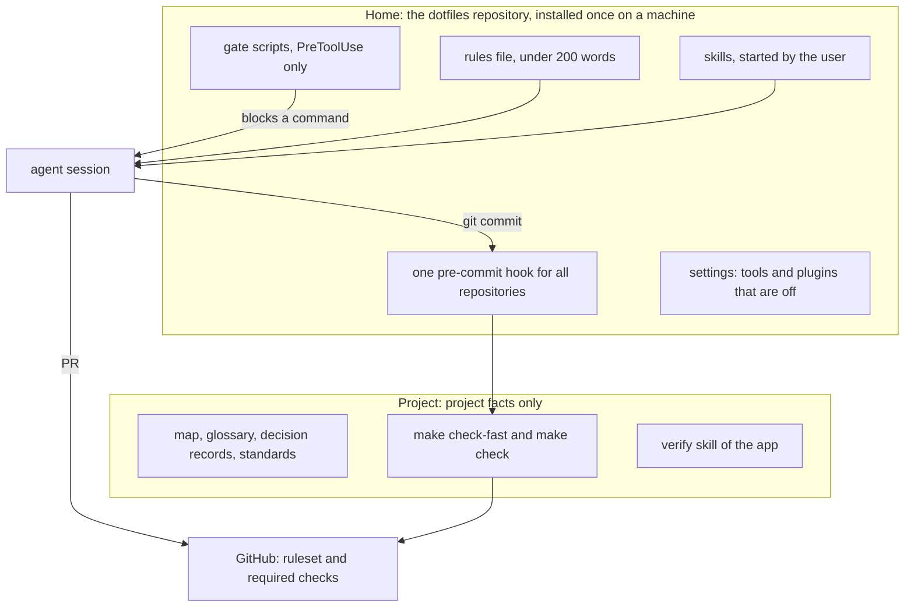

# Rules that hold, version 2: one home, small gates, checks at the commit

Status: plan, not built. Date: 2026-11-23. Branch: `ai-fable`. Base of this plan: commit `6fc9ba3`.

This file changes `docs/specs/rules-that-hold.md` (version 1). Version 1 stays as the record of tickets 01 to 13.
The input of version 2 is `docs/research/rules-that-hold/J-mattpocock-videos.md` (89 videos, read in full).

## 1. Why a version 2

Version 1 made the setup smaller. It kept its shape: a router in the agent hooks, and a generic layer in each project.
The videos show a different shape, and it removes the two things that the owner dislikes.

| Complaint | Cause in the shape | Version 1 | Version 2 |
|---|---|---|---|
| "too messy" | a generic layer is copied into each project, then kept in sync | kept, made smaller | removed |
| "too messy" | 5,991 lines of hook code on 8 events | cut to under 3,000 | under 1,500, on 1 event |
| "rules are skipped" | 2,847 always-loaded words, and more text from hooks | under 600 words | under 200 words |
| "rules are skipped" | hooks select skills by prompt words | 3 rows removed | all removed |

## 2. The design in 7 decisions

Each decision names its source finding in file J.

1. **One home (J5).** The dotfiles repository is the home. It installs to the user level of a machine once.
   A project holds only project facts: its map, glossary, decision records, coding standards, checks and its verify skill.
   No generic text, no skill links and no version file go into a project.
2. **Rules file under 200 words (J1).** It holds the owner, the reply shape, the hard "never" list and pointers.
   Each other rule moves to a check, a gate or a skill. The map "no rule is lost" in the ticket README stays the record.
3. **Gates are small scripts on one event (J2).** One file for each gate on PreToolUse, plus one shared command parser.
   A gate blocks, and prints the right step. No other hook event has setup code.
4. **Checks run at the commit (J3).** One pre-commit hook for each repository on the machine: secret scan, text lint,
   then the project's `make check-fast`. Its time limit is 3 seconds. Slow checks run in CI.
   The 2 Stop checks are removed.
5. **The user starts a skill (J4).** No hook selects a skill, and no text is added to a prompt.
   The rules file has an index of at most 6 lines. Skill descriptions are short, and each skill has a length limit.
   The deterministic part of a skill is a script in the skill folder (J8).
6. **Context diet (J6).** The home has one versioned `settings.json`. It switches off unused built-in tools,
   bundled skills, connectors and plugins. A number guards it: tokens at the start of a session.
7. **Retro makes checks (J9).** A repeated mistake becomes a lint rule, a check or a line in the coding standards.
   The owner starts the retro. Nothing automates it.

Not changed from version 1: the GitHub wall, CI, the verification skill and the PR body rules.
The review on 2 axes, the scenario runs and the numbers tool also stay.

## 3. Where each present gate goes

| Gate today | Version 2 home | Reason |
|---|---|---|
| secret-scan | pre-commit and pre-push hook | it must hold with no agent |
| no-verify | gate script | it protects the hook above |
| merge-approval | gate script, and the GitHub ruleset | the ruleset is the wall |
| worktree-first | gate script, for tracked files only | today it also blocks notes in an untracked folder |
| ask-first | gate script | no remote wall exists for a server |
| gh-write | gate script | outward action |
| pr-rules | CI check `pr-text`, and the `pr` skill | the check exists since ticket 06 |
| ship | step in the `ship` skill, and PR evidence in `pr-text` | a process, not a command |
| writing-for-agents | skill description | the skill is model-invoked |

Result: 6 gate scripts. The 3 other gates become a CI check or a skill step.

## 4. What happens to the work that is built

| Built on `ai-fable` | Version 2 |
|---|---|
| 01 numbers, 02 scenarios, 03 two profiles in tests | kept |
| 04 CI and `ai-github-wall`, 05 `ai-check`, 06 `pr-text` | kept |
| 07 text lint at the commit, 08 map and library checks, 09 fail-closed pre-commit | kept, moved into the one global hook |
| 10 Stop self-check | removed (decision 4) |
| 11 reminder rows removed | kept |
| 12 and 13 skill index and status line | index kept, the status line is removed with the SessionStart hook |

Open tickets of version 1: 14 and 15 become V2. 16 becomes V1. 17 becomes V3. 20 becomes V5. 21 becomes V8.
Tickets 18, 19, 22, 23 and 24 stay as they are.

## 5. Tickets of version 2

Each ticket is one worktree from `ai-fable`. Each ticket ends with the full suite (`bash ai/tests/run.sh`) at exit 0.
A removed test file gets a line in `docs/tickets/rules-that-hold/CHANGED-GUARDS.md`.

| Ticket | Work | Done when |
|---|---|---|
| V1 context diet | Measure tokens at session start for Claude and Codex. Write the home `settings.json`. Switch off each unused tool, bundled skill, connector and plugin, with the list from research file I. | `ai-doctor --numbers` prints the start tokens. The number is at most half of the first measurement. A test fails when it grows. |
| V2 short rules file | Cut the rules file to under 200 words with one reply block of at most 80 words. Remove the style text that 2 plugins add at session start. | Word count test. The 4 behaviour scenarios pass 3 of 3 runs. The map "no rule is lost" names a home for each removed line. |
| V3 gate scripts | Write 6 gate files and one parser from the present code. Remove the router, the prompt hook, the SessionStart text and the Stop checks. | Hook code under 1,500 lines. One event in `hooks.json`. The gate cases of the test suite pass. Gate scenarios: 6 of 6 hold on Claude. |
| V4 one commit hook | Install one pre-commit and pre-push hook with `core.hooksPath`. It runs the secret scan, the text lint, then `make check-fast`, then the repository's own hook. | Test in 3 fixture repositories: no Makefile, a Makefile, an own hook. A commit with a key fails with no agent. The hook reports its time, and warns above 3 seconds. |
| V5 project layer | Replace `ai-adopt` by a small `ai-init`: map skeleton, check targets, CI template. Add `ai-init --remove-generic`, which removes the old blocks, links and version file from a project. | A fixture project of the old form becomes the new form. A second run changes nothing. No command of the setup needs a per-project update. |
| V6 skills | Give each skill a length limit that can only go down. Shorten each description. Move the fixed steps of 3 skills into scripts in their folders. | All descriptions together are under 1,000 tokens. The limit test passes. Each script has a test. |
| V7 retro loop | Add a script that lists the owner's corrections from the session files of a project. The `retro` skill reads the list and proposes a check for each repeated one. | The script has a test with a fixture session. One real retro on this repository gives at least one new check, as its own PR. |
| V8 extend guide | Write `docs/EXTENDING.md`: add a rule (check first, then gate, then skill), add a skill, add a tool, add a project fact. One contract test holds the guide true. | The test adds a gate from the guide in a temporary copy, and the gate blocks. |
| V9 proof | Ticket 23 of version 1, with one more part: move one real project to the new form and do 3 real tasks there. | The report compares the numbers with `docs/reports/baseline-2026-11-20.md`. |

Order: V1, V2 and V4 have no dependency. V3 needs V4. V5 needs V3. V6 to V8 need V5. V9 is last.

## 6. Edge cases

- **A repository with its own hook path** (for example husky): a local `core.hooksPath` wins over the global one.
  V4 must find this case and print one line. `ai-doctor --project` reports it.
- **A compound command** (`cd x && git push origin main`): the shared parser of V3 keeps the present split logic.
  The tests of fix R-017 stay.
- **Codex:** its hooks fail open, and it has no `ask` answer. The gate scripts give deny only.
  The commit hook and the GitHub ruleset are the walls for Codex.
- **A hook that fails:** the PreToolUse entry keeps `"onFailure": "block"` (fix R-018).
- **A project that is not moved yet:** the old blocks do no harm. They are text. `ai-init --remove-generic` is one PR, and it is the last setup PR of that project.
- **A server:** `ask-first` stays a gate there. No remote wall covers a restart or a deploy.
- **Plugins that the owner likes:** V1 switches a plugin off as the default, and a project can switch it on in its own settings.

## 7. Decisions for the owner

The plan uses the recommended answer where the owner gives none.

| Id | Question | Recommended |
|---|---|---|
| O1 | Remove the generic layer from each project? | Yes. It is the largest cause of sync work. |
| O2 | Remove the 2 Stop checks and the prompt questions? | Yes. The commit hook and CI do this job with less noise. |
| O3 | One reply block of 80 words in place of 3 style sources? | Yes. The words of the owner's shape stay. The 2 plugins stop adding text. |
| O4 | Which plugins are on as the default? | Only the core plugin and Serena. Each other one by project. |

## 8. Not in this plan

- No new rule. Each rule of today keeps a home.
- No change on the `ai` branch, on `main` or on an installed machine.
- No evals for skill wording. The source says that he judges wording without evals, and we have 16 scenarios.

## 9. Not checked

- If an `ask` permission rule shows a prompt in bypass mode. V3 must test it before it uses one.
- The token count at session start of this setup with each plugin on. V1 measures it first.
- The 3 second limit on a large project. V4 reports the time and does not fail on it.
