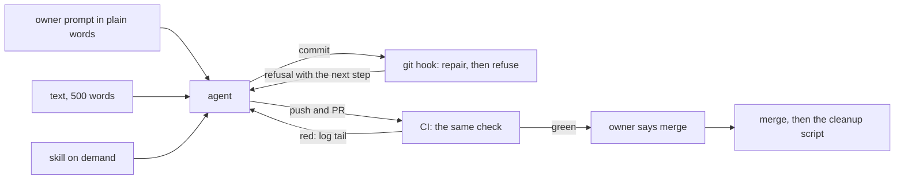

# Rules that hold, version 3: one way for each phase, forced by checks

Status: plan, not built. Date: 2026-11-24. Branch: `ai-fable`.

This file replaces the design of `docs/specs/rules-that-hold-v2.md`. Version 2 stays as a record.
Version 2 had 5 blockers (it removed the owner's typed OK, and it used a global hooks path).
Version 3 starts from measurements: the owner's real prompts, 6 reference repositories, and real sessions in 2 trial projects.

## 1. What the measurements say

| Fact | Number | Source |
|---|---|---|
| Start of one session that answers "OK" | 56,880 tokens, 199 tools, 40 MCP servers, 158 skills, 23 hook processes | trial project, installed setup |
| Same session with only project settings and denied unused tools | 13,700 to 15,800 tokens, 0 agent hooks | lean trial project |
| 4 tasks (feature, fix, edit on main, unclear idea), same model | installed: 1.74 USD, 193 hook processes. Lean: 0.57 USD | 8 real sessions |
| Flow result of the 4 tasks | the same: worktree, test first, ledger line. The lean one also did the "edit on main" task, on a branch | 8 real sessions |
| Ways around the agent gate hook | 125 of 184 tries pass (here-document, brace group, forged state file) | 215 payloads |
| Ways around a git hook by a change of tool | none: git runs the hook for each tool. `--no-verify` stays, so CI must stand behind it | git design, not tested here |
| Steps of the feature path that only the model's memory holds | 10 of 18 | setup map |
| Owner prompts that name a check command | 1 of 2,543 | 89 sessions, 2 machines |
| Owner prompts that are a question or an audit | 16% to 24% | the same |
| Owner prompts about a server or a deploy | 8% to 11% | the same |
| OMC use | its agents: yes (executor, code-reviewer, security-reviewer, architect). Its 76 skills: 3 calls on one machine | the same |
| Serena calls against grep and graphify | 7 against 1,128 and 175 | one machine, 60 days |

Cost of each part at session start (measured, one part off for each run):

| Part | Tokens |
|---|---|
| claude.ai connectors | 6,300 |
| OMC (skill list, agents, MCP server) | 4,900 |
| 3 style and design plugins | 5,200 |
| 15 built-in tools that the trial denied (cron, notebook, workflow and others) | 9,300 |
| Core plugin and Serena | 9,000 |
| Global rules file (3,460 words) | about 5,000 |

What the 6 reference repositories do:

- None has a router, a hook that adds text for each prompt, or a memory store.
- Three have a commit hook that repairs format and lint, and stages the result again.
- Two have one aggregate check command, and a GitHub ruleset requires that one check.
- Three have custom lint rules or guard scripts for repeated mistakes. Two have ratchets that only go down.
- One caps the always-loaded file at 20 lines with a CI check.
- No one has a script that selects the next phase. A red check tells the agent what to do.

One fact about the skills: `grill-with-docs` is typed-only. No agent can start it. `grilling` and `domain-modeling` can be started by an agent.

## 2. The principle: three layers

1. **Text says what the owner wants.** At most 500 words for all projects. A CI check holds the limit.
2. **A skill holds a procedure that needs judgment.** It loads when it is needed: grilling, test-first, bug diagnosis, verification, review, PR text.
3. **A check holds each thing that is true or false.** It runs at the commit: it repairs what a tool can repair, then it refuses. The same command runs in CI, and GitHub requires it. A refusal prints the exact next step. This is how the setup corrects the agent.

The agent hook keeps only what git and GitHub cannot see: the owner's typed OK, a server command, a `gh` write, and a hook override in a command.

The owner types plain words. The owner types no check command. The agent runs the commands that the project already has: `make check-fast`, `make check`, and the new `make fix`.

## 3. The flows

| Flow | The owner says | The agent does | What forces it |
|---|---|---|---|
| Small change | "lets add ...", "I want ...", "fix it" | worktree and branch, failing test, code, `make check`, commit, push, PR | commit hook: no commit on main, repair, red check. CI: the same check |
| Bug | "... is not working", a screenshot | `diagnosing-bugs` for a hard one. A red test before the fix | commit hook: a `fix` commit needs a test and a ledger line |
| Unclear or big idea | "idk yet", "lets think" | `grilling` and `domain-modeling` (glossary, decision records), then `to-spec`, `to-tickets` | text only. The PR size check warns when a big change has no spec |
| Ticket work | `/implement` | one ticket in a fresh session, then the small-change flow | the same as the small change |
| UI | "the page looks ..." | prototype variants, the owner picks, then the small-change flow with screenshots | PR check: UI files changed and no screenshot evidence |
| Proof in the real app | (none) | `verify-<app>`: launch, doctor, drive, evidence | PR check: app code changed and no evidence run after the last code commit |
| PR | "pr" | a script writes the fixed parts of the body. The agent writes the diagram and the merge danger | CI job `pr-text` |
| Wait for CI | (none) | `gh pr checks --watch`. Red: read the log tail, repair, push | GitHub ruleset: no merge with a red check |
| Merge | "merge", "approve 21" | `gh pr merge --squash --delete-branch` | agent gate `merge-approval`, and the ruleset |
| Cleanup | "any worktrees left?" | one script: pull main, remove the worktree and the branch, refresh the graph and the library list | the script runs after each merge |
| Question or audit | "why ...", "audit ..." | read only, a short answer | agent gate `ask-first` for a command that changes a machine |
| Server work | "connect to ...", "deploy" | plan, risk, undo. Then the typed OK. The project's own deploy skill | agent gate `ask-first`. No remote wall exists here |
| Refactor | "simplify ...", "clean ..." | `improve-codebase-architecture`, then its own PR | PR size check |
| After a mistake | "why did you ..." | `retro`: the mistake becomes a check or a lint rule in the project | the 500-word cap stops a new sentence |
| New project | "adopt this repo" | one command: Map, Makefile, git hooks, CI workflow. It prints one command for the owner (ruleset, push protection) | `ai-doctor` reports a project with no CI or no ruleset |

## 4. What a project gets, and how it grows

| Layer | Holds | Grows by |
|---|---|---|
| Machine (this repository) | the 500 words, the settings, the skills, 4 agent gates, the git hook template | a PR to this repository |
| Project, generic part | `Makefile` targets `fix`, `check-fast`, `check`. The git hooks. One CI workflow with the job `check` | the adopt command writes it once |
| Project, own part | Map, glossary, decision records, coding standards, regression ledger, `verify-<app>`, project rules | the work itself |
| Project, growth point | a `checks/` folder: one small script for each repeated mistake, called by `make check` | `retro` adds a script with a test |

A project never gets a copy of the machine rules. The 3 generic blocks in a project `AGENTS.md` go away (about 250 of 562 words in the trial project).

## 5. Overlaps that go away

| Today | Version 3 |
|---|---|
| 38 claude.ai connectors in each code session | off in code sessions |
| 76 OMC skills in the list, 4 to 5 OMC hook processes for each tool call | OMC agents stay. Its skill list and its per-call hooks are off |
| 2 style plugins add 1,700 words at session start | one reply block of about 80 words in the rules file (owner decision O3) |
| Serena loads 14 tool schemas in each session | on for a project that asks for it |
| Router rows that select a skill from prompt words | removed. The rules name the 2 skills for an unclear request |
| Format error: the hook refuses, the agent repairs, then commits again | the hook repairs and stages. No extra turn (seen in 3 of 3 trial sessions with a commit) |
| `make check-fast` skips lint when the project has no lint config | the adopt command adds the lint to the check when the tool is installed |

## 6. Tickets

Each ticket is one worktree from `ai-fable`. Each ticket ends with the full suite at exit 0.

| Ticket | Work | Done when |
|---|---|---|
| W1 git hooks | A hook template for a project: no commit on main, repair and stage, `make check-fast`, the `fix` rule, a pre-push secret scan. It runs after the hook tool of the project, when one exists. | 4 fixture repositories pass: plain, husky, pre-commit framework, worktree. The red-team script shows 0 tool changes that avoid it. |
| W2 CI and wall | The adopt command writes the CI workflow as the default. `ai-github-wall` reads the branch and the job names of the project, and switches on push protection. | A fixture project gets a workflow whose job name equals the ruleset check. `ai-doctor` reports a project with no CI. |
| W3 context diet | Count the use of each built-in tool in the session logs. Then one settings block: connectors off, unused tools denied, OMC skill list and per-call hooks off. | `ai-doctor --numbers` prints the start tokens. The number is at most 25,000. A test fails when it grows. |
| W4 rules file | Cut the global file to 500 words. Move procedures into the skills and into the refusal texts of the hooks. Add the CI cap. | The word test passes. The 4 trial tasks give the same flow result in 3 of 3 runs. The map "no rule is lost" names a home for each line. |
| W5 agent hook | Keep 4 gates and the recorder of the owner's OK. Remove the router rows, the session-start text and the reminders. Close the here-document and brace-group holes. | Hook code under 2,000 lines. The red-team script: each plain form is blocked, and the 2 holes are closed. |
| W6 scripts for fixed steps | `make fix`. A PR body script (headings, check output, session block). A cleanup script after a merge. | Each script has a test. A trial session opens a PR with no hand-written fixed part. |
| W7 growth point | `checks/` in a project, called by `make check`. `retro` writes a check with a test, not a sentence. | One real retro gives one new check in a trial project. |
| W8 proof | The 4 trial tasks as scenarios of `ai-eval`, for the installed setup and for version 3. Then one real project. | A report with cost, time, hook processes and flow result for both setups. |

Order: W1 and W2 first. They make the walls. W3 and W6 have no dependency. W4 needs W1. W5 needs W1 and W4. W7 needs W6. W8 is last.

## 7. Decisions for the owner

| Id | Question | Recommended |
|---|---|---|
| O1 | Git hooks and CI as the walls, and the agent hook for 4 gates only? | Yes. |
| O2 | claude.ai connectors off in code sessions? | Yes. A project can switch one on. |
| O3 | The 2 style plugins become one reply block of about 80 words? | The owner decides. The plugins cost about 5,000 tokens for each session. |
| O4 | OMC: keep the agents, switch off the skill list and the per-call hooks? | Yes. The logs show agent use and almost no skill use. |
| O5 | Serena on only where a project asks for it? | Yes. 7 calls in 60 days on one machine. |

## 8. Limits of the evidence

- The trial project has 3 code files. A large project can behave in a different way.
- Each trial task ran one time for each setup. W8 runs each task 3 times.
- The lean trial had no verification skill, no PR and no CI. Those steps are not proven yet.
- The prompt audit read 89 sessions on 2 machines. Older sessions were not on disk.
- The hook-process counts come from the session event stream of one Claude Code version (2.1.325).

## 9. Not in this plan

- No script that selects the next phase. No reference repository has one, and a red check does this job.
- No change for Codex and OMX yet. The git hooks and CI hold for each agent. The agent gates come later.
- No block of an agent merge by a second account. The ruleset and the agent gate stay the 2 walls.
