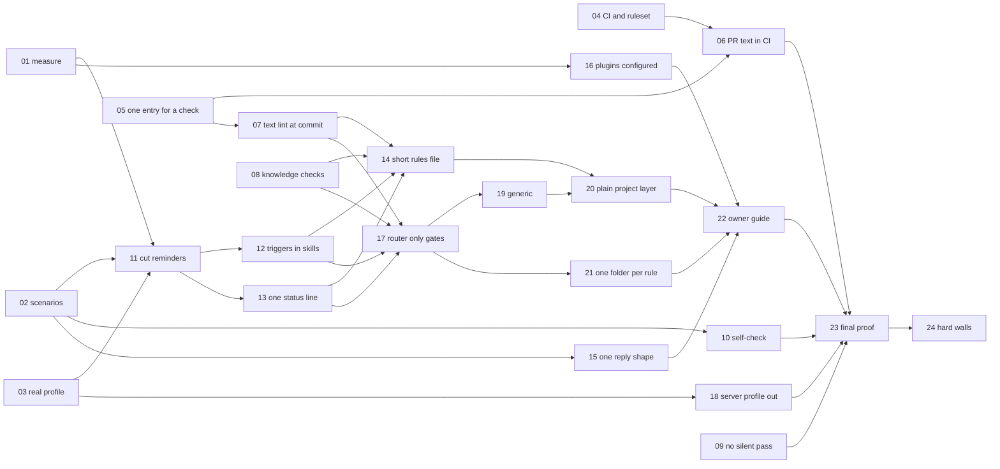

# Tickets: rules that hold

Spec: `docs/specs/rules-that-hold.md`. Research notes: `docs/research/rules-that-hold/` (files A to I).
Status: DRAFT, 2026-11-20. The owner has not started the work.

## What these tickets do

They keep each rule, skill, plugin and gate of the owner. They move each rule to the lowest place that can check it, remove the copies, and prove each step.
Nothing is merged into `ai` by these tickets. The work lands on the branch `rules-that-hold`. The owner tries that branch on one project, then decides.

## How an agent works a ticket

1. Read the spec sections 4 to 6, then the ticket, then the research file that the ticket names.
2. Work in your own worktree on a branch `rth-<NN>-<slug>`, made from `rules-that-hold`.
3. Write the failing test first. Then make the change.
4. Run the tests that the ticket names. Run the full suite before you say "done".
5. Run the verify drives that the ticket names, and keep the evidence folder.
6. Tick each box that is true. Move the ticket file to `done/` in the same commit.
7. When a fact in the ticket does not match the repo, stop and write the difference into the ticket. Do not guess.
8. Add no rule, hook or reminder that the ticket does not name.

A ticket with the status `needs-owner` waits for the decision that it names. The decisions are in section 9 of the spec.
No ticket deletes a test file before the owner gives decision D1. Until then a ticket builds the new check and leaves the old row and its case file in place.

## The tickets

| # | Ticket | Kind | Size | Blocked by | Owner step |
|---|---|---|---|---|---|
| 01 | One command prints the fixed cost and the obedience numbers | New tool | M | None | None |
| 02 | One behaviour scenario for each gate, on both agents | Tests | M | None | None |
| 03 | The router suite tests the rules that the machines load | Tests | S | None | None |
| 04 | The tests run on each pull request, and GitHub refuses a direct push | New checks | M | None | Run 1 command |
| 05 | One entry point runs a gate from the hook, the git hook and CI | Prefactor | M | None | None |
| 06 | The PR text check is a required check on GitHub | Move | M | 04, 05 | None |
| 07 | The commit hook refuses the em dash and warns on a long sentence | Move | S | 05 | None |
| 08 | The Map, the library list and old memory files are checked by a program | Move | S | None | None |
| 09 | A missing check tool fails, and never passes in silence | Fix | S | None | None |
| 10 | The agent gets a failed check back at the end of its turn | Self-check | M | 02 | D5 |
| 11 | The 14 reminder rules with a home in another place leave the router | Removal | M | 01, 02, 03 | D1 |
| 12 | A workflow starts from its skill, not from a prompt regex | Move | M | 11 | D1 |
| 13 | One status line at session start | Simplify | S | 11 | None |
| 14 | The always-loaded rules file has under 600 words and works as an index | Removal and move | L | 07, 08, 11, 12, 13 | D3 |
| 15 | One source shapes each reply | Simplify | M | 02 | D4, D7 |
| 16 | Each plugin is configured so that no job is done twice | Config | M | 01 | D6 |
| 17 | The router holds only gates, and starts only for a command that a gate names | Removal | L | 07, 08, 11, 12, 13 | None |
| 18 | The server profile lives in its own branch | Move out | L | 03 | D8 |
| 19 | One config file holds each owner value, and no tracked file names a local thing | Generic | M | 17 | None |
| 20 | A project gets plain files, and a monorepo works | Project layer | M | 14, 19 | None |
| 21 | A new rule is one folder, one row and one test | Structure | L | 17 | None |
| 22 | The owner guide: use it, extend it, try it on a project, recover | Docs | S | 15, 16, 20, 21 | None |
| 23 | The whole branch is proven, and the numbers are compared with the baseline | Final proof | M | 01 to 22 | Try 1 project |
| 24 | A project or an agent cannot switch the core off | Optional | S | 23 | D9, sudo |



Tickets with no blocker can start at once: 01, 02, 03, 04, 05, 08, 09.

## No rule is lost: where each rule lives after the work

"Home" is the one place that holds the rule after the work. The verdict and the reason for each row are in research file E1.

### The 12 gates: all stay

| Gate | Home after | Also checked outside the agent | Ticket |
|---|---|---|---|
| `secret-scan` | Session gate | The commit hook, and GitHub push protection | 04, 05 |
| `merge-approval` | Session gate (the owner's merge OK) | A GitHub ruleset refuses a push to the default branch | 04 |
| `pr-rules` | Session gate | A required check on GitHub runs the same code | 06 |
| `no-verify` | Session gate | CI runs the checks again, so the flag gains nothing | 04 |
| `worktree-first` | Session gate | The ruleset refuses the push | 04 |
| `gh-write` | Session gate | None | None |
| `ask-first` | Session gate | None | None |
| `writing-for-agents` | Session gate | None | None |
| `ship` | Session gate | The required checks | 04, 06 |
| `no-destroy`, `no-sudo`, `audit-before-install` | Session gates, with the `server` profile | The owner decides with D8 | 18 |

### The 27 reminders: the rule stays, the reminder goes

| Reminder | Fires, not followed | Home of the rule after | Ticket |
|---|---|---|---|
| `docs-lookup` | 107, 80% | The context7 server says it in each session; 1 index line in the rules file | 11, 14 |
| `tracker-flow` | 53, 72% | The project doc `docs/agents/issue-tracker.md`; 1 index line | 11, 14 |
| `upgrade-review` | 39, 79% | Runs once after an upgrade, from the install or the sync | 11 |
| `no-ai-base` | 34, 76% | The `setup-rollout` skill; `ai-doctor` reports a project with no setup | 11 |
| `feature-grill` | 20, 50% | A kickoff skill that the model can call; 1 index line | 12 |
| `nav-first` | 13, 62% | 1 line in the rules file. The deny goes only after ticket 02 measures it on and off | 11 |
| `ui` | 11, 82% | The description of the UI skill; the Map line "Design" | 12 |
| `browser-not-enabled`, `seo-not-enabled`, `blog-not-enabled` | 22, 80% to 100% | `ai-info` lists what is off; the tool list in the rules file | 11 |
| `legacy-memory` | 8, 75% | `ai-doctor` fails while old memory files exist | 08 |
| `knowledge-check` | 6, 67% | The docs check fails on a Map path that does not exist | 08 |
| `merge-review` | 4, 75% | The ship skill names it as the step after a merge | 11 |
| `verify-before-done` | 3, 0% | The verify walls at the end of a turn already enforce it | 11 |
| `domain-docs` | 1, 100% | The description of the domain skill | 11 |
| `diagnosing-bugs`, `tdd` | no data | The skill descriptions | 12 |
| `seo`, `blog`, `browser` | never fired | The plugin skill and tool descriptions | 12 |
| `no-em-dash`, `ste-sentence` | no data | The commit hook and the PR text check | 07 |
| `project-knowledge`, `serena`, `graph` | no data | 1 status line at session start | 13 |
| `omc`, `ledger-nudge` | never fired | The ignore file and `make check` already cover them | 11 |

### The verification skill and its walls: all stay

The skills `create-verification-skill` and `maintain-verification-skill`, the proof file `run.log`, and the walls `verify-tool-exists`, `verify-tool-used`, `verify-commit` and `verify-pr` stay as they are.
Ticket 06 adds the same PR proof as a check on GitHub. Ticket 10 uses the proof for the self-check.

### The rules in the always-loaded text

Research file E1, Task 1, has 153 rows. 41 rows stay as text. 60 rows are a copy of a line that stays in its home. 21 rows are a procedure that moves into a skill. 13 rows get a check. 18 rows are stale or do nothing.
Ticket 14 applies this list, and the owner marks each line to keep first (decision D3).

## The owner's manual steps

Each step is one command. The agent prepares the command, and the owner runs it, because it changes GitHub or needs `sudo`.

| # | Step | Command | Ticket |
|---|---|---|---|
| M1 | See the ruleset before it is made | `ai-github-wall --dry-run` (prints the JSON that it would send) | 04 |
| M2 | Make the ruleset for the default branches | `ai-github-wall --apply` (it calls `gh api repos/<owner>/<repo>/rulesets`) | 04 |
| M3 | Check that secret push protection is on | `gh api repos/<owner>/<repo> --jq .security_and_analysis` | 04 |
| M4 | Mark the text lines to keep | Edit the list that ticket 14 makes | 14 |
| M5 | Try the branch on one project | The 2 commands of the owner guide: switch, then switch back | 22, 23 |
| M6 | Pin the core with root-owned files | The 2 `sudo` commands of ticket 24 | 24 |

The ruleset that M2 sends:

```json
{
  "name": "pull request and green checks",
  "target": "branch",
  "enforcement": "active",
  "bypass_actors": [],
  "conditions": { "ref_name": { "include": ["~DEFAULT_BRANCH", "refs/heads/ai"], "exclude": [] } },
  "rules": [
    { "type": "deletion" },
    { "type": "non_fast_forward" },
    { "type": "pull_request", "parameters": {
        "required_approving_review_count": 0, "dismiss_stale_reviews_on_push": false,
        "require_code_owner_review": false, "require_last_push_approval": false,
        "required_review_thread_resolution": false } },
    { "type": "required_status_checks", "parameters": {
        "strict_required_status_checks_policy": false,
        "required_status_checks": [ { "context": "tests" }, { "context": "pr-text" } ] } }
  ]
}
```

The review count is 0, because one owner cannot approve their own pull request. The owner's merge OK stays in the session gate `merge-approval`.
Ticket 04 sends 2 rulesets: this one for the branch that has the workflow, and one without the status checks for a default branch that has no workflow.

## The template of a ticket

Each ticket file has these parts, in this order:

1. `# <NN>: <title>`: the behaviour that works after the ticket.
2. **What to build:** from the view of the owner or the agent, not a list of layers.
3. **Why:** the evidence, with numbers and the research file.
4. **Solution:** the decisions, in 3 to 8 lines.
5. **Rules kept:** each owner rule that the ticket touches, and its home after.
6. **Edge cases:** what can go wrong, and what the ticket does about each one.
7. **Owner steps:** exact commands, or "None".
8. **Blocked by:** ticket numbers, or "None (can start immediately)".
9. **Status:** `ready-for-agent`, or `needs-owner` with the decision.
10. **Size:** S (hours), M (a day), L (days).
11. The acceptance boxes: each one is a fact that a person can see.
12. **Verify:** the tests, the verify drive and the behaviour scenario that must pass.
13. **Rollback:** how to undo it.

## Numbers that the final ticket must show

| Number | Baseline (commit `1aafab6`) | Target |
|---|---|---|
| Reminder rules | 27 | 0, plus 1 status line |
| Global always-loaded words | 3,460 | under 600 |
| Fixed cost of a new Claude session | about 22,790 tokens | under 11,000 |
| Hook processes for one Bash call, all plugins | 7 | 3 or fewer |
| Router lines | 6,038 | under 3,000 |
| Gate scenarios that pass on Claude | not measured | 9 of 9 on the `dev-mac` render, 12 of 12 on the `server` render |
| Rules that also hold with no agent | 2 | each rule that is visible in a commit or a PR |
| Files touched by one rule change | 9.5 | 4 or fewer: 1 folder with 3 files, and 1 row |
| Lines with a local name in tracked files | 124 | 0 outside the config file |
